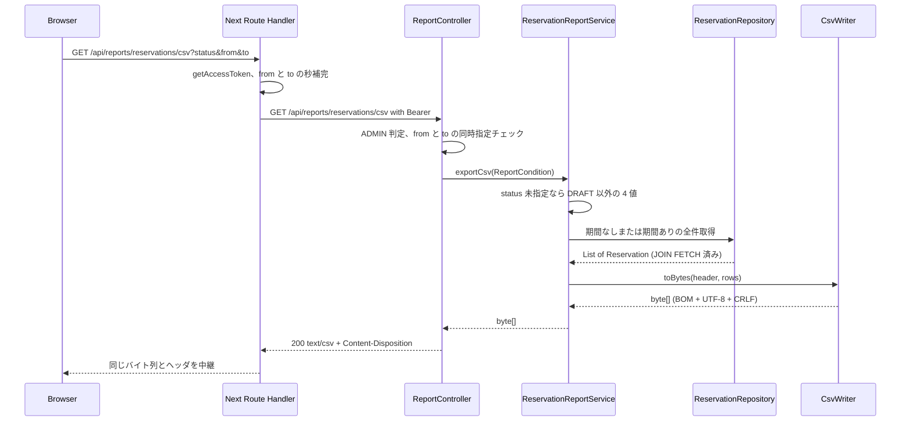

# Business Logic Model — csv-report

## 1. 全体フロー

ADMIN が `/reservations` のボタンを押してから CSV を受け取るまでの流れ。

## 2. バックエンドの処理

### 2.1 ReportController（presentation）

1. `GET /api/reports/reservations/csv` を `@PreAuthorize("hasRole('ADMIN')")` で保護する（MEMBER・APPROVER は 403、未認証は 401 を既存ハンドラが返す）
2. `from` と `to` の片方だけが指定されたら `ValidationException("from と to は同時に指定してください。")`（400）。既存の予約一覧と同じ文言
3. `status`（`List<ReservationStatus>`）・`from`・`to`（`LocalDateTime`）から `ReportCondition` を作り、`ReservationReportService.exportCsv` を呼ぶ
4. 戻りの `byte[]` を `ResponseEntity` に包み、ヘッダを付けて 200 で返す（ヘッダは BR-11）

### 2.2 ReservationReportService（application）

`@Transactional(readOnly = true)` で次を行う。

1. **有効な status の決定**：`condition.statuses()` が空なら `[PENDING, APPROVED, REJECTED, CANCELLED]`（DRAFT 以外の全値）、指定があればその値
2. **取得**：`condition.hasPeriod()` が真なら `findAllForReportByPeriodAndStatusIn(from, to, statuses)`、偽なら `findAllForReportByStatusIn(statuses)`。どちらも `JOIN FETCH` 済みで `ORDER BY r.startAt ASC, r.id ASC`
3. **行への変換**：`Reservation` を 7 列の文字列リストに変換する（列と整形は BR-06・BR-07）
4. **CSV 化**：`CsvWriter.toBytes(HEADER, rows)` を呼んで `byte[]` を返す

### 2.3 CsvWriter（application/csv、純粋関数）

`toBytes(List<String> header, List<List<String>> rows)`：

1. ヘッダ行とデータ行を順に処理する。各セルは「数式無害化（BR-09）→ RFC 4180 エスケープ（BR-08）」の順で整える
2. セルを `,` で連結し、各行の末尾に `CRLF` を付ける（最終行も付ける）
3. 結果の文字列を UTF-8 の `byte[]` にし、先頭に BOM（`EF BB BF`）を連結する

フレームワークにも `Reservation` にも依存しない。入力は文字列のみなので、ユニットテストで形式を網羅できる。

## 3. フロントエンドの処理

### 3.1 ボタンの表示とリンクの組み立て（`page.tsx` と `CsvDownloadButton`）

1. `page.tsx` は既存どおり `isAdmin` を求める。`isAdmin` が偽ならボタンを描画しない
2. 真なら `CsvDownloadButton` に現在の `status`（`selectedStatuses`、未選択は空配列）・`from`・`to` を渡す。ボタンは `/api/reports/reservations/csv?status=..&from=..&to=..` の `<a download>` を描画する（値がない項目はクエリに含めない）
3. `resourceName` と `page` は渡さない（BR-14）

### 3.2 Route Handler（`app/api/reports/reservations/csv/route.ts`）

1. `getAccessToken()` が `null` なら 401 を JSON（`{code:"UNAUTHORIZED", message}`）で返す
2. リクエストの `status`（複数）・`from`・`to` だけを取り出し、`from`/`to` は 16 文字なら `:00` を補う（既存の `toIsoWithSeconds` と同じ規則）
3. `BACKEND_URL`（未設定なら `http://localhost:8080`）の `/api/reports/reservations/csv` を、`Authorization: Bearer`・`Accept: */*`・`cache: no-store` で `fetch` する
4. バックエンドが非 2xx なら、そのステータスと本文・`Content-Type` をそのまま返す（401・403・400 の透過）
5. 2xx なら本文を**バイト列のまま**（文字列にデコードせずに）返し、`Content-Type`・`Content-Disposition` はバックエンドの値を引き継ぎ、`Cache-Control: no-store` を付ける

## 4. エラーと境界

| 状況 | 結果 |
|---|---|
| 未認証 | Route Handler またはバックエンドが 401 |
| MEMBER・APPROVER | 403（`{code:"FORBIDDEN"}`）。Route Handler が透過する |
| `from` と `to` の片方だけ | 400（`VALIDATION_ERROR`）。Route Handler が透過する |
| 不正な `status` | 400（Spring の型変換エラー、既存の `GlobalExceptionHandler`） |
| 条件に合う予約が 0 件 | 200、ヘッダ行のみの CSV |
| バックエンド停止 | Route Handler の `fetch` が例外 → 502（`{code:"BACKEND_UNAVAILABLE"}`）を返す |

`<a download>` で開いた応答が 400・403 の JSON だった場合、ブラウザは JSON をファイルとして保存するか、そのまま表示する。ADMIN だけが押せるボタンで、期間は通常 UI 側の入力に由来するため、専用のエラー表示（toast 等）は設けない。
