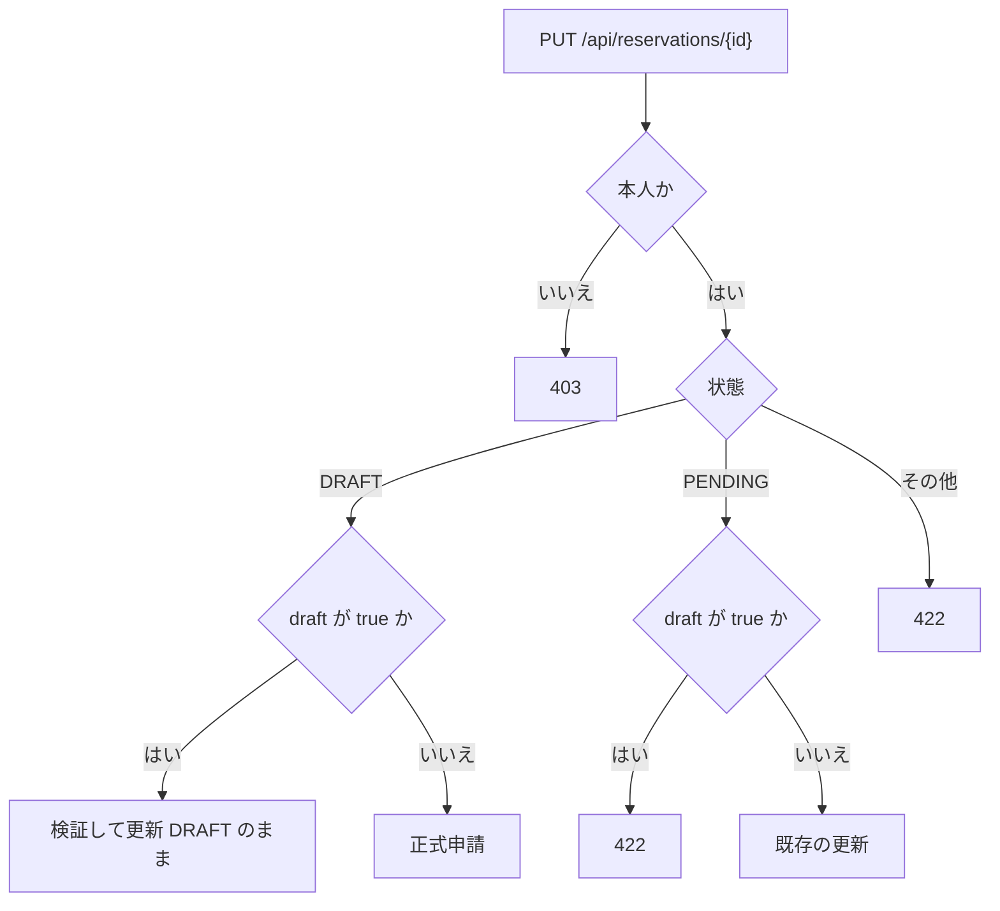
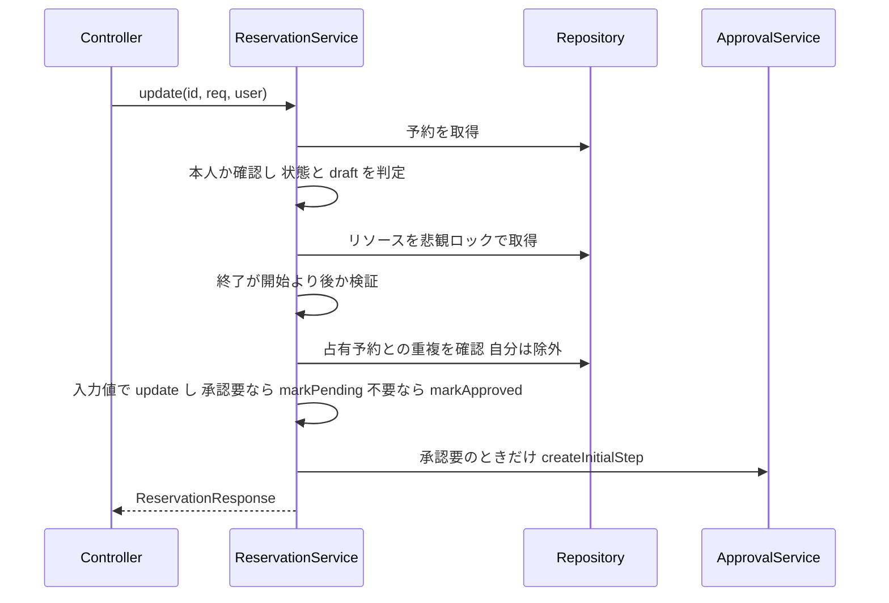

# Business Logic Model — reservation-draft

**略記**: `BE/` = `backend/src/main/java/com/example/bookflow/`。ルールの詳細は `business-rules.md` を参照。

## 変更するクラスと責務

| クラス | 変更 |
|---|---|
| `BE/application/ReservationService.java` | `create` に下書きの分岐を追加。`update` を状態と `draft` の分岐に拡張。`delete` を新設。`checkReadAccess` に下書きの規則を追加。`list` で `status` 未指定のとき `DRAFT` を除く |
| `BE/domain/Reservation.java` | `markPending()` を追加 |
| `BE/presentation/ReservationController.java` | `DELETE /{id}`（204）を追加 |
| `BE/presentation/dto/CreateReservationRequest.java`、`UpdateReservationRequest.java` | 任意の `Boolean draft` を追加 |

承認の `ApprovalService` は変更しない（`createInitialStep` を正式申請から呼ぶだけ）。

## 処理 1: 下書き保存（`create` で `draft = true`）

1. リソースを取得する（ロックしない）。存在しなければ 404。
2. 終了が開始より後かを検証する。違えば 422。
3. 重複判定はしない。
4. 状態を `DRAFT` にして保存する。承認ステップは作らない。

`draft` が `null` または `false` のときは、既存の通常申請の処理をそのまま行う。

## 処理 2: 下書きの更新と正式申請（`update`）

### 正式申請の流れ

- 重複があれば `409`、承認者がいなければ `422` で終わり、トランザクションが巻き戻る（`DRAFT` のまま残る）。
- 下書きの更新（`draft: true`）は、ロックと重複判定を行わず、時刻の整合だけを検証して `update(...)` する。

## 処理 3: 削除（`delete`）

1. 予約を取得する。存在しなければ 404。
2. 本人でなければ 403（ADMIN も、他人の下書きなら 403）。
3. 状態が `DRAFT` でなければ 422。
4. `ReservationRepository.delete(...)` で物理削除し、204 を返す。

## 処理 4: 閲覧（`get`、`checkReadAccess`）

既存の規則（MEMBER は本人のみ）に加え、予約の状態が `DRAFT` のときは、本人と ADMIN だけを許可する。他人の APPROVER は 403。

## 処理 5: 一覧（`list`）

1. `status` が指定されていれば、指定された状態の集合をそのまま使う。
2. 指定がなければ、`DRAFT` を除く 4 状態（`PENDING`、`APPROVED`、`REJECTED`、`CANCELLED`）の集合を使う。
3. ADMIN は `findByStatusInFetch`、それ以外は `findByRequesterIdAndStatusInFetch`（自分の予約）を呼ぶ。

## データの流れ

| 入力 | 経路 | 出力 |
|---|---|---|
| 下書き保存（画面） | Server Action から `POST`（`draft: true`） | `DRAFT` の予約（201） |
| 下書きの更新（画面） | Server Action から `PUT`（`draft: true`） | `DRAFT` の予約（200） |
| 正式申請（編集画面、詳細画面） | Server Action から `PUT`（`draft` なし） | `PENDING` または `APPROVED` の予約（200） |
| 削除（詳細画面） | Server Action から `DELETE` | なし（204） |

詳細画面の「正式申請」は、予約の現在の値（開始、終了、目的、参加人数）をそのまま `PUT` の本文に入れる。更新 API が必須項目を要求するためである。

## エラーのまとめ

| 状況 | HTTP | コード |
|---|---|---|
| 入力の形式が不正（必須項目の欠落など） | 400 | `VALIDATION_ERROR` |
| 権限がない | 403 | `FORBIDDEN` |
| 対象がない | 404 | `NOT_FOUND` |
| 時間帯の重複（正式申請） | 409 | `RESERVATION_CONFLICT` |
| 状態に合わない操作、時刻の不整合、承認者がいない | 422 | `VALIDATION_ERROR`、`APPROVER_NOT_AVAILABLE` |
