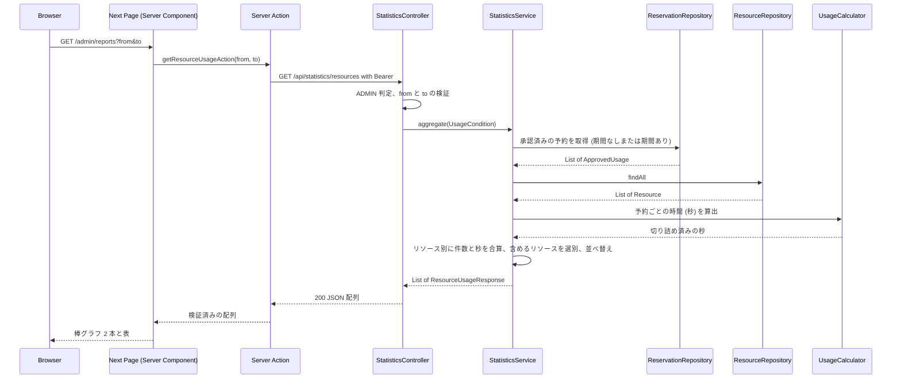

# Business Logic Model — usage-report

## 1. 全体フロー

ADMIN が `/admin/reports` を開いてから、集計結果を見るまでの流れ。

## 2. バックエンドの処理

### 2.1 StatisticsController（presentation）

1. `GET /api/statistics/resources` を `@PreAuthorize("hasRole('ADMIN')")` で保護する（MEMBER・APPROVER は 403、未認証は 401 を既存ハンドラが返す）
2. `from` と `to` の片方だけが指定されたら `ValidationException("from と to は同時に指定してください。")`（400）
3. 両方指定されていて `from` が `to` より前でなければ `ValidationException("from は to より前にしてください。")`（400）
4. `UsageCondition(from, to)` を作り、`StatisticsService.aggregate` の結果の `List<ResourceUsageResponse>` をそのまま 200 で返す

### 2.2 StatisticsService（application）

`@Transactional(readOnly = true)` で次を行う。

1. **取得**：`condition.hasPeriod()` が真なら `findApprovedUsageByPeriod(APPROVED, from, to)`、偽なら `findApprovedUsage(APPROVED)`。どちらも `ApprovedUsage(resourceId, startAt, endAt)` の `List`
2. **予約の合算**：予約を 1 件ずつ見て、`resourceId` ごとに「件数 + 1」と「秒の合計 += `UsageCalculator.clippedSeconds(startAt, endAt, from, to)`」を足し込む（`Map<UUID, 集計値>`）
3. **リソースの取得と選別**：`resourceRepository.findAll()` で全リソースを取り、`resource.isActive()` が真、または 2 の集計に含まれる（件数が 1 以上）ものだけを残す
4. **応答の組み立て**：残したリソースごとに `ResourceUsageResponse(resourceId, resourceName, 件数, 合計秒 / 60 を切り捨てた分)` を作る。集計に含まれないリソースは件数 0・合計 0
5. **並べ替え**：合計分の降順、同値は件数の降順、さらに同値はリソース名の昇順

### 2.3 UsageCalculator（application、純粋関数）

`clippedSeconds(startAt, endAt, from, to)`：

1. `from` が `null` でなければ `max(startAt, from)`、`null` なら `startAt` を開始とする
2. `to` が `null` でなければ `min(endAt, to)`、`null` なら `endAt` を終了とする
3. 終了と開始の差を秒で返す。負になる場合は 0 を返す（`from >= to` は Controller が 400 にするため到達しない前提の防御）

フレームワークにもエンティティにも依存しない。境界の組合せはユニットテストで網羅する。

## 3. フロントエンドの処理

### 3.1 ページ（`app/(authenticated)/admin/reports/page.tsx`、Server Component）

1. `admin/layout.tsx` が非 ADMIN を 403 画面で止める（ページは呼ばれず、Server Action も呼ばれない）
2. `searchParams` から `from`・`to`（文字列のとき）を取り出す
3. `getResourceUsageAction({ from, to })` を呼ぶ。`ApiClientError` の `code` が `VALIDATION_ERROR` のときはエラーメッセージを保持して集計を空にし、それ以外のエラーは再 throw する
4. ヘッダ（見出し「利用実績」、対象期間の説明）、`UsageFilterForm`、エラーがあればインラインのメッセージ、結果を描画する
5. 応答の配列自体が空（表示対象のリソースが 1 件もない）のときは、「表示するリソースがありません。」を表示する。それ以外は件数と時間の `UsageBarChart` 2 本と表を描画する（実績が 0 件のリソースしかなくても、配列は空でないので描画する）

### 3.2 期間フィルタ（`UsageFilterForm.tsx`、Client Component）

1. `from`・`to` の `datetime-local` 入力と「集計する」「リセット」ボタンを持つ
2. 送信時にクライアント側で検証する：片方だけ入力されていれば「開始日時と終了日時は両方入力してください。」、両方あって `from` が `to` 以降なら「開始日時は終了日時より前にしてください。」を画面内に表示し、遷移しない
3. 検証を通れば `router.push("/admin/reports?from=..&to=..")`、両方空なら `router.push("/admin/reports")`
4. 「リセット」は `router.push("/admin/reports")`

### 3.3 棒グラフ（`UsageBarChart.tsx`、Server Component）

1. 入力は見出し、色のクラス、行（ラベル、値、表示用の文字列）の配列
2. 最大値を求め、各行の棒の幅を `最大値 > 0 ? 値 / 最大値 * 100 : 0`（%）にする
3. 各行にラベル（リソース名）、棒、数値の表示文字列を並べる

## 4. エラーと境界

| 状況 | 結果 |
|---|---|
| 未認証 | バックエンドが 401（ページには認証ガードが先に効く） |
| MEMBER・APPROVER | API は 403。ページは `admin/layout.tsx` が 403 画面 |
| `from` と `to` の片方だけ | API は 400（`VALIDATION_ERROR`）。フォームは送信前に止め、URL 直打ちはページが画面内にメッセージを出す |
| `from >= to` | API は 400（`VALIDATION_ERROR`）。フォームとページの扱いは上と同じ |
| 実績が 1 件もない | 有効なリソースが件数 0・合計 0 で並ぶ（棒の長さは 0） |
| リソースが 1 件もない | 空の状態メッセージ |
| バックエンドが 5xx などの想定外 | ページが再 throw し、既存のエラーバウンダリに流れる |
