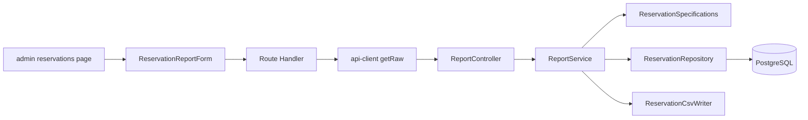

# Application Design（CSV 帳票出力）

詳細は同じディレクトリの `components.md`、`component-methods.md`、`services.md`、`component-dependency.md` を参照。

## 設計判断（`application-design-plan.md` の回答）

| 論点 | 決定 |
|---|---|
| ダウンロード経路 | Route Handler がバックエンドを中継し、クライアントが `fetch` から Blob でダウンロードする。失敗時はトースト（RPT-14） |
| 出力方式 | 全件をメモリ上でバイト列にして `ResponseEntity<byte[]>` で返す |
| 件数上限 | 設けない。既知の制約として記録する |
| CSV 生成の置き場所 | `application` 層の `ReservationCsvWriter`（Spring 非依存）と `ReservationCsvRow` |
| 条件の問い合わせ | `ReservationSpecifications`（domain）と `JpaSpecificationExecutor` |
| 画面構成 | サーバーの `page.tsx` と `FormData` 方式の `ReservationReportForm`。新しい shadcn コンポーネントは追加しない |

## 構成の要約

## 変更ファイル（予定）

### 新規
- backend: `ReportController`、`ReportService`、`ReservationCsvWriter`、`ReservationCsvRow`、`ReservationSpecifications`、各テスト
- frontend: `src/app/api/reports/reservations/csv/route.ts`、`admin/reservations/page.tsx`、`ReservationReportForm.tsx`、各テスト
### 変更
- backend: `ReservationRepository`（継承の追加）
- frontend: `api-client.ts`（`getRaw`）、`nav-items.ts` とそのテスト
- docs-next: `api-spec.md`、`screen-spec.md`、`requirements.md`（権限マトリクス）、`csv-export.md`（影響範囲の記述）

## 検証メモ
- 要件 RPT-01〜18 はすべて、上記のコンポーネントのいずれかに割り当てた（RPT-15〜18 は仕様書の更新）。
- `SecurityConfig` は変更しない（`@PreAuthorize` による認可）。
- 既存の `GET /api/reservations` と `ReservationService` は変更しない。
