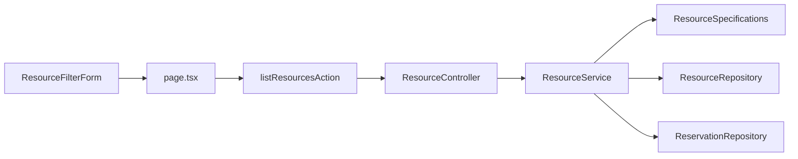

# Component Dependency

## Dependency Matrix
| From \ To | ResourceSpecifications | ResourceRepository | ReservationRepository |
|---|---|---|---|
| ResourceController | - | - | - |
| ResourceService | uses | uses | uses |
| ResourceSpecifications | - | - | - |

ResourceController は ResourceService にのみ依存する（変更なし）。

## Data Flow

## Communication Patterns
- FE から BE: REST（`GET /api/resources?category&keyword&from&to&page`）
- BE 内: Controller から Service、Service から Repository（Specification を引数に渡す）
- 後続課題（`resource-list-sort`、`reservation-list-filter`）は、同じ構造に Specification と Pageable の sort を足す形で拡張できる
