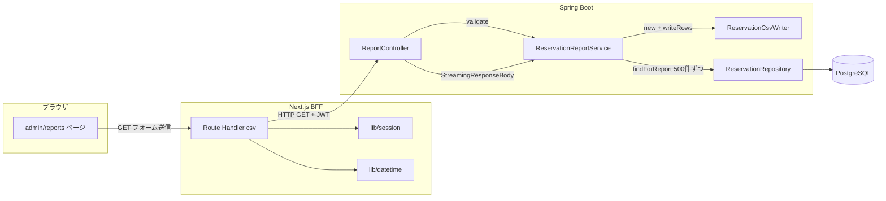
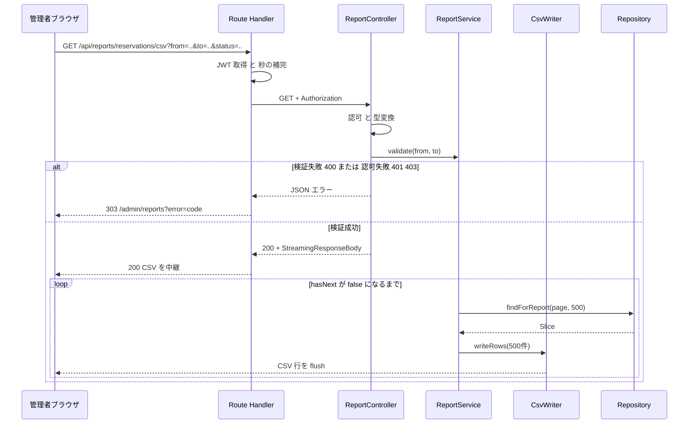

# Component Dependency — CSV 帳票出力

## 1. 依存関係マトリクス（行 → 列を利用する）

### BE

| 利用する側 ＼ 利用される側 | ReservationReportService | ReservationCsvWriter | ReservationRepository | Reservation / ReservationStatus | ValidationException |
|---|:---:|:---:|:---:|:---:|:---:|
| `ReportController` | ○ | - | - | ○（引数型のみ） | - |
| `ReservationReportService` | - | ○ | ○ | ○ | ○ |
| `ReservationCsvWriter` | - | - | - | ○ | - |
| `ReservationRepository` | - | - | - | ○ | - |

- 依存は `presentation → application → domain` の一方向のみ。`infrastructure` への新規依存はない（`@EnableMethodSecurity` は既存）。
- `ReservationCsvWriter` は Spring / JPA の型を使わない。`Reservation`（domain）だけを知る。

### FE

| 利用する側 ＼ 利用される側 | `lib/datetime.ts` | `lib/session.ts`（`getAccessToken`） | `lib/labels.ts` | BE API |
|---|:---:|:---:|:---:|:---:|
| Route Handler | ○ | ○ | - | ○（HTTP） |
| `/admin/reports` ページ | - | - | ○ | -（直接は呼ばない） |
| `server/actions/reservations.ts` | ○（抽出元） | ○ | - | ○ |

- ページはフォームの送信先として Route Handler の URL を指すだけで、BE を直接呼ばない（Server Action も使わない）。

## 2. 構成図

## 3. データフロー（成功時 / 失敗時）

## 4. 通信パターン

| 区間 | 方式 | 認証 | 備考 |
|---|---|---|---|
| ブラウザ → Route Handler | 同一オリジンの通常 GET（フォーム送信） | セッション cookie | JWT はブラウザに渡らない |
| Route Handler → BE | サーバー間 HTTP GET（`BACKEND_URL`） | `Authorization: Bearer <JWT>` | 応答本文をストリームのまま中継。バッファリングしない |
| Service → Repository | 同期呼び出し（ページ単位） | - | 1 ページ 1 トランザクション |
| Service → Writer | 同期呼び出し（`OutputStream` に直接書く） | - | ページごとに `flush` |
