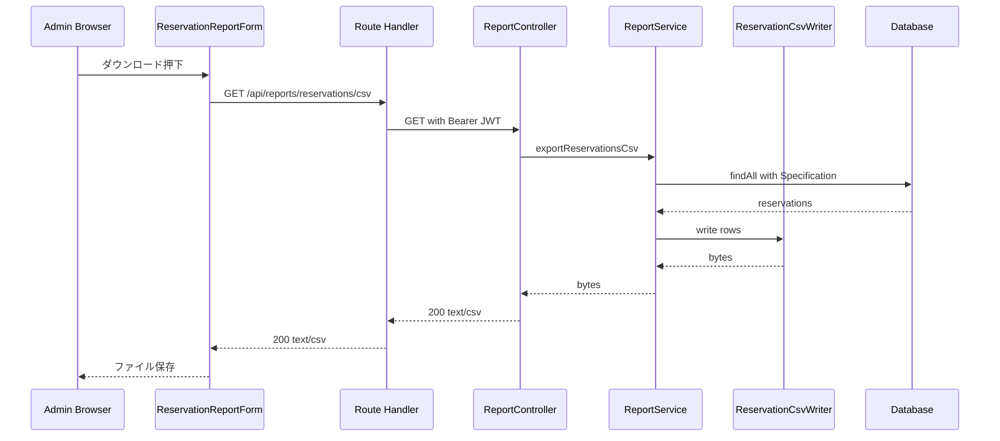

# Component Dependencies

## Dependency Matrix

| コンポーネント | 依存先 |
|---|---|
| ReportController | ReportService、ReservationStatus |
| ReportService | ReservationRepository、ReservationSpecifications、ReservationCsvWriter、ReservationCsvRow |
| ReservationCsvWriter | ReservationCsvRow、ReservationStatus |
| ReservationSpecifications | Reservation、ReservationStatus |
| ReservationRepository | Reservation（`JpaSpecificationExecutor` を追加） |
| Route Handler | api-client の `getRaw`、`getAccessToken` |
| ReservationReportForm | Route Handler（HTTP）、`RESERVATION_STATUS_LABELS`、sonner |
| `admin/reservations/page.tsx` | ReservationReportForm |

4 レイヤーの方向は presentation → application → domain で、逆向きの依存はない。`ReservationCsvWriter` は application 内の純粋なクラスで、JPA エンティティに依存しない。

## Communication Patterns
- ブラウザ → Route Handler: 同一オリジンの GET（Cookie でセッション）
- Route Handler → Backend: Bearer JWT 付きの GET
- Backend 内: 同期呼び出しのみ

## Data Flow

エラー時は Controller が `{ code, message }` と 400 / 403 を返し、Route Handler が同じ内容を中継し、フォームがトーストで通知する。
