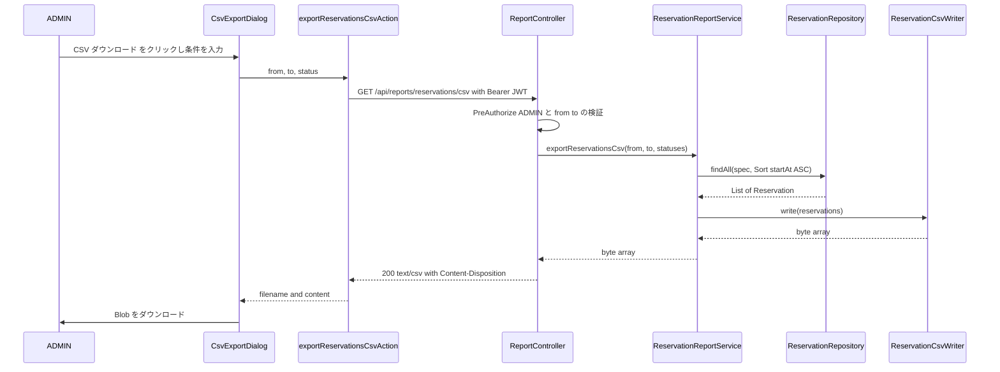

# Component Dependencies: CSV 帳票出力（Issue #29）

## 依存マトリクス（Backend）

行が依存元、列が依存先。○ は依存あり。

| From \ To | ReservationReportService | ReservationCsvWriter | ReservationSpecifications | ReservationRepository | Reservation / ReservationStatus |
|---|---|---|---|---|---|
| ReportController（presentation） | ○ | - | - | - | ○（`ReservationStatus` のみ、パラメータの型） |
| ReservationReportService（application） | - | ○ | ○ | ○ | ○ |
| ReservationCsvWriter（application） | - | - | - | - | ○ |
| ReservationSpecifications（domain） | - | - | - | - | ○ |

4 層の依存方向（presentation → application → domain）を守る。domain から上位層への依存、presentation から domain の Repository への直接依存はない。Service は presentation の DTO を使わない（バイト列を返す）。

## 依存マトリクス（Frontend）

| From \ To | exportReservationsCsvAction | api-client.ts `getText` | session.ts `getAccessToken` | labels.ts | ui/dialog・button・input・label、sonner |
|---|---|---|---|---|---|
| reservations/page.tsx | - | - | - | - | - （`CsvExportDialog` を描画するだけ） |
| CsvExportDialog.tsx | ○ | - | - | ○（ステータスの表示名） | ○ |
| reports.ts | - | ○ | ○ | - | - |

## 通信パターン

- ブラウザ → Next.js：Server Action の呼び出し（RSC のプロトコル）。JWT はブラウザに出ない
- Next.js → Spring Boot：`BACKEND_URL/api/reports/reservations/csv` への GET（`Authorization: Bearer <JWT>`）。既存の `api-client.ts` のサーバー側経路
- 応答：BE は CSV のバイト列を一括で返す（Q2）。Server Action は文字列（BOM を含む）とファイル名を返す。ブラウザは Blob を作ってダウンロードさせる

## データフロー



テキスト代替:

```
ADMIN -> CsvExportDialog(条件入力) -> exportReservationsCsvAction
  -> GET /api/reports/reservations/csv (Bearer JWT)
  -> ReportController(ADMIN 判定・from/to 検証)
  -> ReservationReportService -> ReservationRepository.findAll(spec, startAt ASC)
  -> ReservationCsvWriter.write -> byte[]
  -> 200 text/csv + Content-Disposition
  -> {filename, content} -> Blob -> ダウンロード
エラー: 401 / 403 / 400 -> ApiClientError -> toast.error
```
