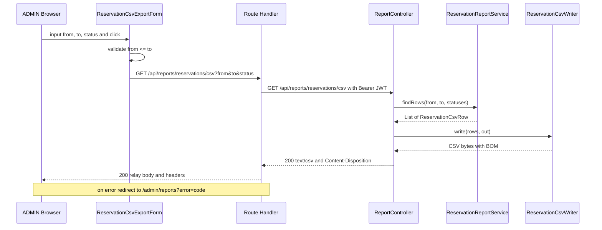

# Application Design（csv-export）

**作成日時**: 2026-10-26T01:37:50+00:00
**入力**: `../../requirements/csv-export/requirements.md`（承認済み）、`../../plans/csv-export/application-design-plan.md`（確認質問 7 問、すべて推奨案で回答済み）
**詳細**: `components.md`（コンポーネント）、`component-methods.md`（シグネチャ）、`services.md`（Service）、`component-dependency.md`（依存とデータの流れ）

## 1. 設計判断の要約（PR の「設計判断」に転記する用）

| 論点 | 決定 | 理由（要約） |
|---|---|---|
| D-1 backend のレスポンス方式 | `ResponseEntity<byte[]>` | 件数が少なく性能目標もない。ストリーミングは `open-in-view: false` の下でのトランザクションの開き直し、200 送信後のエラー、非同期テストの負担が利点を上回る。CSV 生成部は `OutputStream` に書く形にして、将来ストリーミングへ移る余地を残す |
| D-2 CSV の生成方法 | 自前実装 | ライブラリに任せられるのはエスケープだけで、BOM、CSV インジェクション対策、書式はどちらでも自前になる。依存を増やさず、エスケープ規則はユニットテストで網羅する |
| D-3 frontend のダウンロード方式 | Route Handler + GET フォーム | JWT はブラウザから読めないため、サーバー側で付けて中継する。バイト列のまま中継するので BOM とファイル名が保たれ、ブラウザ標準のダウンロードになる。Server Action + Blob は `text()` で BOM が落ちる問題があり、大きなデータの返却にも向かない |
| エラー時の振る舞い | 未認証は `/auth/signin`、それ以外は `/admin/reports?error=<code>` へリダイレクト | GET フォームの遷移でもエラーを画面上で伝えられる。日付の前後はフォームで送信前に検証する |
| 予約クエリ | `Specification`（`JpaSpecificationExecutor`） | `from` / `to` / `status` の未指定を条件の省略で自然に表せる。`(:from IS NULL OR ...)` は PostgreSQL で null の型を決められずエラーになる場合があり、H2 のテストでは検出しにくい |
| CSV 生成部の置き場所 | presentation（`presentation/csv/`） | CSV は JSON と同じく HTTP 応答の表現形式で、application と domain に書式を持ち込まない |
| 画面 | `/admin/reports`「帳票出力」、サイドナビの ADMIN 専用項目の末尾 | 予約データの出力はリソース管理と扱う対象が違う。後続の帳票（利用実績など）も同じ画面に置ける |

## 2. D-1〜D-3 の比較表

### 2.1 比較の前提

- `spring.jpa.open-in-view: false`。Controller から処理が戻った後は、Hibernate のセッションもトランザクションも閉じている。
- `Reservation.resource` / `Reservation.requester` は LAZY。
- JWT はブラウザの JavaScript から読めない（httpOnly cookie またはサーバー側セッション）。`/api/backend` の rewrite は Authorization を付けない。
- `api-client.ts` は JSON 前提で、CSV 本文をそのまま返すメソッドがない。
- Fetch 仕様の `Response.text()` は UTF-8 としてデコードする際に先頭の BOM を取り除く。
- 学習用のシステムで想定件数は少なく、数値の性能目標はない（NFR-4）。

### 2.2 D-1 backend のレスポンス方式

| 観点 | A. `StreamingResponseBody` | B. `ResponseEntity<byte[]>`（採用） |
|---|---|---|
| メモリ | 行ごとに書き出せば、件数に比例して増えない | エンティティの一覧と CSV のバイト列の両方を一度メモリに載せる |
| トランザクション | 書き出しは Controller が戻った後に別スレッドで行われる。DB から少しずつ読みながら書くなら、書き出し側でトランザクションを開き直す必要がある | Service の読み取り専用トランザクションの中で読み終え、DTO に詰め替えてから CSV にする。既存の作りと同じ |
| 途中のエラー | 200 とヘッダを送った後に失敗すると、壊れた CSV のまま通信が切れる | 失敗は CSV を返す前に起きるので、既存の例外ハンドラで 4xx / 5xx の JSON を返せる |
| テスト | MockMvc では `asyncDispatch` が要り、非同期リクエストのタイムアウトも考える必要がある | 既存の結合テストと同じ書き方で、本文のバイト列（BOM を含む）を検査できる |
| D-3 との関係 | 端から端までストリーミングになるのは、D-3 で本文をそのまま流す場合だけ | D-3 のどの方式とも組み合わせられる |
| 将来の拡張 | 大量件数に強い | CSV 生成部を `OutputStream` に書く形にしておけば、後でストリーミングに移れる |

### 2.3 D-2 CSV の生成方法

| 観点 | A. 自前で書く（採用） | B. `opencsv` |
|---|---|---|
| 依存 | 追加なし | ライブラリと推移的な依存（commons 系）が加わる。技術スタックの表にない依存の追加になる |
| RFC 4180 のエスケープ | 「カンマ、ダブルクォート、CR、LF を含むなら囲み、`"` を `""` にする」の数行。ユニットテストで網羅する | ライブラリに任せられる。既定の囲み方や改行コードを要件（必要なセルだけ囲む、CRLF）に合わせる設定の確認が要る |
| CSV インジェクション対策 | 自前 | 機能がないため自前の前処理が要る |
| BOM、日本語ラベル、日時書式 | 自前 | 自前 |
| 学習効果 | エスケープ規則をテストで確かめながら書く | ライブラリの設定の読み方を学べる |

### 2.4 D-3 frontend のダウンロード方式

| 観点 | A. Route Handler + GET フォーム（採用） | B. Server Action + Blob | C. Route Handler + fetch + Blob |
|---|---|---|---|
| 仕組み | Route Handler が JWT を付けて backend を呼び、本文とヘッダを中継する。画面は GET フォームで条件をクエリ文字列にして送る | Server Action が CSV を受け取って返し、Client Component が Blob にしてダウンロードさせる | A と同じ Route Handler を Client Component が `fetch` で呼び、Blob にしてダウンロードさせる |
| BOM | バイト列のまま中継するので保たれる | 文字列で返すと BOM が落ちるため、付け直すか Base64 などで受け渡す必要がある | `blob()` で受ければ保たれる |
| ファイル名 | backend の `Content-Disposition` をそのまま中継する | 別に返すか、クライアントで組み立てる | `Content-Disposition` をクライアントで解析する |
| エラー表示 | そのままではエラーの本文が表示される。エラー時に画面へリダイレクトして補う | 戻り値で受けて画面上に出せる | `fetch` の結果で受けて画面上に出せる |
| メモリ | 中継はストリーム | Next.js とブラウザの両方で全体を載せる | ブラウザで全体を載せる |
| Next.js の作法 | ファイルの返却は Route Handler の用途に合う | Server Action は主に更新処理向け | Route Handler の用途に合う |
| テスト（Vitest） | Route Handler の `GET` を直接呼び、`getAccessToken` を `vi.mock`、backend を MSW で返す | 既存の Server Action テストの書き方を使えるが、jsdom で `URL.createObjectURL` のモックが要る | Route Handler は A と同じ。クライアント側は B と同じモックが要る |

## 3. コンポーネント構成

### backend

| コンポーネント | レイヤー | 種別 | 責務 |
|---|---|---|---|
| `ReportController` | presentation | 新規 | `GET /api/reports/reservations/csv`、ADMIN 限定、ヘッダとファイル名 |
| `ReservationCsvWriter` | presentation（`csv/`） | 新規 | BOM、ヘッダ、列、書式、ラベル、インジェクション対策、RFC 4180、CRLF |
| `ReservationReportService` | application | 新規 | 検証、条件の組み立て、取得、行 DTO への詰め替え |
| `ReservationCsvRow` | application | 新規（record） | CSV の 1 行分 |
| `ReservationSpecifications` | domain | 新規 | 検索条件と JOIN FETCH の `Specification` |
| `ReservationRepository` | domain | 変更 | `JpaSpecificationExecutor<Reservation>` を追加 |

### frontend

| コンポーネント | 種別 | 責務 |
|---|---|---|
| `app/api/reports/reservations/csv/route.ts` | 新規 Route Handler | パラメータの選別、JWT の付与、中継、エラー時のリダイレクト |
| `lib/api-client.ts` | 変更 | `getRaw` の追加 |
| `app/(authenticated)/admin/reports/page.tsx` | 新規 Server Component | 画面「帳票出力」、エラーメッセージ |
| `app/(authenticated)/admin/reports/ReservationCsvExportForm.tsx` | 新規 Client Component | 日付 2 つ、ステータス 4 種、ボタン、日付の前後チェック |
| `components/layout/nav-items.ts` | 変更 | 「帳票出力」の追加 |

## 4. 処理の流れ

テキストによる代替表現: フォームが日付の前後を検証して Route Handler に GET を送る。Route Handler が JWT を付けて Controller を呼ぶ。Controller は Service から行の一覧を受け取り、CSV 生成部で BOM 付きの CSV にして返す。Route Handler は本文とヘッダを中継する。エラー時は画面へリダイレクトする。

## 5. Code Generation への引き継ぎ事項

- `@GetMapping` に `produces = "text/csv"` を付けない。`Content-Type` は `ResponseEntity` で設定する（エラー時に例外ハンドラが JSON を返す処理と衝突させないため）。
- `@PreAuthorize` はパラメータの型変換の後に評価される。MEMBER が不正な日付を送ると 403 ではなく 400 になるが、受入条件（正しいパラメータで 403）には影響しない。
- `LocalDate` のパラメータには `@DateTimeFormat(iso = DateTimeFormat.ISO.DATE)` を付ける。
- `Specification` の JOIN FETCH は、件数取得のクエリ（`query.getResultType()` が `Long`）では付けない。条件なしの述語は `cb.conjunction()` を返す。合成 API は Spring Boot 4.0.6 が解決する Spring Data JPA の版で、jar またはドキュメントを確かめてから書く（記憶で書かない）。
- GET フォームは空の日付も `from=` として送るため、Route Handler で空文字を捨てる。`status` は `searchParams.getAll("status")` で取り出す。
- Route Handler は `ApiClientError` 以外の例外（通信失敗など）も捕捉し、`error=INTERNAL_SERVER_ERROR` でリダイレクトする。
- 承認状態のラベルは `frontend/src/lib/labels.ts` の `RESERVATION_STATUS_LABELS` と同じ文言を backend に複製する。BE と FE をまたぐ自動テストは作らず、BE のテスト（`ReservationCsvWriterTest`）で期待する文言を固定し、`labels.ts` とは手で揃える。
- Route Handler のリダイレクトは絶対 URL が必要なため `new URL(path, request.url)` を使う。
- 画面のエラーメッセージは `error` の値を既知のコードに対応づけ、未知の値をそのまま画面に出さない。

## 6. 要件との対応

| 要件 | 担うコンポーネント |
|---|---|
| FR-1 エンドポイント | `ReportController` |
| FR-2 列、FR-3 書式、FR-4 インジェクション対策 | `ReservationCsvWriter` |
| FR-5 絞り込み、FR-6 並び順 | `ReservationReportService`、`ReservationSpecifications`、`ReservationRepository` |
| FR-7 ファイル名 | `ReportController`（Route Handler は中継のみ） |
| FR-8 認可 | `ReportController`（`@PreAuthorize`）、`admin/layout.tsx`（画面のガード、既存） |
| FR-9 管理者画面 | 帳票出力ページ、`ReservationCsvExportForm`、`nav-items.ts` |
| NFR-1 サーバー側の認可 | `@PreAuthorize` |
| NFR-2 インジェクション対策、パラメータバインド | `ReservationCsvWriter`、`Specification`（Criteria API はパラメータバインド） |
| NFR-3 JWT を露出させない | Route Handler（サーバー側で付与） |
| NFR-4 N+1 回避 | `fetchResourceAndRequester()` |
| NFR-5 Excel の文字化け防止、既存 API の互換 | BOM。既存メソッドとエンドポイントは変更しない |
| NFR-6 4 レイヤー、単体でテストできる CSV 生成 | `ReservationCsvWriter` は HTTP と DB に依存しない |
| NFR-7 テスト | `ReservationCsvWriterTest`、`ReservationReportServiceTest`、`ReportControllerTest`、Route Handler とフォームと `nav-items` の Vitest |

設計の一貫性の確認：FR-1〜9 と NFR-1〜7 のすべてに担当コンポーネントがあることを確認した。依存の向きは 4 レイヤーの規則に沿う（`component-dependency.md`）。
