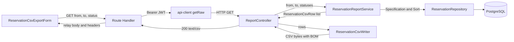

# Component Dependency（csv-export）

**作成日時**: 2026-10-26T01:37:50+00:00

## 依存関係の表

行のコンポーネントが列のコンポーネントに依存する場合に「○」。

| 依存元 \ 依存先 | ReportController | ReservationCsvWriter | ReservationReportService | ReservationCsvRow | ReservationSpecifications | ReservationRepository |
|---|---|---|---|---|---|---|
| ReportController | - | ○ | ○ | ○ | | |
| ReservationCsvWriter | | - | | ○ | | |
| ReservationReportService | | | - | ○ | ○ | ○ |
| ReservationCsvRow | | | | - | | （`Reservation` エンティティ） |
| ReservationSpecifications | | | | | - | （`Reservation` エンティティ） |

- 依存の向きは presentation -> application -> domain で、4 レイヤーの規則に沿う。presentation の `ReservationCsvWriter` が application の `ReservationCsvRow` を使うのは、既存の Controller が application の Service の戻り値を使うのと同じ向きである。
- application と domain は presentation（CSV の書式）を知らない。

| 依存元 | 依存先 | 方式 |
|---|---|---|
| `ReservationCsvExportForm` | CSV 中継 Route Handler | ブラウザの GET フォーム送信（同一オリジン、cookie 付き） |
| CSV 中継 Route Handler | `lib/session.ts`（`getAccessToken`） | 関数呼び出し |
| CSV 中継 Route Handler | `lib/api-client.ts`（`getRaw`） | 関数呼び出し |
| `lib/api-client.ts` | backend `ReportController` | HTTP（`BACKEND_URL` + `/api`、`Authorization: Bearer`） |
| 帳票出力ページ | `ReservationCsvExportForm` | React の描画 |
| サイドナビ | `nav-items.ts` | 既存の関数呼び出し |

## データの流れ

テキストによる代替表現: フォーム -> Route Handler（条件）-> api-client（JWT 付与）-> Controller -> Service -> Repository -> DB。Service が行の一覧を Controller に返し、Controller が CSV 生成部で BOM 付きのバイト列にして返す。Route Handler は本文とヘッダをブラウザへ中継する。

## エラーの流れ

| 発生箇所 | backend の応答 | Route Handler の振る舞い | 利用者に見えるもの |
|---|---|---|---|
| フォームの日付の前後 | （送信しない） | - | フォーム上のメッセージ |
| トークンなし | - | `/auth/signin` へリダイレクト | サインイン画面 |
| JWT の期限切れなど | 401 `UNAUTHORIZED` | `/auth/signin` へリダイレクト | サインイン画面 |
| ADMIN 以外 | 403 `FORBIDDEN` | `/admin/reports?error=FORBIDDEN` | 画面上のメッセージ（通常は `admin/layout.tsx` が先に 403 画面を出すため到達しない） |
| 不正な日付、`from` > `to`、未知の `status` | 400 `VALIDATION_ERROR` | `/admin/reports?error=VALIDATION_ERROR` | 画面上のメッセージ |
| 想定外 | 500 `INTERNAL_SERVER_ERROR` | `/admin/reports?error=INTERNAL_SERVER_ERROR` | 画面上のメッセージ（汎用） |
| 通信失敗（backend に届かない） | （応答なし。`ApiClientError` 以外の例外） | `/admin/reports?error=INTERNAL_SERVER_ERROR` | 画面上のメッセージ（汎用） |
