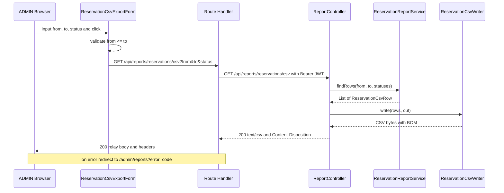

# Application Design Plan（csv-export）

**作成日時**: 2026-10-26T01:34:32+00:00
**入力**: `../../requirements/csv-export/requirements.md`（承認済み）、`execution-plan.md`（承認済み）、RE 補足 `../../reverse-engineering/csv-export-supplement.md`

この計画では、要件の未決事項 D-1〜D-3 の比較表と推奨案、その他の設計判断の提案を示し、学習者の判断が要る点を末尾の質問で確認する。回答を受けてから、成果物（第 5 節）を `Docs/spec/aidlc-docs/inception/application-design/csv-export/` に生成する。

---

## 1. 比較の前提になる事実

比較表の評価は、次の事実に基づく（いずれもコードまたは仕様で確認した）。

- `application.yml` は `spring.jpa.open-in-view: false`。Controller から処理が戻った後は、Hibernate のセッションもトランザクションも閉じている。
- `Reservation.resource` / `Reservation.requester` は LAZY。セッションの外で読むと例外になる。
- ブラウザの JavaScript から JWT は読めない（httpOnly cookie またはサーバー側セッション）。`/api/backend` の rewrite は Authorization を付けない。
- `api-client.ts` は JSON 前提で、CSV 本文をそのまま返すメソッドがない。
- Fetch 仕様の `Response.text()` は UTF-8 としてデコードする際に先頭の BOM を取り除く。CSV を文字列として受け渡す経路では、BOM を付け直す処理が要る。
- 想定件数：学習用のシステムで、シードの予約は 2 件。数値の性能目標はない（NFR-4）。

## 2. D-1〜D-3 の比較表と推奨案

### D-1 backend のレスポンス方式

| 観点 | A. `StreamingResponseBody` | B. `ResponseEntity<byte[]>` |
|---|---|---|
| メモリ | 行ごとに書き出せば、件数に比例して増えない | エンティティの一覧と CSV のバイト列の両方を一度メモリに載せる |
| トランザクション | 書き出しは Controller が戻った後に別スレッドで行われる。`open-in-view: false` のため、DB から少しずつ読みながら書くなら、書き出し側で `TransactionTemplate` などを使ってトランザクションを開き直す必要がある | Service の `@Transactional(readOnly = true)` の中で読み終え、DTO に詰め替えてから CSV にする。既存の作りと同じ |
| 途中のエラー | 200 とヘッダを送った後に失敗すると、壊れた CSV のまま通信が切れる。エラーの JSON は返せない | 失敗は CSV を返す前に起きるので、既存の `GlobalExceptionHandler` で 4xx / 5xx の JSON を返せる |
| テスト | MockMvc では `asyncDispatch` が要り、非同期リクエストのタイムアウト設定も考える必要がある | 既存の結合テストと同じ書き方で、本文のバイト列（BOM を含む）を検査できる |
| D-3 との関係 | 端から端までストリーミングになるのは、D-3 で Route Handler が本文をそのまま流す場合だけ | D-3 のどの方式とも組み合わせられる |
| 将来の拡張 | 大量件数に強い | CSV 生成部を `Writer` / `OutputStream` に書く形にしておけば、後でストリーミングに移れる |

**推奨：B（`ResponseEntity<byte[]>`）**。件数が少なく性能目標もないため、ストリーミングのメモリ上の利点より、トランザクションの開き直し、途中エラー、非同期テストという負担のほうが大きい。CSV 生成部は出力先（`OutputStream`）を受け取る形にして、将来ストリーミングへ移る余地を残す。

### D-2 CSV の生成方法

| 観点 | A. 自前で書く | B. `opencsv` |
|---|---|---|
| 依存 | 追加なし | ライブラリと推移的な依存（commons 系）が加わる。技術スタックの表（CLAUDE.md）にない依存の追加になる |
| RFC 4180 のエスケープ | 「カンマ、ダブルクォート、CR、LF を含むなら囲み、`"` を `""` にする」の数行。ユニットテストで網羅する | ライブラリに任せられる。既定では全セルを囲むなど、要件に合わせた設定（区切り、囲み、改行コード CRLF）の確認が要る |
| CSV インジェクション対策（FR-4） | 自前で書く（どちらの方式でも必要） | 対策の機能はないため、自前の前処理が要る |
| BOM、日本語ラベル、日時書式 | 自前（どちらの方式でも必要） | 自前（どちらの方式でも必要） |
| 学習効果 | エスケープ規則をテストで確かめながら書くため、仕様の理解が深まる | ライブラリの設定の読み方を学べる |

**推奨：A（自前で書く）**。出力は 7 列の固定形式で、ライブラリに任せられるのはエスケープだけである。BOM、インジェクション対策、書式はどちらでも自前になるため、依存を増やす利点が小さい。

### D-3 frontend のダウンロード方式

| 観点 | A. Route Handler + GET フォーム（またはリンク） | B. Server Action + Blob | C. Route Handler + クライアントの fetch + Blob |
|---|---|---|---|
| 仕組み | `src/app/api/reports/reservations/csv/route.ts` が JWT を付けて backend を呼び、本文とヘッダを中継する。画面は `<form method="get">` で条件をクエリ文字列にして送る | Server Action が backend の CSV を受け取って返し、Client Component が Blob にして `<a download>` をクリックさせる | A と同じ Route Handler を、Client Component が `fetch` で呼び、Blob にしてダウンロードさせる |
| BOM | バイト列をそのまま中継するので保たれる | 文字列で返すと `text()` で BOM が落ちるため、付け直すか Base64 などで受け渡す必要がある | `blob()` で受ければ保たれる |
| ファイル名（FR-7） | backend の `Content-Disposition` をそのまま中継すればよい | ファイル名を別に返すか、クライアントで組み立てる | `Content-Disposition` をクライアントで解析する |
| エラー表示（FR-9） | ブラウザの遷移になるため、そのままではエラーの本文が表示される。Route Handler がエラー時に画面へリダイレクトすれば、画面上にメッセージを出せる | Server Action の戻り値でエラーを受け、画面上に出せる | `fetch` の結果でエラーを受け、画面上に出せる |
| メモリ | 中継はストリーム（Next.js でも全体を載せない） | Next.js とブラウザの両方で全体を載せる | ブラウザで全体を載せる |
| Next.js の作法 | ファイルの返却は Route Handler の用途に合う | Server Action は主に更新処理向けで、大きなデータの返却には向かない | Route Handler の用途に合う |
| テスト（Vitest） | Route Handler の `GET` を `Request` で直接呼び、`getAccessToken` を `vi.mock`、backend を MSW で返す。フォームは送信先とパラメータを検査する | 既存の Server Action テストの書き方を使える。Blob とクリックは jsdom で `URL.createObjectURL` のモックが要る | Route Handler は A と同じ。クライアント側は B と同じくモックが要る |
| JavaScript への依存 | フォーム送信だけなら不要（入力検証には使う） | 必要 | 必要 |

**推奨：A（Route Handler + GET フォーム）**。BOM とファイル名を中継するだけで済み、ブラウザ標準のダウンロードになる。エラー表示の弱点は、次の 2 点で補う。

- 入力の前後関係（開始日が終了日より後）は、フォームの送信前にクライアントで検証して送らない（backend の 400 に頼らない）
- Route Handler は backend のエラーを受けたら `/admin/reports?error=<code>` にリダイレクトし、画面にメッセージを出す。未認証（トークンなし、または 401）は `/auth/signin` にリダイレクトする（Question 4）

## 3. その他の設計判断（提案）

### 3.1 backend のコンポーネント（4 レイヤー）

| レイヤー | コンポーネント | 責務 |
|---|---|---|
| presentation | `ReportController`（`/api/reports`） | `GET /reservations/csv`。`@PreAuthorize("hasRole('ADMIN')")`。`from` / `to`（`LocalDate`）と `status`（`List<ReservationStatus>`）を受け取り、Service と CSV 生成部を呼び、`Content-Type` / `Content-Disposition` 付きの `ResponseEntity<byte[]>` を返す。ファイル名の日時もここで付ける |
| presentation（Question 6） | `ReservationCsvWriter` | 行の一覧を BOM 付き UTF-8 の CSV に書く。ヘッダ、列順、日時書式、承認状態のラベル、CSV インジェクション対策、RFC 4180 のエスケープ、CRLF。HTTP にも DB にも依存しない |
| application | `ReservationReportService` | `@Transactional(readOnly = true)`。`from` > `to` の検証（`ValidationException`、400）、期間（`from` の 0 時以上、`to` の翌日 0 時未満）とステータスの条件の組み立て、取得結果を行 DTO に詰め替える |
| application | `ReservationCsvRow`（record） | CSV の 1 行分（予約 ID、リソース名、申請者名、開始日時、終了日時、目的、ステータス）。LAZY 関連をトランザクション内で読み終えるための詰め替え先 |
| domain / infrastructure | `ReservationRepository` の拡張（Question 5） | 期間とステータスで絞り、開始日時と予約 ID の昇順に並べ、リソースと申請者を JOIN FETCH して全件を返す |

実装上の注意（Code Generation に引き継ぐ）:

- `@GetMapping` に `produces = "text/csv"` を付けず、`Content-Type` は `ResponseEntity` で設定する。`produces` を付けると、例外ハンドラが JSON のエラーを返すときに、Content-Type の取り決めと衝突するおそれがある。
- `@PreAuthorize` はパラメータの型変換の後に評価されるため、MEMBER が不正な日付を送ると 403 ではなく 400 になる。受入条件（正しいパラメータの MEMBER / APPROVER は 403）には影響しない。

### 3.2 frontend のコンポーネント

| コンポーネント | 種別 | 責務 |
|---|---|---|
| `src/app/api/reports/reservations/csv/route.ts` | Route Handler（`GET`） | 受け取ったクエリから `from` / `to` / `status` だけを取り出して backend に渡す。JWT は `getAccessToken()` で付ける。成功時は本文、`Content-Type`、`Content-Disposition` を中継する。トークンなし、または 401 なら `/auth/signin` へ、それ以外のエラーは `/admin/reports?error=<code>` へリダイレクトする |
| `api-client.ts` の拡張 | ライブラリ | `getRaw(path, params)` を追加し、URL の組み立て、トークン付与、`assertOk`（エラー時の `ApiClientError`）を再利用して `Response` を返す。既存メソッドは変えない |
| `src/app/(authenticated)/admin/reports/page.tsx` | Server Component | 画面「帳票出力」。`searchParams.error` があればエラーメッセージを表示する。ADMIN のガードは既存の `admin/layout.tsx` が行う |
| `ReservationCsvExportForm.tsx` | Client Component | 開始日、終了日（`<input type="date">`）、ステータスのチェックボックス（4 種）、「CSV ダウンロード」ボタン。`<form method="get" action="/api/reports/reservations/csv">`。送信前に開始日が終了日より後なら送信を止めて画面にメッセージを出す |
| `nav-items.ts` | 純関数 | ADMIN 専用項目に「帳票出力」（`/admin/reports`）を追加する |

ステータスのチェックボックスのラベルは `RESERVATION_STATUS_LABELS` を使う。`DRAFT` は画面の選択肢に出さない（ベース実装で発生しないため）。

### 3.3 処理の流れ（推奨案の場合）

テキストによる代替表現: ブラウザのフォームが入力を検証して Route Handler に GET を送る。Route Handler が JWT を付けて backend の Controller を呼ぶ。Controller は Service から行の一覧を受け取り、CSV 生成部で BOM 付きの CSV にして返す。Route Handler は本文とヘッダをそのまま中継する。エラー時は画面へリダイレクトする。

## 4. 確認質問

**回答（2026-10-26T01:37:50+00:00、チャットで受領）**: Q1: B, Q2: A, Q3: A, Q4: A, Q5: A, Q6: A, Q7: A（すべて推奨案）。学習者の補足：「比較表は PR の『設計判断』にも要約して載せたいので、成果物に残してください。」
回答の分析：未回答なし、曖昧な回答なし、矛盾なし（Q4 は Q3 = A を前提とする質問で、Q3 = A と整合する）。追加の質問は不要と判断した。各質問の `[Answer]:` にも同じ回答を記入した。

各質問の `[Answer]:` に記号を記入するか、チャットで「Q1: B, Q2: A …」の形で返してください。「推奨」は私の見立てで、従う必要はありません。

## Question 1
D-1 backend のレスポンス方式は？（比較は 2 節）

A) `StreamingResponseBody`

B) `ResponseEntity<byte[]>`（CSV 生成部は `OutputStream` に書く形にして、将来ストリーミングに移る余地を残す）。推奨

X) Other (please describe after [Answer]: tag below)

[Answer]: B

## Question 2
D-2 CSV の生成方法は？（比較は 2 節）

A) 自前で書く。推奨

B) `opencsv` を依存に追加する

X) Other (please describe after [Answer]: tag below)

[Answer]: A

## Question 3
D-3 frontend のダウンロード方式は？（比較は 2 節）

A) Route Handler + GET フォーム（ブラウザ標準のダウンロード）。推奨

B) Server Action + Blob

C) Route Handler + クライアントの fetch + Blob

X) Other (please describe after [Answer]: tag below)

[Answer]: A

## Question 4
（Question 3 で A を選んだ場合）backend がエラーを返したときの Route Handler の振る舞いは？

A) トークンなし、または 401 は `/auth/signin` へ、それ以外（403、400、500 など）は `/admin/reports?error=<code>` へリダイレクトし、画面にメッセージを表示する。推奨: 画面上でエラーに気づける

B) backend のステータスと JSON の本文をそのまま返す（ブラウザにエラーの本文が表示される。実装は最小）

X) Other (please describe after [Answer]: tag below)

[Answer]: A

## Question 5
期間とステータスで絞り込む予約クエリの組み立て方は？ `from` / `to` / `status` はそれぞれ未指定がありうるため、条件の有無で組み合わせが変わります。

A) Spring Data JPA の `Specification`（Criteria API）で、指定された条件だけを動的に組み立てる。リソースと申請者の JOIN FETCH と並び順も含める。推奨: 未指定の条件を自然に省ける。`ReservationRepository` に `JpaSpecificationExecutor` を加える必要があり、既存の `@Query` 中心の書き方とは異なる

B) `@Query`（JPQL）を 1 つ追加し、未指定の値は Service で補う（`status` 未指定は全ステータス、`from` / `to` 未指定は十分に古い日時と遠い未来の日時の番兵値）。既存の書き方に揃うが、番兵値という取り決めが増える

C) `@Query` で `(:from IS NULL OR r.startAt >= :from)` の形にして 1 メソッドで扱う。既存の書き方に揃うが、PostgreSQL で null パラメータの型を決められずエラーになる場合があり、H2 のテストでは検出しにくい

X) Other (please describe after [Answer]: tag below)

[Answer]: A

## Question 6
`ReservationCsvWriter`（CSV 生成部）を置くレイヤーは？

A) presentation（`presentation/csv/`）。推奨: CSV は JSON と同じく HTTP 応答の表現形式で、DTO と同じ層に置くのが自然

B) application（`application/report/`）。帳票の生成を業務処理として扱う

X) Other (please describe after [Answer]: tag below)

[Answer]: A

## Question 7
新しい管理者ページのパス、画面名、サイドナビの表示は？

A) パス `/admin/reports`、画面名「帳票出力」、サイドナビは ADMIN 専用項目の末尾（「ユーザー管理」の後）に「帳票出力」。推奨: 後続の帳票（利用実績など）も同じ画面に置ける

B) パス `/admin/reservations/export`、画面名「予約 CSV 出力」、サイドナビは ADMIN 専用項目の末尾に「予約 CSV 出力」

X) Other (please describe after [Answer]: tag below)

[Answer]: A

---

## 5. 成果物の生成（回答後に実行）

成果物の置き場所：`Docs/spec/aidlc-docs/inception/application-design/csv-export/`

- [x] 回答を分析し、曖昧な点や矛盾があれば追加の質問をする（追加の質問なし）
- [x] `components.md`：コンポーネントの定義と責務
- [x] `component-methods.md`：メソッドのシグネチャ、入出力の型
- [x] `services.md`：Service の定義と処理の組み立て
- [x] `component-dependency.md`：依存関係の表、通信方式、データの流れ
- [x] `application-design.md`：上記と D-1〜D-3 の決定、比較表を 1 つにまとめた文書（第 1 節は PR の「設計判断」に転記する用の要約）
- [x] 設計の完全性と一貫性の確認（要件 FR-1〜9、NFR-1〜7 との対応。`application-design.md` 第 6 節）
