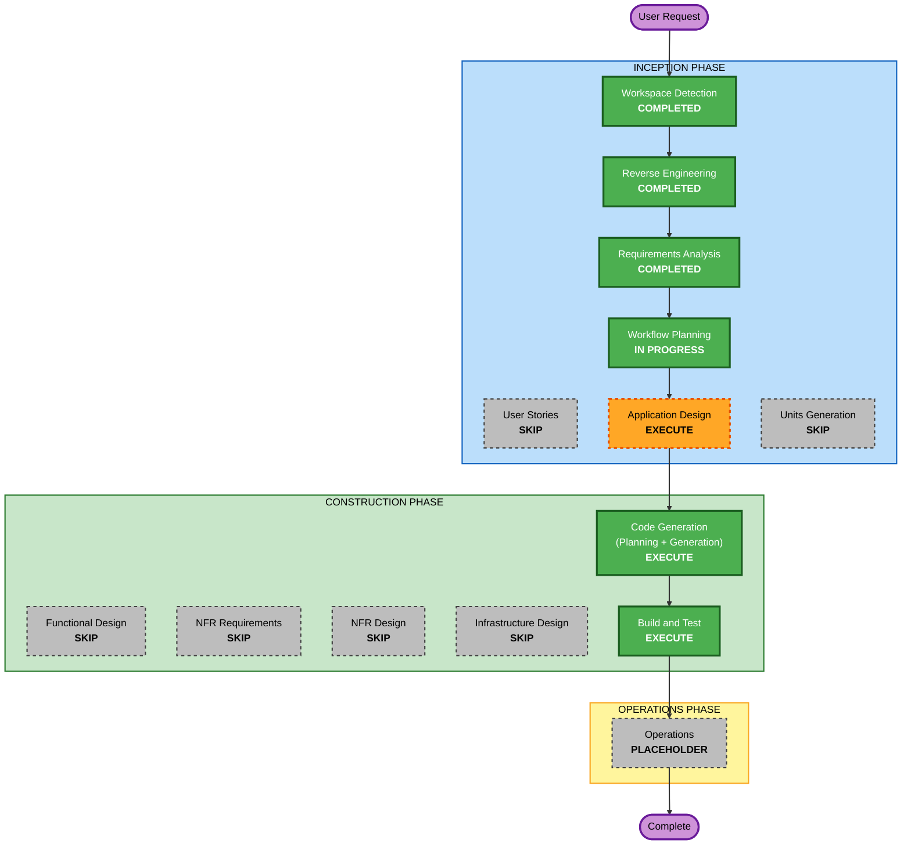

# Execution Plan（csv-export）

**作成日時**: 2026-10-26T01:32:47+00:00
入力: `../../requirements/csv-export/requirements.md`（承認済み）、`../../requirements/csv-export/requirement-verification-questions.md`（回答済み）、RE 成果物（既存 8 ファイルと `../../reverse-engineering/csv-export-supplement.md`）。User Stories は学習者の承認によりスキップする。

## Detailed Analysis Summary

### Transformation Scope (Brownfield Only)
- **Transformation Type**: Single feature の追加（縦切り 1 本）。アーキテクチャの変更はないが、BE と FE の両方に新しいコンポーネントが加わる
- **Primary Changes**:
  - BE: ADMIN 限定の `GET /api/reports/reservations/csv`（新しい Controller、Service、CSV 生成、期間とステータスで絞る予約クエリ）
  - FE: JWT をサーバー側で付けるダウンロード経路（Route Handler か Server Action。D-3）、新しい管理者ページ（絞り込みフォームとボタン）、サイドナビの項目追加
  - 仕様: `api-spec.md`、`screen-spec.md`
- **Related Components**: `ReservationRepository`、`Reservation`、`SecurityConfig` / `@PreAuthorize`、`GlobalExceptionHandler`、`api-client.ts`、`session.ts`、`admin/layout.tsx`、`nav-items.ts`、`labels.ts`

### Change Impact Assessment
- **User-facing changes**: Yes。ADMIN のサイドナビに項目が増え、新しい画面からファイルをダウンロードできる。MEMBER / APPROVER の画面は変わらない。
- **Structural changes**: Yes（小）。BE に `reports` 系のコンポーネント、FE に backend へ中継する経路が新しく加わる。4 層の境界と依存方向は変えない。
- **Data model changes**: No。テーブルと Flyway マイグレーションは変更しない（`start_at` のインデックス追加もしない。数値の性能目標がないため）。
- **API changes**: Yes（追加のみ）。新しいエンドポイントを 1 つ追加する。CSV を返すため、api-spec の「レスポンス形式：JSON」の例外になる。既存 API は変えない。
- **NFR impact**: Yes（要件で定義済み）。ADMIN 限定の認可、CSV インジェクション対策、JWT を露出させないこと、大量件数でのメモリ使用（D-1）。拡張機能は適用しない。

### Component Relationships
- **Primary Component**: `backend` の新しい帳票出力エンドポイントと、`frontend` の新しい管理者ページ
- **Infrastructure Components**: なし
- **Shared Components**: API 契約（`api-spec.md` が真実の源）。承認状態の日本語ラベル（BE の CSV と FE の `labels.ts` で文言を揃える）
- **Dependent Components**: 新しい管理者ページ -> FE のダウンロード経路 -> BE のエンドポイント
- **Supporting Components**: `BaseControllerTest` と `@WithMock*`、`frontend/tests/unit`（Vitest、MSW）、`nav-items.test.ts`

| Component | Change Type | Change Reason | Change Priority |
|---|---|---|---|
| `api-spec.md`、`screen-spec.md` | Minor | Spec-first | Critical（実装より先に更新） |
| `ReservationRepository` | Minor | 期間とステータスで絞り、並べるクエリの追加 | Critical |
| BE の帳票出力コンポーネント（Controller、Service、CSV 生成） | Major（新規） | RPT-01〜04 | Critical |
| FE のダウンロード経路 | Major（新規） | RPT-05、NFR-3 | Critical |
| 新しい管理者ページ | Major（新規） | RPT-05 | Important |
| `nav-items.ts` | Minor | ADMIN 専用項目の追加 | Important |
| `api-client.ts` | Minor または変更なし | D-3 の結果による（CSV 本文を受け取るメソッドが必要になる場合） | Important |

### Risk Assessment
- **Risk Level**: Medium。新しいエンドポイント、FE に新しい種類の経路（backend への中継）、新しい画面が加わる。既存機能への影響は小さい。
- **Rollback Complexity**: Easy。DB の変更がなく、追加だけなのでコミットを戻せば済む。
- **Testing Complexity**: Moderate。次の点は自動テストだけでは確かめきれないため、学習者が実機で確認する。
  - PostgreSQL での期間の境界（`to` の日を含む）と並び順
  - ブラウザで実際にファイルがダウンロードされ、Excel（または相当のアプリ）で文字化けしないこと
  - ストリーミングを選んだ場合（D-1）、書き出し中の DB 読み出しが PostgreSQL で問題なく動くこと

## Module Update Strategy
- **Update Approach**: Sequential（仕様書 -> BE -> FE）
- **Critical Path**: 仕様書の更新 -> BE のエンドポイント -> FE のダウンロード経路 -> 管理者ページ
- **Coordination Points**: クエリパラメータ（`from` / `to` の日付形式、`status` の繰り返しキー）、ヘッダ（`Content-Type`、`Content-Disposition`）、エラー時のレスポンス（403 / 400 は JSON）、承認状態のラベル
- **Testing Checkpoints**: BE の実装後に `./gradlew test`、FE の実装後に `pnpm test`、`pnpm lint`、`pnpm format:check`、`pnpm exec tsc --noEmit`。最後に学習者が PostgreSQL と画面で結合確認する

## Workflow Visualization

テキストによる代替表現: Workspace Detection -> Reverse Engineering -> Requirements Analysis -> Workflow Planning -> Application Design -> Code Generation -> Build and Test -> Operations（プレースホルダー）。それ以外のステージはスキップする。

## Phases to Execute

### INCEPTION PHASE
- [x] Workspace Detection (COMPLETED)
- [x] Reverse Engineering (COMPLETED。今回の範囲の補足を追加)
- [x] Requirements Analysis (COMPLETED)
- [x] User Stories (SKIPPED)
  - **Rationale**: 利用者は ADMIN の 1 ペルソナで、画面の振る舞いと受入条件はシートと要件で確定している。学習者もスキップを承認した。
- [x] Workflow Planning (IN PROGRESS)
- [ ] Application Design - EXECUTE
  - **Rationale**: BE（帳票出力の Controller、Service、CSV 生成）と FE（ダウンロード経路、新しい管理者ページ）に新しいコンポーネントが加わり、責務とメソッドの定義が要る。要件の未決事項 D-1〜D-3（レスポンス方式、CSV 生成方法、ダウンロード方式）は、学習者の希望により比較表を作ってから決める。
  - **成果物**: `Docs/spec/aidlc-docs/inception/application-design/csv-export/` に、コンポーネント（責務と配置レイヤー）、メソッドのシグネチャ、コンポーネント間の依存とシーケンス、D-1〜D-3 の比較表と推奨案。新しい管理者ページのパスと画面名、ファイル名を付ける場所（FR-7）、FE のエラー表示と入力検証（FR-9）もここで確定する。
  - 比較の結果、学習者の判断が要る点は、ステージ内の確認質問で解消してから設計を確定する。
- [ ] Units Generation - SKIP
  - **Rationale**: 1 つの縦切り（Issue #29）で完結する。BookFlow ではユニットオブワークを縦切り Issue 単位とするため、Code Generation は単一ユニット `csv-export` として進める。

### CONSTRUCTION PHASE
- [ ] Functional Design - SKIP
  - **Rationale**: 新しいデータモデルはない。業務ルール（列、書式、エスケープ、インジェクション対策、期間の判定、並び順）は `requirements.md` の FR-2〜FR-6 で定義済みで、コンポーネントの責務は Application Design で定める。
- [ ] NFR Requirements - SKIP
  - **Rationale**: NFR は `requirements.md` の NFR-1〜7 で定義済みで、拡張機能は適用しない。技術選定の論点（ストリーミング、ライブラリ）は Application Design の D-1、D-2 で扱う。
- [ ] NFR Design - SKIP
  - **Rationale**: NFR Requirements をスキップするため対象外。
- [ ] Infrastructure Design - SKIP
  - **Rationale**: インフラ、デプロイ、DB スキーマ、環境変数の変更がない（FE の中継経路は既存の `BACKEND_URL` を使う想定）。
- [ ] Code Generation - EXECUTE (ALWAYS)
  - **Rationale**: 実装が必要。計画（番号付きステップとチェックボックス）を `Docs/spec/aidlc-docs/construction/plans/csv-export-code-generation-plan.md` に作り、承認を得てから実装する。計画の先頭ステップは `/update-spec` による仕様書の更新（Spec-first）とする。
- [ ] Build and Test - EXECUTE (ALWAYS)
  - **Rationale**: 手順書と結果を `Docs/spec/aidlc-docs/construction/build-and-test/csv-export/` に作る。実行するのは `./gradlew test`、`./gradlew spotlessCheck`、`./gradlew checkstyleMain`、`pnpm test`、`pnpm lint`、`pnpm format:check`、`pnpm exec tsc --noEmit`。`pnpm build` は dev サーバーと `.next` を共有して壊れるため実行しない。docs-next のビルドはローカルで実行できないため CI で確認する。PostgreSQL と画面での確認は学習者が行う。

### OPERATIONS PHASE
- [ ] Operations - PLACEHOLDER
  - **Rationale**: BookFlow では CI 品質ゲート（`CI Frontend`、`CI Backend`）が Operations 相当。push と PR 作成は学習者が行い、PR 作成後に CI の結果を確認する。

## セッションの区切り（モデルの切り替え）

学習者の手順では INCEPTION を Opus、CONSTRUCTION を Sonnet で行う。Application Design の承認が INCEPTION の最後のゲートになるため、そこでセッションを区切る。CONSTRUCTION を始めるセッションは、`Docs/spec/aidlc-state.md`（成果物のパス規則を含む）、`requirements.md`、Application Design の成果物を読み込んでから Code Generation の計画に入る。

## Package Change Sequence
1. `docs-next/docs/spec/`: `api-spec.md`、`screen-spec.md` の更新（Spec-first、`/update-spec`）
2. `backend`: Repository（クエリ追加）-> CSV 生成 -> Service -> Controller -> テスト（ユニット、結合）
3. `frontend`: ダウンロード経路（D-3）-> 管理者ページと絞り込みフォーム -> `nav-items.ts` -> Vitest

## Estimated Timeline
- **Total Phases**: 実行 5 ステージ（Workflow Planning、Application Design、Code Generation、Build and Test、Operations 相当の CI 確認）。スキップ 7 ステージ（User Stories、Units Generation、Functional Design、NFR Requirements、NFR Design、Infrastructure Design は本計画でスキップ。Reverse Engineering は補足のみ実行済み）。
- **Estimated Duration**: シートの推定工数（半日〜1 日）の範囲

## Success Criteria
- **Primary Goal**: ADMIN が新しい管理者画面から、期間とステータスで絞り込んだ予約一覧を BOM 付き UTF-8 の CSV としてダウンロードできる。MEMBER / APPROVER は 403。
- **Key Deliverables**: Application Design の成果物（D-1〜D-3 の比較表を含む）、更新した仕様書 2 ファイル、BE と FE の実装、BE（ユニット、結合）と FE（Vitest）のテスト、Build and Test の手順書と結果
- **Quality Gates**:
  - 既存テストを含む `./gradlew test` が pass する
  - `pnpm test`、`pnpm lint`、`pnpm format:check`、`pnpm exec tsc --noEmit` が pass する
  - `./gradlew spotlessCheck`、`./gradlew checkstyleMain` で新しい指摘がない
  - シートの受入条件 5 項目を満たす
  - 学習者が PostgreSQL と画面で、ダウンロード、文字化けしないこと、絞り込み、403 を確認する
