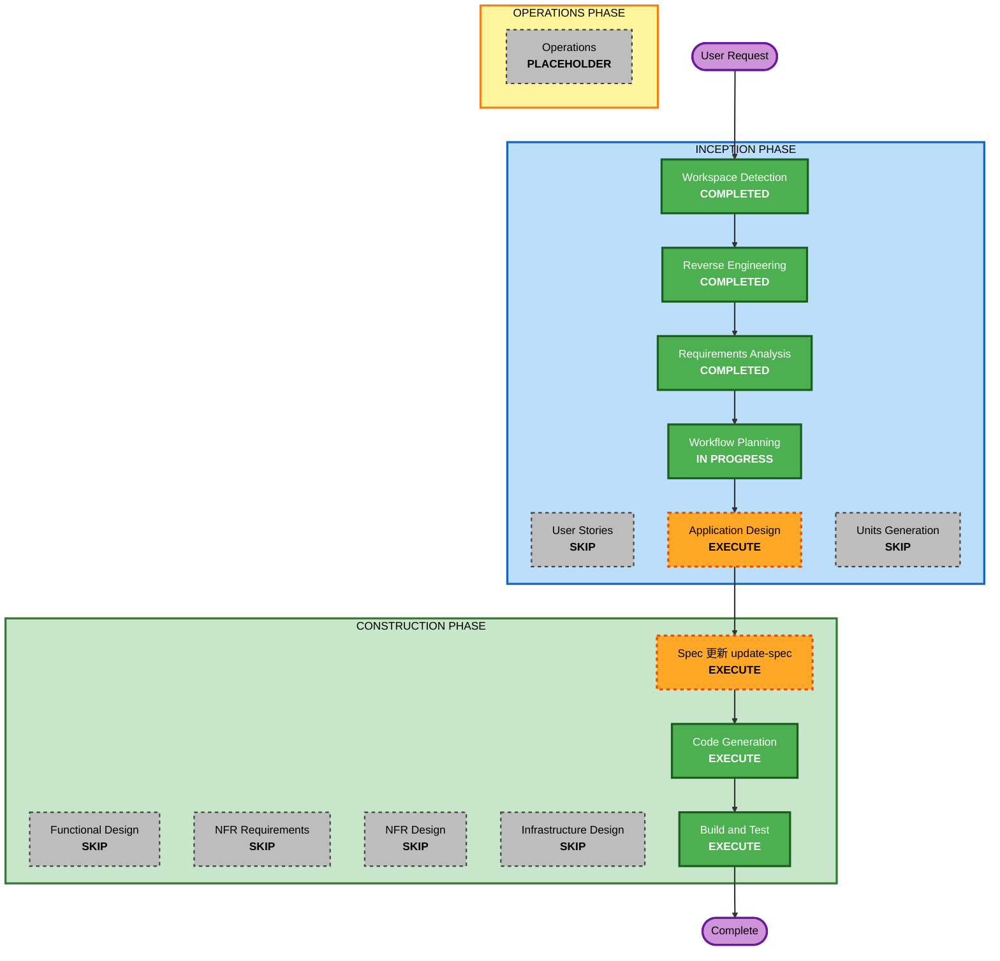

# Execution Plan: リソース一覧の検索・フィルタ追加（Issue #23）

## Detailed Analysis Summary

### Transformation Scope (Brownfield Only)
- **Transformation Type**: Single component（リソース一覧機能の拡張。BE・FE の縦切り 1 本）
- **Primary Changes**: `GET /api/resources` への `keyword` 追加、`ResourceFilterForm` へのキーワード入力欄追加
- **Related Components**: backend（Controller / Service / Repository）、frontend（page / ResourceFilterForm / Server Action）、spec 2 ファイル

### Change Impact Assessment
- **User-facing changes**: Yes — `/resources` のフィルタフォームにキーワード入力欄が加わる
- **Structural changes**: No — 4 層構成・新規コンポーネントなし（Repository の問い合わせ方式は設計で決定）
- **Data model changes**: No — スキーマ・Flyway 変更なし
- **API changes**: Yes — `GET /api/resources` に任意パラメータ `keyword`（後方互換）
- **NFR impact**: No — 拡張 3 種は No。性能・セキュリティの新規要件なし（バインドパラメータの使用のみ）

### Component Relationships (Brownfield Only)
- **Primary Component**: backend の `ResourceService` / `ResourceRepository`
- **Infrastructure Components**: なし
- **Shared Components**: なし
- **Dependent Components**: frontend（`listResourcesAction` → `resources/page.tsx` → `ResourceFilterForm`）
- **Supporting Components**: `api-spec.md` / `screen-spec.md`（Spec-first の更新対象）

| Component | Change Type | Change Reason | Priority |
|-----------|-------------|---------------|----------|
| ResourceRepository | Major | 検索条件の追加（方式は Application Design で決定） | Critical |
| ResourceService | Minor | keyword の正規化と両経路（通常 / from-to）への適用 | Critical |
| ResourceController | Minor | `keyword` の受け取りと Service への受け渡し | Critical |
| ResourceFilterForm / page.tsx / resources.ts | Minor | 入力欄・SearchParams・API パラメータ | Important |
| api-spec.md / screen-spec.md | Minor | Spec-first での仕様追記 | Critical |

### Risk Assessment
- **Risk Level**: Low
- **Rollback Complexity**: Easy（任意パラメータの追加のみ。スキーマ変更なし）
- **Testing Complexity**: Moderate（Repository 層の統合テストが新規。既存に前例がない）

## Workflow Visualization



テキスト代替:

```
WD(done) -> RE(done) -> RA(done) -> WP(in progress)
  -> Application Design(EXECUTE) -> Spec 更新(EXECUTE)
  -> Code Generation(EXECUTE) -> Build and Test(EXECUTE) -> Complete
SKIP: User Stories / Units Generation / Functional Design /
      NFR Requirements / NFR Design / Infrastructure Design
```

## Phases to Execute

### INCEPTION PHASE
- [x] Workspace Detection (COMPLETED)
- [x] Reverse Engineering (COMPLETED)
- [x] Requirements Analysis (COMPLETED)
- [ ] User Stories - SKIP
  - **Rationale**: 利用者が直接触れる変更だが、ペルソナは既存 3 ロールで差異なく、単一の検索機能。受入条件はシートと requirements.md に既にある。要件承認時に追加の指示なし
- [x] Workflow Planning (IN PROGRESS)
- [ ] Application Design - EXECUTE
  - **Rationale**: requirements.md の「設計上の検討事項」（`%` と `_` の扱い、キーワード入力欄の UI 文言）を決める必要がある。併せて Repository の問い合わせ方式（`Specification` / `@Query` / 派生クエリ）と、keyword の正規化の置き場所（Controller / Service）を決める。新規コンポーネントは想定せず軽量な深度で行う
- [ ] Units Generation - SKIP
  - **Rationale**: 縦切り 1 本で分解不要。unit は単一（`resource-list-filter`）とし、Code Generation を 1 回実施する

### CONSTRUCTION PHASE
- [ ] Functional Design - SKIP
  - **Rationale**: 新規データモデルなし。業務ルールは「部分一致・OR・trim・AND 組み合わせ」で requirements.md に確定済み、残る判断は Application Design で扱う
- [ ] NFR Requirements - SKIP
  - **Rationale**: 新規の性能・セキュリティ要件なし。拡張 3 種はいずれも No
- [ ] NFR Design - SKIP
  - **Rationale**: NFR Requirements をスキップするため
- [ ] Infrastructure Design - SKIP
  - **Rationale**: インフラ変更なし
- [ ] Spec 更新（`/update-spec`）- EXECUTE（BookFlow の Spec-first）
  - **Rationale**: `api-spec.md` §`GET /api/resources` と `screen-spec.md` §`/resources` を Code Generation より前に更新する。Application Design の決定事項（`%` と `_`、UI 文言）を反映する
- [ ] Code Generation - EXECUTE (ALWAYS)
  - **Rationale**: BE・FE 実装とテスト（Repository 統合テストを含む）
- [ ] Build and Test - EXECUTE (ALWAYS)
  - **Rationale**: BE の `./gradlew test` / `spotlessApply` / `checkstyleMain`、FE の `pnpm test` / `lint` / `format:check` を実行して検証する

### OPERATIONS PHASE
- [ ] Operations - PLACEHOLDER
  - **Rationale**: BookFlow では CI（`CI Frontend` / `CI Backend`）を Operations 相当として運用する

## Package Change Sequence (Brownfield Only)
1. docs-next/docs/spec（api-spec・screen-spec）— Spec-first
2. backend — Repository → Service → Controller → テスト（FE が依存する API 契約の確定）
3. frontend — Server Action → page → ResourceFilterForm → テスト
- **Update Approach**: Sequential（FE は BE の API 契約に依存。同一 unit 内で縦切りに進める）
- **Testing Checkpoints**: BE 完了時に BE テスト、FE 完了時に FE テストと lint・format

## Estimated Timeline
- **Total Phases**: 実行 5 ステージ（Application Design / Spec 更新 / Code Generation / Build and Test + 本 Planning）
- **Estimated Duration**: シート記載の 2〜3 時間（Repository 統合テストの新設分は増える可能性あり）

## Success Criteria
- **Primary Goal**: `keyword` でリソース名・説明を部分一致検索でき、既存フィルタと AND で組み合わせられる
- **Key Deliverables**: spec 更新 2 件、BE 実装とテスト、FE 実装とテスト、Build and Test 手順書
- **Quality Gates**: 受入条件 6 項目の充足、既存テストの pass、Spotless / Checkstyle / oxlint / oxfmt の通過
