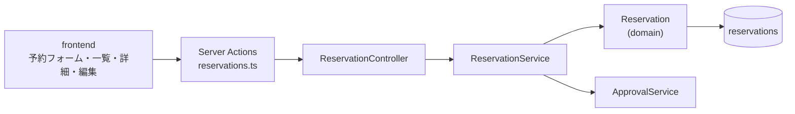
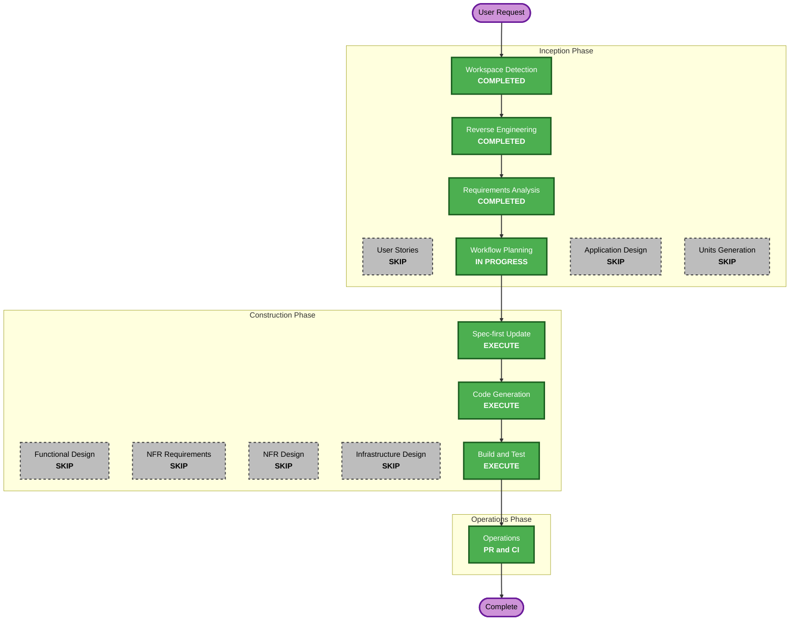

# Execution Plan: 予約の下書き保存

## Detailed Analysis Summary

### Transformation Scope（Brownfield）

- **Transformation Type**: Single component change（予約ドメイン内の機能追加。アーキテクチャ変更・デプロイモデル変更なし）
- **Primary Changes**: 予約ステータス `DRAFT` の生成・更新・正式申請・削除を追加し、閲覧権限と一覧・詳細・編集・申請フォームの画面を対応させる
- **Related Components**:
  - backend: `ReservationController` / `ReservationService` / `Reservation` / `CreateReservationRequest` / `UpdateReservationRequest` / `ReservationRepository`（変更不要の見込み）/ `ApprovalService`（呼び出しのみ）
  - frontend: `ReservationForm` / `ReservationEditForm` / 予約一覧・詳細・編集ページ / `reservations.ts`（Server Actions）/ `reservation.ts`（Zod スキーマ）/ `labels.ts`・`enums.ts`（確認のみ）
  - docs: `api-spec.md` / `screen-spec.md` / `requirements.md`（状態遷移図を含む）/ `er-diagram.md`

### Change Impact Assessment

| 観点 | 影響 | 説明 |
|---|---|---|
| User-facing changes | Yes | 申請フォームに「下書き保存」、一覧に「下書き」タブ、詳細に「編集・正式申請・削除」を追加 |
| Structural changes | No | 新規コンポーネント・サービス層は不要。4 層の境界内で完結 |
| Data model changes | No | `reservations.status` の CHECK に `DRAFT` は定義済み。Flyway 追加なし |
| API changes | Yes | `POST` に `draft`、`PUT` に `DRAFT` 更新と正式申請、`DELETE /api/reservations/{id}` を新設 |
| NFR impact | No | 拡張 3 種は不採用。正式申請の直列化は既存の悲観ロック方式を踏襲 |

### Component Relationships

- **Primary Component**: `ReservationService`（遷移判定・権限・重複チェック・承認ステップ生成の分岐をここに集約）
- **Shared Components**: `frontend/src/lib/types/api.ts`、`ReservationResponse`（変更不要の見込み）
- **Dependent Components**: `ApprovalService`（正式申請で `createInitialStep` を呼ぶ。承認一覧は `approval_steps` 経由のため下書きは自然に出ない）
- **Supporting Components**: 仕様書 4 点（Spec-first）

| 構成要素 | Change Type | Priority |
|---|---|---|
| `ReservationService` | Major | Critical |
| `Reservation`（遷移メソッド追加） | Minor | Critical |
| `ReservationController`（DELETE 追加） | Minor | Critical |
| 2 つの Request DTO | Minor | Critical |
| 予約フォーム・一覧・詳細・編集ページ | Major | Important |
| Server Actions・Zod スキーマ | Minor | Important |
| 仕様書 4 点・状態遷移図 | Major | Critical（実装より先） |

### Risk Assessment

- **Risk Level**: Medium（`POST`/`PUT` の既存挙動に分岐を足すため回帰リスクがある。権限分岐が 3 ロールにまたがる。競合課題 2 件と同じ API・画面を触る）
- **Rollback Complexity**: Easy（DB 変更なし。コード差分の取り消しのみ）
- **Testing Complexity**: Moderate（状態遷移 × 権限 × `requires_approval` の組み合わせを網羅する必要がある）

## Workflow Visualization

## Phases to Execute

### INCEPTION PHASE

- [x] Workspace Detection (COMPLETED)
- [x] Reverse Engineering (COMPLETED: 予約ドメイン分を追加)
- [x] Requirements Analysis (COMPLETED)
- [ ] User Stories: SKIP
  - **Rationale**: 利用者は予約申請者（MEMBER）一人称の機能拡張で、ADMIN と APPROVER の扱いも受入条件で確定済み。受入条件は要件定義書に揃っている
- [x] Workflow Planning (IN PROGRESS)
- [ ] Application Design: SKIP
  - **Rationale**: 新規コンポーネント・サービスなし。既存の `ReservationService` / `Reservation` にメソッドを足す範囲で、責務の置き場所は要件 NFR-03 で確定済み
- [ ] Units Generation: SKIP
  - **Rationale**: 縦切り 1 ユニット（`reservation-draft`）で完結する

### CONSTRUCTION PHASE（ユニット: `reservation-draft`）

- [ ] Functional Design: SKIP
  - **Rationale**: 状態遷移・権限・エラーの振る舞いは要件定義書で確定済み。残る細部（正式申請を指示する項目の名称、DELETE の成功ステータス）は次の仕様更新で確定する
- [ ] NFR Requirements: SKIP
  - **Rationale**: 拡張 3 種が不採用で、新規の非機能要求がない（NFR-01〜04 は既存方式の踏襲）
- [ ] NFR Design: SKIP
  - **Rationale**: NFR Requirements を SKIP するため連動
- [ ] Infrastructure Design: SKIP
  - **Rationale**: IaC・インフラ変更なし
- [ ] Spec-first 更新（`/update-spec`）: EXECUTE
  - **Rationale**: 仕様が真実の源。実装より先に `api-spec.md` / `screen-spec.md` / `requirements.md`（状態遷移図を含む）/ `er-diagram.md` を更新する。ここで正式申請を指示する項目の名称（仮称 `submit`）と DELETE の応答を確定する
- [ ] Code Generation: EXECUTE（必須）
  - **Rationale**: 実装計画（番号付きステップとチェックボックス）を作成して承認を得た後、バックエンド→フロントエンドの順に実装する
- [ ] Build and Test: EXECUTE（必須）
  - **Rationale**: `./gradlew test spotlessApply checkstyleMain`、`pnpm lint` / `pnpm test` / `pnpm build`、`docs-next` の `npm run build` で検証する

### OPERATIONS PHASE

- [ ] Operations: BookFlow 翻案（コミット・push、PR 作成、CI 確認）
  - **Rationale**: `/commit-push` と `/create-pr` の確認ゲートを経て、CI Frontend / CI Backend の通過を確認する

## 実装の進め方（Code Generation の想定ステップ）

| 順 | 内容 | 主な対象 |
|---|---|---|
| 1 | ドメイン: `Reservation` に正式申請の遷移メソッドを追加 | `Reservation.java` |
| 2 | DTO: `draft`（POST）と正式申請の指示項目（PUT）を追加 | 2 つの Request DTO |
| 3 | Service: 下書き作成、`DRAFT` 更新、正式申請（重複チェック・承認ステップ生成の分岐）、削除、閲覧権限の分岐、`PUT` ガード変更 | `ReservationService.java` |
| 4 | Controller: `DELETE` 追加 | `ReservationController.java` |
| 5 | バックエンドのテスト: 状態遷移（`DRAFT`→`PENDING` / `APPROVED`）、権限、削除、承認一覧への非表示、重複時に `DRAFT` 維持 | `ReservationServiceTest` / `ReservationControllerTest` |
| 6 | フロント: Zod スキーマと Server Actions（下書き保存・正式申請・削除） | `reservation.ts` / `reservations.ts` |
| 7 | フロント: 申請フォームの「下書き保存」、一覧の「下書き」タブ | `ReservationForm.tsx` / 一覧ページ |
| 8 | フロント: 詳細の操作（編集・正式申請・削除）と編集ページの `DRAFT` 許可 | 詳細・編集ページ |
| 9 | フロントのテスト（Vitest + MSW） | `tests/unit/` |

バックエンドを先に実装し、API 契約が固まってからフロントに進める。

## Estimated Timeline

- **Total Stages to Execute**: 4（Spec-first 更新・Code Generation・Build and Test・Operations。INCEPTION の 4 ステージは完了済み、7 ステージは SKIP）
- **Estimated Duration**: 1〜2 日（シートの見積り半日〜1日に、DELETE API の新設と権限分岐のテストが加わる）

## Success Criteria

- **Primary Goal**: 予約を `DRAFT` として保存し、再編集・正式申請・削除できる
- **Key Deliverables**: 更新済みの仕様書 4 点、`DRAFT` 対応のバックエンド（`POST` / `PUT` / `DELETE`）、フロントの 4 画面、対応するテスト
- **Quality Gates**:
  - 要件定義書の受入条件 8 項目をすべて満たす
  - `./gradlew test spotlessCheck checkstyleMain` と `pnpm lint` / `format:check` / `test` / `build` が成功する
  - `docs-next` の `npm run build` が成功する（リンク・アンカー破損なし）
  - 既存の `PENDING` / `APPROVED` の申請・更新・キャンセルの挙動が変わらない（回帰テスト）
