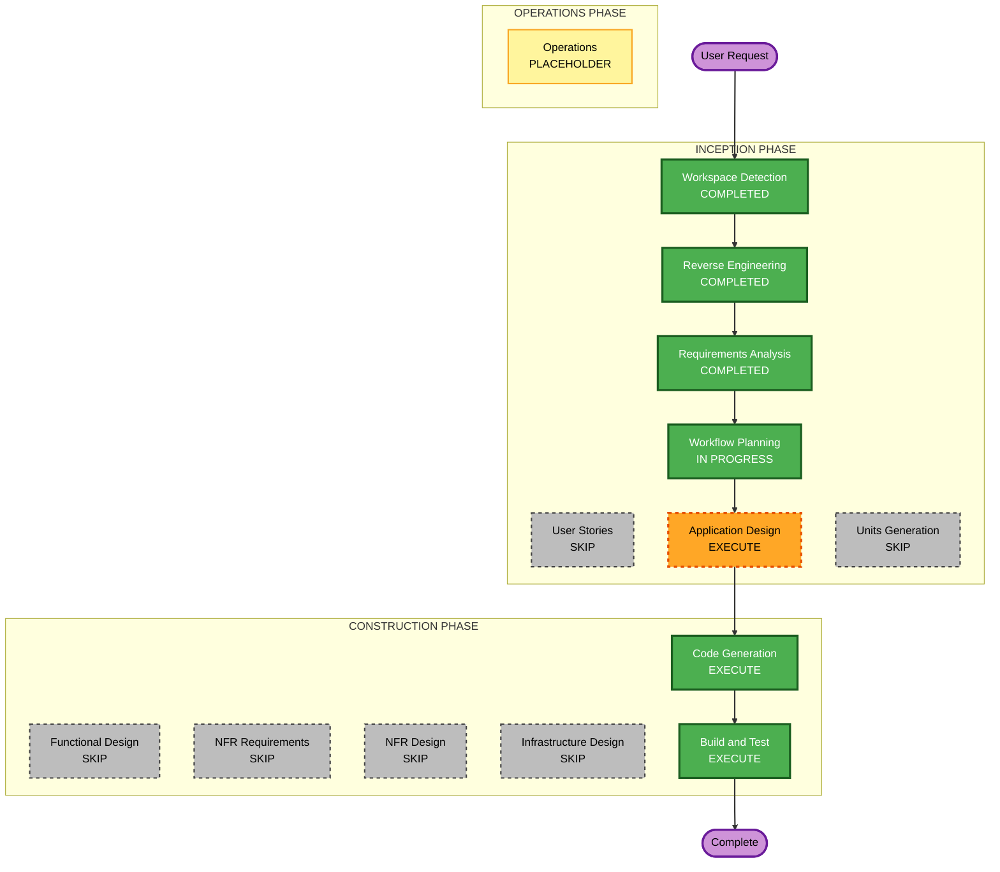

# Execution Plan

## Detailed Analysis Summary

### Transformation Scope (Brownfield Only)
- **Transformation Type**: Single component change（既存 API とフォームの拡張。アーキテクチャ変更なし）
- **Primary Changes**: `GET /api/resources` への `keyword` 追加（BE）、`ResourceFilterForm` と一覧ページへの反映（FE）
- **Related Components**: ResourceController / ResourceService / ResourceRepository、`resources/page.tsx` / `ResourceFilterForm.tsx` / `resources.ts`

### Change Impact Assessment
- **User-facing changes**: Yes。キーワード入力欄と 0 件メッセージが加わる
- **Structural changes**: Minor。BE の検索条件を `Specification` に集約する
- **Data model changes**: No。DB スキーマ変更なし
- **API changes**: Yes（後方互換）。任意の `keyword` を追加
- **NFR impact**: No。入力検証のみ（100 文字、LIKE エスケープ）

### Component Relationships (Brownfield Only)
- **Primary Component**: backend（resource 系）、frontend（/resources）
- **Infrastructure Components**: なし
- **Shared Components**: なし
- **Dependent Components**: frontend は backend の REST に依存。後続課題（reservation-list-filter、resource-list-sort）が同じ構造を再利用する見込み
- **Change Type / Priority**: backend Minor・Critical path、frontend Minor・backend の後

### Risk Assessment
- **Risk Level**: Low
- **Rollback Complexity**: Easy
- **Testing Complexity**: Simple〜Moderate（from/to 経路との AND 条件と LIKE エスケープの確認が要点）

## Workflow Visualization



### Text Alternative
```
INCEPTION:    WD(done) -> RE(done) -> RA(done) -> WP(now) -> AD(execute)
              US(skip), UG(skip)
CONSTRUCTION: CG(execute) -> BT(execute)
              FD, NFR Req, NFR Design, Infra Design (all skip)
OPERATIONS:   placeholder (CI Frontend / CI Backend が相当)
```

## Phases to Execute

### INCEPTION PHASE
- [x] Workspace Detection (COMPLETED)
- [x] Reverse Engineering (COMPLETED)
- [x] Requirements Analysis (COMPLETED)
- [ ] User Stories - SKIP
  - **Rationale**: ペルソナは全ロール共通の 1 つで、受入条件は要件シートに揃っている
- [x] Workflow Planning (IN PROGRESS)
- [ ] Application Design - EXECUTE
  - **Rationale**: `Specification` の導入は新しいコンポーネントとメソッドの定義を伴う。Q4 で保留した「`Specification` か `@Query` か」の最終確定もここで行う（軽量に実施）
- [ ] Units Generation - SKIP
  - **Rationale**: BE と FE を縦切りの 1 ユニットで実装する。分割の必要がない

### CONSTRUCTION PHASE
- [ ] Functional Design - SKIP
  - **Rationale**: 業務ルール（空白除去・エスケープ・100 文字）は requirements.md で確定済み。新しいデータモデルなし
- [ ] NFR Requirements - SKIP
  - **Rationale**: 性能・セキュリティの新規要件なし。拡張ルールは No
- [ ] NFR Design - SKIP
  - **Rationale**: NFR Requirements を実施しないため
- [ ] Infrastructure Design - SKIP
  - **Rationale**: インフラ変更なし
- [ ] Code Generation - EXECUTE (ALWAYS)
  - **Rationale**: 実装。着手前に `/update-spec` で api-spec.md と screen-spec.md を更新する（Spec-first）
- [ ] Build and Test - EXECUTE (ALWAYS)
  - **Rationale**: `./gradlew test`、`pnpm test`、lint、format の検証

### OPERATIONS PHASE
- [ ] Operations - PLACEHOLDER
  - **Rationale**: BookFlow では CI（CI Frontend / CI Backend）が相当

## Package Change Sequence (Brownfield Only)
1. docs-next/docs/spec（`/update-spec`）
2. backend（Specification、Service、Controller、テスト）
3. frontend（Action、フォーム、ページ、テスト）

## Estimated Timeline
- **Total Phases**: 実行 4 ステージ（Application Design、Code Generation、Build and Test と、完了済みの Inception 3 つ）
- **Estimated Duration**: シート記載の 2〜3 時間

## Success Criteria
- **Primary Goal**: keyword でリソース名・説明を部分一致検索できる
- **Key Deliverables**: api-spec と screen-spec の更新、BE と FE の実装、追加テスト
- **Quality Gates**: シートの受入条件 6 項目、既存テスト pass、lint と format の pass
