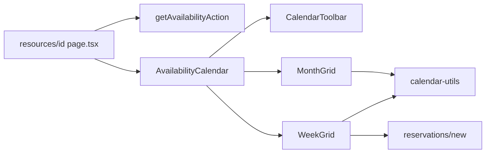
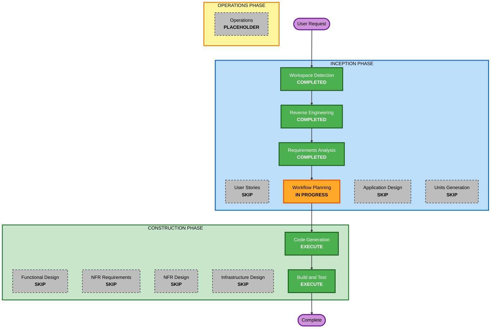

# Execution Plan: カレンダービュー

## Detailed Analysis Summary

### Transformation Scope (Brownfield Only)
- **Transformation Type**: Single component change（リソース詳細画面の表示拡張。frontend のみ）
- **Primary Changes**: 詳細ページへの週/月カレンダーの追加、予約フォームの `startAt`/`endAt` 初期値の受け取り
- **Related Components**: `resources/[id]/page.tsx`、新規 `availability/` コンポーネント群、`reservations/new/page.tsx`、`ReservationForm.tsx`、`screen-spec.md`

### Change Impact Assessment
- **User-facing changes**: Yes（詳細画面にカレンダーが加わり、空き枠から予約フォームへ遷移できる）
- **Structural changes**: No（既存の Server Component と BFF（Server Action）の構成のまま）
- **Data model changes**: No
- **API changes**: No（既存の `GET /api/resources/{id}/availability` を利用。Backend 変更禁止）
- **NFR impact**: No（認可は既存のまま。性能の新要件なし）

### Component Relationships (Brownfield Only)



- **Primary Component**: `resources/[id]/page.tsx`
- **Dependent Components**: `reservations/new`（`startAt`/`endAt` を受け取る側）
- **Shared / Infrastructure / Supporting Components**: なし（`getAvailabilityAction` と `AvailabilitySlotSchema` は変更しない）

| コンポーネント | Change Type | Change Reason | Priority |
|---|---|---|---|
| `resources/[id]/page.tsx` | Moderate | `searchParams` から期間を算出し、カレンダーを描画。既存リストは残す | Critical |
| `availability/calendar-utils.ts`（新規） | New | 期間算出、ローカル整形、占有判定、Asia/Tokyo 基準の現在時刻 | Critical |
| `availability/WeekGrid.tsx`（新規） | New | 8-20 時の 1 時間枠グリッド。空き・予約済み・過去・無効の表示 | Critical |
| `availability/CalendarToolbar.tsx`（新規） | New | 前へ/今日/次へ、週/月切替（`<Link>`） | Critical |
| `availability/MonthGrid.tsx`（新規） | New | 日セルと件数。クリックで週表示へ | Important |
| `availability/AvailabilityCalendar.tsx`（新規） | New | ビューの振り分け | Important |
| `reservations/new/page.tsx` | Minor | `startAt`/`endAt` を読み、フォームへ渡す | Critical |
| `reservations/new/ReservationForm.tsx` | Minor | 初期値の受け取り（形式検証つき） | Critical |
| `screen-spec.md` | Minor | Spec-first の仕様更新 | Critical |
| `getAvailabilityAction`、`backend/` | 変更なし | Backend 変更禁止 | - |

### Risk Assessment
- **Risk Level**: Low から Medium（Backend には影響しないが、日付とタイムゾーンの扱いに不具合が入りやすい）
- **Rollback Complexity**: Easy（frontend のコミットの取り消しだけで戻せる）
- **Testing Complexity**: Moderate（月またぎ、枠の境界、過去判定、UTC 実行環境の組み合わせ）
- **主なリスクと対策**:
  - タイムゾーンのずれ → 現在時刻を Asia/Tokyo で扱う純関数に集約し、固定時刻の入力でテストする
  - 同じ詳細画面を変更する他課題との競合（`resource-detail-info`、`resource-image-upload`） → 詳細ページへの変更を最小にし、カレンダーは `availability/` に閉じる

## Workflow Visualization



### Text Alternative

```
INCEPTION:    Workspace Detection (COMPLETED) -> Reverse Engineering (COMPLETED)
              -> Requirements Analysis (COMPLETED) -> Workflow Planning (IN PROGRESS)
              User Stories / Application Design / Units Generation (SKIP)
CONSTRUCTION: Functional Design / NFR Requirements / NFR Design /
              Infrastructure Design (SKIP)
              Code Generation (EXECUTE) -> Build and Test (EXECUTE)
OPERATIONS:   PLACEHOLDER（CI 品質ゲートで代替）
```

## Phases to Execute

### INCEPTION PHASE
- [x] Workspace Detection (COMPLETED)
- [x] Reverse Engineering (COMPLETED)
  - **Rationale**: 既存の成果物（`reverse-engineering/`）を再利用する
- [x] Requirements Analysis (COMPLETED、承認待ち)
- [x] User Stories (SKIPPED)
  - **Rationale**: 利用者像は一覧・詳細を見る全ロール 1 種類で、受入条件はシートにすでにある
- [x] Workflow Planning (IN PROGRESS)
- [ ] Application Design - SKIP
  - **Rationale**: 新しいコンポーネントはあるが、1 つの画面内の表示部品で、サービス層や境界の設計は要らない。コンポーネント構成は本計画の表で示した
- [ ] Units Generation - SKIP
  - **Rationale**: 分解の必要がなく、単一ユニット `calendar-view`（縦切り 1 本、Issue #27）として Code Generation に進む

### CONSTRUCTION PHASE
- [ ] Functional Design - SKIP
  - **Rationale**: 業務ルール（枠の判定、過去・無効の扱い、期間算出）は requirements.md の FR-05 から FR-12 で確定済みで、データモデルの変更もない。細部は `calendar-utils` のテスト先行で固める。**変更の余地あり**：日付計算が複雑だと感じる場合は EXECUTE に変更できる
- [ ] NFR Requirements - SKIP
  - **Rationale**: 性能・セキュリティの新要件がなく、拡張機能も 3 つとも無効
- [ ] NFR Design - SKIP
  - **Rationale**: NFR Requirements を実行しないため
- [ ] Infrastructure Design - SKIP
  - **Rationale**: インフラ・デプロイの変更がない
- [ ] Code Generation - EXECUTE (ALWAYS)
  - **Rationale**: 実装が必要。計画の最初のステップで `/update-spec` による仕様更新（Spec-first）を行う。計画は `Docs/spec/aidlc-docs/construction/plans/calendar-view-code-generation-plan.md` に作成し、承認を得てから実装する
- [ ] Build and Test (EXECUTE, ALWAYS)
  - **Rationale**: `pnpm test`、`pnpm lint`、`pnpm format:check`、`pnpm build` の検証が必要。Backend は変更しないため実行しない（変更がないことを `git diff --stat` で確認する）

### OPERATIONS PHASE
- [ ] Operations - PLACEHOLDER
  - **Rationale**: BookFlow では CI の品質ゲート（`CI Frontend`）で代替する

## Code Generation の想定ステップ（詳細は次ステージの計画で確定）

テスト先行で、依存の少ない順に進める。

1. `/update-spec`：`screen-spec.md` の `/resources/{id}` と `/reservations/new` を更新する（Spec-first）
2. `calendar-utils.ts` とそのテスト（`frontend/tests/unit/`）：期間算出（週・月、月またぎ）、ローカル整形、占有判定（半開区間）、Asia/Tokyo 基準の現在時刻と過去判定、`view`/`date` の検証とフォールバック
3. `CalendarToolbar.tsx` と `WeekGrid.tsx`：空き（リンク）、予約済み、過去、無効の 4 状態
4. `page.tsx`：`searchParams` を受け取り、期間に応じて `getAvailabilityAction` を呼ぶ。既存リストは残す。取得失敗時はカレンダー領域にメッセージを表示する
5. `ReservationForm.tsx` と `reservations/new/page.tsx`：`startAt`/`endAt` の初期値（形式検証つき）とテスト
6. `MonthGrid.tsx` と `AvailabilityCalendar.tsx`：日セルの件数、クリックで週表示へ
7. 検証：`pnpm test`、`pnpm lint`、`pnpm format:check`、`pnpm build`。dev 専用ログインで、`resource.isActive` が true と false のリソースを目視確認する
8. 成果物：`construction/calendar-view/code/summary.md` を作成する

**MVP の区切り**：ステップ 1 から 5 までで「週表示 + 移動 + 空き枠から予約フォーム + グレーアウト」が完成する。ステップ 6 の月表示を加えて、受入条件を満たす。

## Package Change Sequence (Brownfield Only)

- **Update Approach**: Sequential（仕様、純関数、表示部品、ページ、予約フォームの順）
- **Critical Path**: `calendar-utils`（他の全ての部品が依存する）
- **Coordination Points**: `startAt`/`endAt` の形式（`YYYY-MM-DDTHH:mm`）を `screen-spec.md` に固定する（詳細ページと予約フォームの共通の約束）
- **Testing Checkpoints**: ステップ 2 と 5 の後に `pnpm test`。最後に全検証を通す

## 影響ファイル一覧

- 変更：
  - `frontend/src/app/(authenticated)/resources/[id]/page.tsx`
  - `frontend/src/app/(authenticated)/reservations/new/page.tsx`
  - `frontend/src/app/(authenticated)/reservations/new/ReservationForm.tsx`
  - `docs-next/docs/spec/screen-spec.md`
- 新規：
  - `frontend/src/app/(authenticated)/resources/[id]/availability/`（`AvailabilityCalendar.tsx`、`CalendarToolbar.tsx`、`WeekGrid.tsx`、`MonthGrid.tsx`、`calendar-utils.ts`）
  - `frontend/tests/unit/` 配下の `calendar-utils` のテスト、フォーム初期値のテスト
- 変更なし：`backend/` 全体、`getAvailabilityAction`、`AvailabilitySlotSchema`、`api-spec.md`、`er-diagram.md`、`.claude/` 配下（`agent-config.md` の同期は不要）

## AI-DLC 成果物の一覧

| ステージ | 成果物 | 状態 |
|---|---|---|
| Requirements Analysis | `Docs/spec/aidlc-docs/inception/requirements/requirements.md` | 作成済み（承認待ち） |
| Workflow Planning | `Docs/spec/aidlc-docs/inception/plans/execution-plan.md`（本ファイル） | 作成済み（承認待ち） |
| Code Generation（Part 1） | `Docs/spec/aidlc-docs/construction/plans/calendar-view-code-generation-plan.md` | 未作成 |
| Code Generation（Part 2） | `Docs/spec/aidlc-docs/construction/calendar-view/code/summary.md` | 未作成 |
| Build and Test | `Docs/spec/aidlc-docs/construction/build-and-test/` の 4 ファイル | 未作成（前ユニットの内容を置き換える） |
| 進捗・監査 | `Docs/spec/aidlc-state.md`、`Docs/spec/aidlc-audit.md`（追記専用） | 更新済み |
| Spec-first | `docs-next/docs/spec/screen-spec.md` | Code Generation のステップ 1 で更新 |

## Estimated Timeline
- **Total Phases**: 実行 2 ステージ（Code Generation、Build and Test）
- **Estimated Duration**: 課題シートの推定工数は半日から 1 日

## Success Criteria
- **Primary Goal**: リソース詳細画面で、週・月のカレンダーから空き枠を選んで予約フォームへ進める
- **Key Deliverables**: 更新済みの仕様、`availability/` 一式、予約フォームの初期値受け取り、追加テスト
- **Quality Gates**: 受入条件 6 項目と追加の受入観点、lint とフォーマット、frontend のテストと build がすべて pass、`backend/` の差分がゼロ
- **Integration Testing**: 詳細画面で空き枠をクリックし、予約フォームに日時が入ることを dev 専用ログインで確認する
