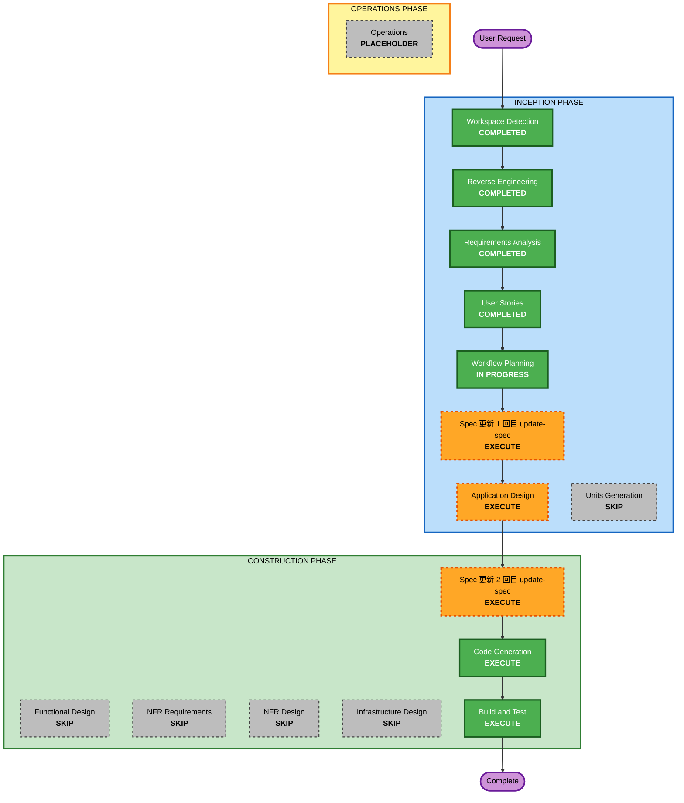

# Execution Plan: CSV 帳票出力（Issue #29）

## 入力

- Reverse Engineering：`Docs/spec/aidlc-docs/inception/reverse-engineering/`（承認済み 2026-10-24T04:05:00+00:00）
- Requirements：`Docs/spec/aidlc-docs/inception/requirements/requirements.md`（承認済み 2026-10-24T04:30:00+00:00）
- User Stories：`Docs/spec/aidlc-docs/inception/user-stories/stories.md`・`personas.md`（承認済み 2026-10-24T05:15:00+00:00。US-1〜US-4、受入条件 18 件）
- 確認質問は BookFlow の運用（`.claude/rules/aidlc-questions.md`）により `AskUserQuestion` で実施し、回答は `requirements.md` と監査ログに記録済み（`requirement-verification-questions.md` は作成していない）

## Detailed Analysis Summary

### Transformation Scope (Brownfield Only)
- **Transformation Type**: Single component（予約データの帳票出力機能の追加。BE・FE の縦切り 1 本）
- **Primary Changes**: 新規エンドポイント `GET /api/reports/reservations/csv`（ADMIN 限定、`text/csv`）、`/reservations` への ADMIN 限定のダウンロード UI、BFF の非 JSON 応答の中継経路
- **Related Components**: backend（新規 Controller / Service / CSV 生成、`ReservationRepository` の取得方式）、frontend（`reservations/page.tsx`、新規の取得経路とダウンロード UI）、spec（`api-spec.md` / `screen-spec.md`、必要に応じて `requirements.md`）

### Change Impact Assessment
- **User-facing changes**: Yes。ADMIN の `/reservations` に CSV ダウンロード UI が加わる。MEMBER / APPROVER の表示は変えない
- **Structural changes**: Yes（小）。4 層構成の中に帳票用の Controller と Service を新設する。FE には `api-client.ts`（JSON 専用）を通らない取得経路が加わる
- **Data model changes**: No。スキーマ・Flyway 変更なし（`start_at` のインデックス追加も要件にない）
- **API changes**: Yes。新規エンドポイント 1 本（既存 API は不変）
- **NFR impact**: Yes（小）。ADMIN 限定の認可（既存の `@PreAuthorize` 方式）、大量データ時の応答方式。拡張 3 種は No

### Component Relationships (Brownfield Only)
- **Primary Component**: backend の帳票 Controller / Service（新規）と予約データの取得
- **Infrastructure Components**: なし
- **Shared Components**: 承認状態の日本語表示名（FE の `labels.ts` と同じ文言を BE でも使う。持ち方は Application Design で決定）
- **Dependent Components**: frontend（取得経路 → ダウンロード UI → `reservations/page.tsx`）
- **Supporting Components**: `api-spec.md` / `screen-spec.md` / `requirements.md`（Spec-first の更新対象）

| Component | Change Type | Change Reason | Priority |
|-----------|-------------|---------------|----------|
| 帳票 Controller（新規） | Major | エンドポイント新設、`@PreAuthorize`、パラメータ検証（片方指定・`from` ≧ `to`） | Critical |
| 帳票 Service / CSV 生成（新規） | Major | 絞り込み・並び順・表記・BOM・エスケープ・0 件時 | Critical |
| ReservationRepository（または Specification） | Minor〜Major | ページングなしの全件取得、期間条件、開始日時の昇順（方式は Application Design で決定） | Critical |
| FE 取得経路（Route Handler または Server Action、新規） | Major | JWT をサーバー側で付けて CSV を中継（方式は Application Design で決定） | Critical |
| FE ダウンロード UI（新規）と `reservations/page.tsx` | Minor | ADMIN のときだけ表示、条件の入力 | Important |
| api-spec.md / screen-spec.md / requirements.md | Minor | Spec-first での仕様追記 | Critical |

### Risk Assessment
- **Risk Level**: Medium（追加のみで既存 API は変えないが、BFF の非 JSON 中継という前例のない経路を含む）
- **Rollback Complexity**: Easy（新規ファイル中心。スキーマ変更なし）
- **Testing Complexity**: Moderate（CSV 生成のユニットテスト、ロール別の Controller 結合テスト、実クエリを通る絞り込みのテスト、FE の取得経路のテスト）

## Workflow Visualization



テキスト代替:

```
WD(done) -> RE(done) -> RA(done) -> US(done) -> WP(in progress)
  -> Spec 更新 1 回目(EXECUTE) -> Application Design(EXECUTE)
  -> Spec 更新 2 回目(EXECUTE) -> Code Generation(EXECUTE)
  -> Build and Test(EXECUTE) -> Complete
SKIP: Units Generation / Functional Design / NFR Requirements /
      NFR Design / Infrastructure Design
```

## Phases to Execute

### INCEPTION PHASE
- [x] Workspace Detection (COMPLETED)
- [x] Reverse Engineering (COMPLETED)
- [x] Requirements Analysis (COMPLETED)
- [x] User Stories (COMPLETED)
- [x] Workflow Planning (IN PROGRESS)
- [ ] Spec 更新 1 回目（`/update-spec`）- EXECUTE（BookFlow の Spec-first、`dev-workflow.md` §4）
  - **Rationale**: 本課題は既存 API の範囲に収まらない（新規エンドポイント）。`dev-workflow.md` §4 は、この場合ステップ 4 では `requirements.md` と `screen-spec.md` の更新にとどめ、`api-spec.md` の詳細は設計の確定後に更新すると定めている。1 回目は、承認済みの要件とストーリーで確定している範囲だけを書く
  - **対象（候補。`/update-spec` で最終特定）**: `screen-spec.md` §`/reservations`（ADMIN にだけ CSV ダウンロード UI を表示すること。入力欄の形などの詳細は 2 回目）、`requirements.md`（シートの「UC-07（CSV・帳票出力）」と同ファイルの UC-07 が一致しない件の扱い）
- [ ] Application Design - EXECUTE
  - **Rationale**: 新規コンポーネント（帳票 Controller / Service / CSV 生成、FE の取得経路とダウンロード UI）がある。`requirements.md` の「設計上の検討事項」9 項目（ダウンロード経路、`StreamingResponseBody` か `byte[]` か、`opencsv` か手書きか、表示名の持ち方、ファイル名と改行コード、画面上の入力 UI、一覧取得の実装、件数上限、CSV インジェクション対策）を決める必要がある
- [ ] Units Generation - SKIP
  - **Rationale**: SKILL.md の基準（複数ユニットへの分解が必要か）で判断した。本課題は縦切り 1 本で、BookFlow では units of work = 縦切り Issue 単位とする（CLAUDE.md）ため、unit は `csv-export` の 1 つとする。`workflow-planning.md` §3.3 は「新規エンドポイント」「複数パッケージの変更」を実行条件に挙げるが、これは単一 unit 内の BE / FE の変更であり、unit の分解を要しない。前課題 #23（API 変更あり）も同じ判断でスキップした

### CONSTRUCTION PHASE
- [ ] Functional Design - SKIP
  - **Rationale**: 新規データモデルなし。業務ルール（期間の判定、両方指定、`from` ≧ `to` の 400、並び順、表記、0 件時、エスケープ）は `requirements.md` と `stories.md` の受入条件で具体値まで確定している
- [ ] NFR Requirements - SKIP
  - **Rationale**: 要件に数値の性能目標・可用性目標はなく、拡張 3 種はいずれも No。実行条件のうち「技術スタックの選定」（`opencsv` の採否）と「性能」（ストリーミングか一括か、件数上限）が部分的に当たるが、いずれも単一コンポーネント内の方式選択で、シートが比較対象を示している。そのため Application Design の検討事項として 1 ステージで扱う。NFR 専用のステージとして扱いたい場合は「Add Skipped Stages」で追加できる
- [ ] NFR Design - SKIP
  - **Rationale**: NFR Requirements をスキップするため
- [ ] Infrastructure Design - SKIP
  - **Rationale**: インフラ・デプロイ構成の変更なし
- [ ] Spec 更新 2 回目（`/update-spec`）- EXECUTE（BookFlow の Spec-first、`dev-workflow.md` §4・§5）
  - **Rationale**: `dev-workflow.md` §5 は、設計で API の詳細が確定したら、コード生成に進む前に `/update-spec` をもう一度実行すると定めている。Application Design の決定を反映し、**Code Generation の開始前に完了させる**
  - **対象（候補）**: `api-spec.md`（新規 §帳票出力 の `GET /api/reports/reservations/csv`：パラメータ、応答ヘッダ、CSV 形式、エラー。エンドポイント一覧への追加）、`screen-spec.md` §`/reservations`（設計で決まった入力 UI・ボタンの詳細）
- [ ] Code Generation - EXECUTE (ALWAYS)
  - **Rationale**: BE・FE の実装とテスト。US-1 → US-2 / US-3 → US-4 の受入条件を検証項目とする
- [ ] Build and Test - EXECUTE (ALWAYS)
  - **Rationale**: BE の `./gradlew test` / `spotlessApply` / `checkstyleMain`、FE の `pnpm test` / `pnpm lint` / `pnpm format:check` で検証する

### OPERATIONS PHASE
- [ ] Operations - PLACEHOLDER
  - **Rationale**: BookFlow では CI（`CI Frontend` / `CI Backend`）を Operations 相当として運用する

## Package Change Sequence (Brownfield Only)
1. docs-next/docs/spec — Spec 更新 1 回目（Application Design の前）
2. docs-next/docs/spec — Spec 更新 2 回目（Application Design の後、Code Generation の前）
3. backend — 予約データの取得 → CSV 生成 → 帳票 Service → 帳票 Controller → テスト（FE が依存する API 契約を先に確定する）
4. frontend — 取得経路 → ダウンロード UI → `reservations/page.tsx` → テスト
- **Update Approach**: Sequential（FE は BE の API 契約に依存。同一 unit 内で縦切りに進める）
- **ストーリーの実装順**: US-1（土台）→ US-2・US-3（絞り込み）→ US-4（ロール制限の確認）。INVEST 点検で記録した US-2〜4 の US-1 への依存に対応する
- **Testing Checkpoints**: BE 完了時に BE テスト、FE 完了時に FE テストと lint・format

## Estimated Timeline
- **Total Phases**: 実行するのは本 Planning の後に 5 ステージ（Spec 更新 1 回目 / Application Design / Spec 更新 2 回目 / Code Generation / Build and Test）
- **Estimated Duration**: シート記載の半日〜1 日（カリキュラム STEP-05 の目安 4〜7 時間）。BFF の非 JSON 中継経路は前例がないため、設計と FE テストで増える可能性がある

## Success Criteria
- **Primary Goal**: ADMIN が `/reservations` から、期間とステータスで絞り込んだ予約一覧を、Excel で文字化けしない CSV としてダウンロードできる。MEMBER / APPROVER は使えない
- **Key Deliverables**: spec 更新（2 回）、BE 実装とテスト（CSV 生成のユニットテストを含む）、FE 実装とテスト、Build and Test 手順書
- **Quality Gates**: `stories.md` の受入条件 18 件とシートの受入条件 5 項目の充足、既存テストの pass、Spotless / Checkstyle / oxlint / oxfmt の通過
- **Integration Testing**: ロール別の Controller 結合テスト（ADMIN 200 / MEMBER 403 / APPROVER 403 / 未認証 401）と、実クエリを通る絞り込みのテストで BE の結合を確認する
