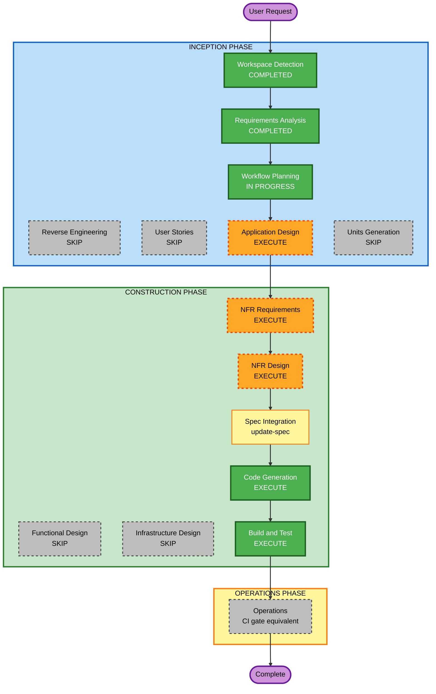

# Execution Plan — CSV 帳票出力（Issue #29）

## Detailed Analysis Summary

### Transformation Scope（Brownfield）

- **Transformation Type**: Single feature addition（新規エンドポイントと新規ページの追加。アーキテクチャ変更・デプロイモデル変更・インフラ変更なし）
- **Primary Changes**: ADMIN 専用の `GET /api/reports/reservations/csv`（BE: presentation / application / domain）、`/admin/reports` ページ・Route Handler・ナビ項目（FE）、仕様書 4 件の更新（docs-next）
- **Related Components**: `ReservationRepository`（期間・ステータス条件付きクエリ追加）、`ReservationStatus`、`labels.ts` の `RESERVATION_STATUS_LABELS`、`nav-items.ts`、`admin/layout.tsx`、`GlobalExceptionHandler`、`SecurityConfig`（変更なし・既存の `@EnableMethodSecurity` を利用）

### Change Impact Assessment

- **User-facing changes**: Yes — 管理者向けの新規ページ「帳票出力」とサイドナビ項目が増え、CSV をダウンロードできる
- **Structural changes**: Yes（小規模）— BE に新規コンポーネント（Report 用 Controller・CSV 組み立てロジック）、FE に Route Handler（ADR-004 の例外）が増える。既存の 4 層構造・コンポーネント境界は変更しない
- **Data model changes**: No — 新規テーブル・カラムなし。Flyway マイグレーション不要
- **API changes**: Yes（後方互換）— 新規エンドポイントの追加のみ。既存 API は変更しない
- **NFR impact**: Yes — Security Baseline（SECURITY-05 / 08 / 15 が blocking）、ストリーミング応答、H2 / PostgreSQL 両対応（NFR-03）

### Component Relationships

- **Primary Components**: BE の Report 系（新規）、FE の `admin/reports`・`app/api/reports/...`（新規）
- **Infrastructure Components**: なし
- **Shared Components**: `ReservationStatus` と日本語ラベル（BE 側にラベル定義が無いため、CSV 用のラベル対応を BE に持たせる必要がある。FE の `labels.ts` と表記を一致させる）
- **Dependent Components**: FE Route Handler は BE の新規エンドポイントに依存する
- **Supporting Components**: `GlobalExceptionHandler`（400 / 403 / 401 の共通エラー形式）、リクエストログ（ADR-017）

| コンポーネント | Change Type | Change Reason | Change Priority |
|---|---|---|---|
| `ReportController`（新規） | Major（新規） | `GET /api/reports/reservations/csv`・`@PreAuthorize("hasRole('ADMIN')")`・パラメータ検証・ストリーミング応答 | Critical |
| 予約 CSV 出力サービス / CSV 組み立てロジック（新規） | Major（新規） | ページ単位読み出し・エスケープ・無害化・BOM・書式 | Critical |
| `ReservationRepository` | Minor | 期間・ステータス条件付きの `JOIN FETCH` クエリ（`CAST` 対策つき）追加 | Critical |
| `app/api/reports/reservations/csv/route.ts`（新規） | Major（新規） | JWT を付与して BE を中継するストリーミング Route Handler | Critical |
| `admin/reports/page.tsx` ほか（新規） | Major（新規） | 絞り込みフォームとダウンロードボタン | Important |
| `nav-items.ts` / `nav-items.test.ts` | Minor | 「帳票出力」を ADMIN のみ表示 | Important |
| 仕様書（`requirements.md` / `api-spec.md` / `screen-spec.md` / `csv-export.md`） | Minor | UC-09・§帳票出力・`/admin/reports`・UC 表記修正 | Important |

### Risk Assessment

- **Risk Level**: Medium
  - 個人情報（申請者名）を一括出力する新規 ADMIN 専用エンドポイントである
  - ストリーミングでは書き出し開始後に HTTP ステータスを変えられない
  - PostgreSQL の null バインド変数型推論は、前回 #76 で実際に本番相当 DB のみで発生した（H2 では検出不能）
  - ADR-004 の例外（Route Handler）を伴う
- **Rollback Complexity**: Easy（新規マイグレーションなし。新規ファイルの追加が中心で、既存機能への影響は `ReservationRepository` と `nav-items.ts` への追記のみ）
- **Testing Complexity**: Moderate（ユニット + 結合 + FE に加え、実 PostgreSQL での手動検証が必要）

## Workflow Visualization



### Text Alternative

```
Phase 1: INCEPTION
  1. Workspace Detection ........ COMPLETED
  2. Reverse Engineering ........ SKIP
  3. Requirements Analysis ...... COMPLETED
  4. User Stories ............... SKIP
  5. Workflow Planning .......... IN PROGRESS
  6. Application Design ......... EXECUTE (Minimal)
  7. Units Generation ........... SKIP
Phase 2: CONSTRUCTION (unit: csv-export)
  8. Functional Design .......... SKIP
  9. NFR Requirements ........... EXECUTE
 10. NFR Design ................. EXECUTE
 11. Infrastructure Design ...... SKIP
 12. Spec Integration (update-spec, engine outside) ... before Code Generation
 13. Code Generation ............ EXECUTE
 14. Build and Test ............. EXECUTE
Phase 3: OPERATIONS ............. CI gate equivalent
```

## Phases to Execute

### INCEPTION PHASE

- [x] Workspace Detection (COMPLETED)
- [x] Reverse Engineering (SKIPPED — 既存成果物が current。予約領域は Requirements Analysis で補完)
- [x] Requirements Analysis (COMPLETED、2026-10-14 承認済み)
- [x] User Stories (SKIPPED)
  - **Rationale**: 技術的には「新規のユーザー向け機能」に該当するが、ペルソナは ADMIN のみの単一ロールで、シナリオと受入条件は `requirements.md`（User Scenarios）とシートの受入条件 5 項目で既に具体化されている。ストーリー化の追加価値が小さいため、Requirements Analysis の承認時に提示したスキップ推奨を採用した（Add User Stories は選択されなかった）。エンジン標準の判定基準からの意識的な逸脱として記録する
- [x] Workflow Planning (IN PROGRESS)
- [ ] Application Design — **EXECUTE（Minimal 深さ）**
  - **Rationale**: 新規コンポーネントが増える（Report 用 Controller、CSV 組み立てロジック、FE の Route Handler・新規ページ）。コンポーネントの責務・メソッド・依存方向（4 層に載せる位置、`StreamingResponseBody` とトランザクション境界、ADR-004 の例外の置き場所）を、実装前に 1 か所で固定する価値がある。既存の境界内に収まる #76 とは異なる
- [ ] Units Generation — **SKIP**
  - **Rationale**: 単一ユニット（`csv-export` = 縦切り Issue #29 の 1 件）で、分解の必要がない。ユニット名は `csv-export`

### CONSTRUCTION PHASE

- [ ] Functional Design — **SKIP**
  - **Rationale**: 新規データモデルなし。業務ルール（絞り込みの意味・列構成・書式・ステータスラベル・数式注入対策・エラー条件）は `requirements.md` の FR-03〜13 に、確認質問の回答つきで確定済み。メソッドレベルの詳細は Application Design と Code Generation 計画で扱う
- [ ] NFR Requirements — **EXECUTE**
  - **Rationale**: Security Baseline（Yes）の blocking 項目（SECURITY-05 / 08 / 15）と、ストリーミング・DB 互換性（NFR-02〜04）を、評価基準つきで確定する
- [ ] NFR Design — **EXECUTE**
  - **Rationale**: NFR Requirements の結果を設計パターンへ落とす（書き出し前の検証・認可、fail closed、ページ単位読み出しとトランザクション、null 許容パラメータの `CAST` パターン、濫用シナリオ 1 件の記述）
- [ ] Infrastructure Design — **SKIP**
  - **Rationale**: インフラ変更なし
- [ ] Spec Integration（エンジン外のスキル `/update-spec`）— **Code Generation の直前に実施**
  - **Rationale**: Spec-first の運用。`requirements.md`（UC-09）、`api-spec.md`（§帳票出力）、`screen-spec.md`（`/admin/reports`）、シート（UC 表記修正）を、コードより先に更新する。`docs-next/docs/` 配下の frontmatter（OKF、`type` 必須）と `docs-next/CLAUDE.md` の文章規範に従い、`npm run build` でリンク・アンカー破損がないことを確認する
- [ ] Code Generation — **EXECUTE**（ALWAYS）
  - **Rationale**: 実装（Part 1 計画 → 承認 → Part 2 生成）。BE → FE の順に実装する
- [ ] Build and Test — **EXECUTE**（ALWAYS）
  - **Rationale**: BE / FE の自動テストと lint / format に加え、**実 PostgreSQL（Docker Compose）上での手動検証**（#76 の教訓）と、CSV を実際に Excel 相当で開いたときの確認、`pnpm build` / `npm run build` を行う

### OPERATIONS PHASE

- [ ] Operations — PLACEHOLDER（BookFlow では CI 品質ゲート `CI Frontend` / `CI Backend` 相当をローカルで再現して確認する）

## Package Change Sequence（Brownfield）

1. **docs-next（仕様書）** — Spec-first のため最初。UC-09・API・画面の仕様を確定する
2. **backend** — API 契約（エンドポイント・パラメータ・CSV 形式）の確定元。Repository → 出力ロジック → Controller の順に、各層のテストと合わせて実装する
3. **frontend** — BE の API 契約に依存。Route Handler → ページ → ナビ項目の順に実装する

- **Update Approach**: Sequential（FE は BE の契約に依存するため並列にしない）
- **Critical Path**: 仕様書 → BE エンドポイント → FE Route Handler
- **Coordination Points**: エンドポイントのパス・クエリ名（`status` / `from` / `to`）・`Content-Disposition` ヘッダ・エラー形式（`{ code, message }`）
- **Testing Checkpoints**: BE 実装完了時（`./gradlew test`）、FE 実装完了時（`pnpm test`）、全体完了時に実 PostgreSQL での手動検証

## Estimated Timeline

- **Total Stages（エンジン上）**: 13 ステージ（EXECUTE 8: Workspace Detection、Requirements Analysis、Workflow Planning、Application Design、NFR Requirements、NFR Design、Code Generation、Build and Test ／ SKIP 5: Reverse Engineering、User Stories、Units Generation、Functional Design、Infrastructure Design）。エンジン外の `/update-spec` による Spec Integration を Code Generation の直前に 1 回挟む
- **Estimated Duration**: 約 1〜1.5 日（シート: 半日〜1 日、Issue: 2〜3 日。設計ステージの承認ゲートと実 PostgreSQL 検証を含めた見積もり）

## Success Criteria

- **Primary Goal**: ADMIN が `/admin/reports` から、期間・ステータスで絞り込んだ予約一覧を、Excel で文字化けせず開ける CSV としてダウンロードできる
- **Key Deliverables**: BE エンドポイントと CSV 出力ロジック、FE ページ・Route Handler・ナビ項目、仕様書 4 件の更新、BE ユニット / 結合テストと FE テスト、設計成果物（`Docs/spec/aidlc-docs/`）
- **Quality Gates**:
  - シート受入条件 5 項目をすべて満たす
  - Security Baseline の SECURITY-05 / 08 / 15 が compliant（blocking）、03 / 11 は確認、その他は N/A の理由つき
  - `./gradlew test` / `spotlessCheck` / `checkstyleMain`、`pnpm test` / `lint` / `format:check` / `build`、`npm run build`（docs-next）がすべて成功
  - 実 PostgreSQL 上で、`from` / `to` / `status` の未指定・指定の組み合わせが 500 にならない
- **Integration Testing**: FE Route Handler → BE → DB の経路で、ADMIN は 200、MEMBER / APPROVER は 403、未認証は 401 となる
