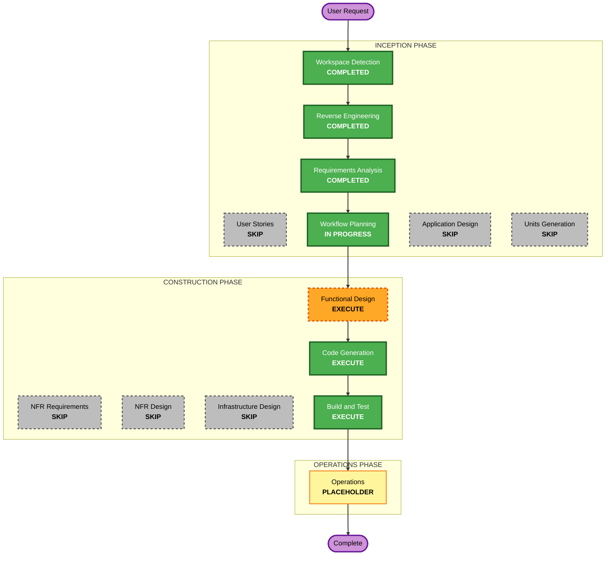

# Execution Plan

## Detailed Analysis Summary

### Transformation Scope (Brownfield Only)
- **Transformation Type**: Single component change（予約ドメインの機能追加。アーキテクチャや基盤は変えない）
- **Primary Changes**: 予約の下書き（`DRAFT`）の保存・再編集・正式申請・削除、閲覧権限の追加、一覧の除外と下書きタブ
- **Related Components**: backend の予約・承認の Service と Controller、frontend の予約の各ページと Server Actions、仕様書 4 本と遷移図

### Change Impact Assessment
- **User-facing changes**: Yes。「下書き保存」ボタン、「下書き」タブ、下書きの詳細画面の「編集」「正式申請」「削除」、表示名を「下書き」に統一
- **Structural changes**: No。4 層の構成を保ち、新規コンポーネントは作らない
- **Data model changes**: No。`DRAFT` は既存の CHECK 制約に定義済みで、Flyway のマイグレーションは追加しない
- **API changes**: Yes。`POST` / `PUT` に `draft` を追加、`DELETE /api/reservations/{id}` を新設、`GET /api/reservations` は `status` 未指定のとき下書きを除く
- **NFR impact**: 小さい。下書きの閲覧権限をバックエンドで強制する（NFR-01）。性能への影響はない

### Component Relationships (Brownfield Only)
- **Primary Component**: backend の `ReservationService` / `ReservationController`
- **Infrastructure Components**: なし
- **Shared Components**: frontend の `lib/types` と `lib/schemas`（応答と入力のスキーマ）、`lib/labels.ts`（表示名）
- **Dependent Components**: frontend の Server Actions と予約の各ページ（API の契約に依存）
- **Supporting Components**: 既存のテスト（backend の Service・Controller、frontend の Server Action と MSW のモック）

| 関連コンポーネント | 変更の種類 | 理由 | 優先度 |
|---|---|---|---|
| `ReservationService` | Major | 作成・更新・削除・閲覧権限・一覧の除外を変える | Critical |
| `ReservationController` と DTO | Minor | `draft` の追加、`DELETE` の新設 | Critical |
| `ApprovalService` | なし | 承認ステップの生成は `ReservationService` から呼ぶ（呼び出しを増やすだけ） | Important |
| frontend の予約の各ページ | Major | ボタン、タブ、編集画面の条件、詳細画面の操作 | Critical |
| frontend の Server Actions とスキーマ | Minor | `draft` と削除の呼び出しを追加 | Important |
| テスト一式 | Major | 下書きの遷移、権限、削除、一覧の除外を追加 | Critical |

### Risk Assessment
- **Risk Level**: Medium（複数コンポーネントにまたがり、既存の閲覧権限と一覧の既定動作を変える）
- **Rollback Complexity**: Easy（DB を変更しないため、コミットを戻せば元に戻る）
- **Testing Complexity**: Moderate（権限の組み合わせと状態遷移の網羅が要る）

## Workflow Visualization

## Phases to Execute

### INCEPTION PHASE
- [x] Workspace Detection (COMPLETED)
- [x] Reverse Engineering (COMPLETED)
- [x] Requirements Analysis (COMPLETED)
- [ ] User Stories - SKIP
  - **Rationale**: 受入条件は要件シートで定義済みで、3 つのロールごとの権限の判断も要件書（D-1、D-2）で確定している。ストーリーを書いても同じ内容の言い換えになる。ただし、複数のロールと画面の変更があるため、判断が分かれる境界にある。追加を望む場合は選べる。
- [x] Workflow Planning (IN PROGRESS)
- [ ] Application Design - SKIP
  - **Rationale**: 新規のコンポーネントやサービスは作らない。変更は既存の `ReservationService` と画面の範囲に収まる。
- [ ] Units Generation - SKIP
  - **Rationale**: 新規エンドポイントを 1 つ足すが、作業単位は 1 つ（1 Issue が縦切り 1 つ）で、分解は要らない。

### CONSTRUCTION PHASE
- [ ] Functional Design - EXECUTE
  - **Rationale**: 状態遷移（`DRAFT` から `PENDING` / `APPROVED`）、権限の組み合わせ、`draft` フラグの意味、削除の条件など、業務ルールの詳細を確定する必要がある。要件書の前提・解釈 3（下書き以外への `draft: true`）もここで確定する。
- [ ] NFR Requirements - SKIP
  - **Rationale**: 拡張機能を適用しない（D-9）。性能の要件はなく、権限の強制は要件書の NFR-01 で足りる。
- [ ] NFR Design - SKIP
  - **Rationale**: NFR Requirements を実行しないため。
- [ ] Infrastructure Design - SKIP
  - **Rationale**: インフラとデータベースのスキーマに変更がない。
- [ ] Code Generation - EXECUTE (ALWAYS)
  - **Rationale**: 実装の計画とコード生成が必要。
- [ ] Build and Test - EXECUTE (ALWAYS)
  - **Rationale**: ビルド、テスト、検証が必要。

### OPERATIONS PHASE
- [ ] Operations - PLACEHOLDER
  - **Rationale**: BookFlow では PR 作成と CI の品質ゲート（`CI Frontend` / `CI Backend`）が相当する。

## 仕様書の更新（Spec-first）の差し込み位置

仕様書はコード生成より前に更新する（`dev-workflow.md` のステップ 4）。今回は業務ルールの詳細が設計で確定するため、2 回に分ける。

| 回 | タイミング | 更新するもの |
|---|---|---|
| 1 回目 | この計画の承認後、Functional Design の前 | `requirements.md`（遷移・権限・RSV の記述）、`screen-spec.md`（4 画面）、遷移図（drawio） |
| 2 回目 | Functional Design の承認後、Code Generation の前 | `api-spec.md`（`draft`・`DELETE`・一覧の `status` と除外・権限・エラー表）、`er-diagram.md`（`status` 列の「未使用」の記述） |

## Package Change Sequence (Brownfield Only)

1. 仕様書（上の 2 回に分けて更新）
2. backend: `ReservationService` のルール、`ReservationController` と DTO、Service・Controller のテスト
3. frontend: Server Actions とスキーマ、予約の各ページ、ラベル、テスト

frontend は backend の API の契約に依存するため、backend を先に作る。両者は縦切りで 1 つの作業単位として扱い、最後にまとめて検証する。

## Estimated Timeline
- **Total Stages**: 実行 3（Functional Design、Code Generation、Build and Test）、省略 6、完了済み 4、仕様書の更新 2 回
- **Estimated Duration**: STEP-05 の目安は 4〜7 時間。削除を加えたため、上限寄りと見ている（実測ではなく見立て）。必要なら相談する（承認時の方針）。

## Success Criteria
- **Primary Goal**: 予約を下書きとして保存し、再編集・正式申請・削除できる
- **Key Deliverables**: 更新した仕様書 4 本と遷移図、backend と frontend の実装、下書きに関するテスト
- **Quality Gates**: 要件書の受入条件がすべて満たされる。`pnpm lint`、`pnpm test`、`./gradlew test`、Checkstyle が通る。PR の AI レビューの総合判定が「完了」になる
