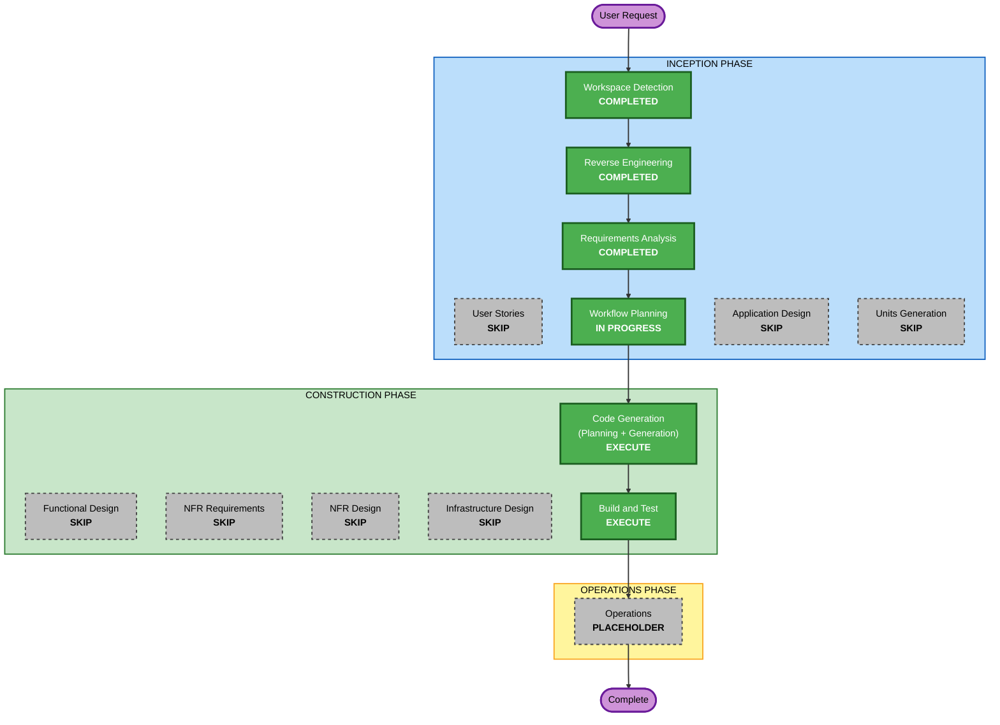

# Execution Plan

入力: `requirements.md`（承認済み）、Reverse Engineering 成果物、`requirement-verification-questions.md`（回答済み）。User Stories は学習者の指示によりスキップする。

## Detailed Analysis Summary

### Transformation Scope (Brownfield Only)
- **Transformation Type**: Single component change（リソース一覧機能への条件追加。アーキテクチャ変更なし）
- **Primary Changes**: `GET /api/resources` への `keyword` 追加（BE 3 層）、フィルタフォームと Server Action への入力追加（FE）、仕様書 2 ファイルの更新
- **Related Components**: `ResourceController`、`ResourceService`、`ResourceRepository`、`ResourceFilterForm.tsx`、`page.tsx`、`listResourcesAction`、`api-spec.md`、`screen-spec.md`

### Change Impact Assessment
- **User-facing changes**: Yes。一覧画面にキーワード入力欄が加わる。
- **Structural changes**: No。4 層の境界と依存方向は変わらない。
- **Data model changes**: No。`resources` テーブルと Flyway マイグレーションは変更しない。
- **API changes**: Yes（後方互換）。`GET /api/resources` に任意の `keyword` を追加する。既存パラメータとレスポンス形式は変えない。
- **NFR impact**: No。新しい NFR はなく、拡張機能（Security、Resiliency、Property-Based Testing）は適用しない。

### Component Relationships
- **Primary Component**: `backend` の `ResourceService.list` と、`frontend` の `/resources`
- **Infrastructure Components**: なし
- **Shared Components**: なし（API 契約は `api-spec.md` が真実の源）
- **Dependent Components**: `listResourcesAction` が `GET /api/resources` に依存する。他に一覧 API を呼ぶ箇所は未確認（Code Generation で `grep` により確認する）
- **Supporting Components**: `ResourceServiceTest`、`ResourceControllerTest`、`frontend/tests/unit`

| Component | Change Type | Change Reason | Change Priority |
|---|---|---|---|
| `api-spec.md`、`screen-spec.md` | Minor | Spec-first | Critical（最初に更新） |
| `ResourceRepository` | Minor | `@Query` メソッド追加 | Critical |
| `ResourceService` | Minor | 正規化、エスケープ、経路ごとの分岐 | Critical |
| `ResourceController` | Minor | `keyword` の受け取り | Critical |
| `listResourcesAction` | Minor | `keyword` をクエリに付与 | Important |
| `page.tsx`、`ResourceFilterForm.tsx` | Minor | 入力欄と URL 連携 | Important |

### Risk Assessment
- **Risk Level**: Low（既存機能への任意パラメータの追加で、未指定時は既存メソッドを使う）
- **Rollback Complexity**: Easy（DB 変更なし。コミットを戻せば済む）
- **Testing Complexity**: Simple。ただし次の点は実機での確認が要る。
  - JPQL の `LIKE ... ESCAPE` が PostgreSQL と H2 の両方で動くか
  - 期間フィルタ経路で `keyword` が効くか
  - ページ遷移で `keyword` が引き継がれるか

## Module Update Strategy
- **Update Approach**: Sequential（仕様書、BE、FE の順）
- **Critical Path**: 仕様書の更新 -> BE の API -> FE の呼び出し。FE は BE の `keyword` 仕様が固まってから実装する。
- **Coordination Points**: `keyword` のクエリ名と正規化規則（前後空白の除去、空は解除）。BE と FE で二重に正規化しても結果は同じだが、正は BE とする。
- **Testing Checkpoints**: BE 実装後に `./gradlew test`、FE 実装後に `pnpm test` と `pnpm lint`。最後に画面で結合確認する。

## Workflow Visualization

テキストによる代替表現: Workspace Detection -> Reverse Engineering -> Requirements Analysis -> Workflow Planning -> Code Generation -> Build and Test -> Operations（プレースホルダー）。それ以外のステージはスキップする。

## Phases to Execute

### INCEPTION PHASE
- [x] Workspace Detection (COMPLETED)
- [x] Reverse Engineering (COMPLETED)
- [x] Requirements Analysis (COMPLETED)
- [x] User Stories (SKIPPED)
  - **Rationale**: ペルソナが実質 1 つ（一覧を使う利用者）で、画面の振る舞いと受入条件はシートと要件で確定している。学習者もスキップを指示した。
- [x] Workflow Planning (IN PROGRESS)
- [ ] Application Design - SKIP
  - **Rationale**: 新しいコンポーネントやサービスはなく、既存の 4 層の境界内の変更である。実装方式（`@Query` の追加）は要件の Q6 で決定済み。
- [ ] Units Generation - SKIP
  - **Rationale**: 1 つの縦切り（Issue #23）で完結し、分割する単位がない。Code Generation は単一ユニット `resource-keyword-search` として進める。

### CONSTRUCTION PHASE
- [ ] Functional Design - SKIP
  - **Rationale**: 新しいデータモデルや複雑な業務ルールはない。キーワードの正規化とエスケープの規則は `requirements.md` の FR-05〜FR-07 で定義済み。
- [ ] NFR Requirements - SKIP
  - **Rationale**: 新しい NFR はなく、拡張機能は適用しない（Q7〜Q9）。互換性とパラメータバインドは `requirements.md` の NFR に記載済み。
- [ ] NFR Design - SKIP
  - **Rationale**: NFR Requirements をスキップするため対象外。
- [ ] Infrastructure Design - SKIP
  - **Rationale**: インフラ、デプロイ、DB スキーマの変更がない。
- [ ] Code Generation - EXECUTE (ALWAYS)
  - **Rationale**: 実装が必要。Code Generation の計画（番号付きステップとチェックボックス）を作成して承認を得てから実装する。計画の先頭ステップは、`/update-spec` による仕様書の更新（Spec-first）とする。
- [ ] Build and Test - EXECUTE (ALWAYS)
  - **Rationale**: `./gradlew test`、`./gradlew spotlessApply`（または検証）、`./gradlew checkstyleMain`、`pnpm test`、`pnpm lint`、`pnpm format:check` の実行手順を整理し、結果を確認する。

### OPERATIONS PHASE
- [ ] Operations - PLACEHOLDER
  - **Rationale**: BookFlow では CI 品質ゲート（`CI Frontend`、`CI Backend`）が Operations 相当。PR 作成後に CI の結果を確認する。

## Package Change Sequence
1. `docs-next/docs/spec/`: `api-spec.md`、`screen-spec.md` の更新（Spec-first）。`docs-next` の変更なので `npm run build` でリンクとアンカーの破損がないか確認する。
2. `backend`: Repository（`@Query` 追加）-> Service（正規化、エスケープ、経路分岐）-> Controller（`keyword` 受け取り）-> テスト
3. `frontend`: Server Action -> `page.tsx` -> `ResourceFilterForm` -> Vitest

## Estimated Timeline
- **Total Phases**: 実行 4 ステージ（Workflow Planning、Code Generation、Build and Test、Operations 相当の CI 確認）。スキップ 7 ステージ。
- **Estimated Duration**: シートの推定工数 2〜3 時間の範囲

## Success Criteria
- **Primary Goal**: リソース一覧でキーワード検索ができ、カテゴリや期間と AND で絞り込める。
- **Key Deliverables**: 更新した仕様書 2 ファイル、BE と FE の実装、BE と FE のテスト、Build and Test の手順書
- **Quality Gates**:
  - 既存テストを含む `./gradlew test` が pass する
  - `pnpm test`、`pnpm lint`、`pnpm format:check` が pass する
  - `./gradlew checkstyleMain` が pass する
  - シートの受入条件 6 項目を満たす
  - 画面で `keyword` の入力、解除、`category` や期間との AND、ページ遷移後の引き継ぎを確認する
