# Execution Plan — reservation-draft

## Detailed Analysis Summary

### Transformation Scope（Brownfield）

- **Transformation Type**: Single component change（予約ドメインの状態遷移ロジック拡張。新しいサービス・新しい画面ルートは追加しない）
- **Primary Changes**: `DRAFT` ステータスを実際に機能させるための、作成時の分岐・更新時の遷移ロジック・アクセス制御・一覧表示の拡張
- **Related Components**: `ReservationService`（create/update/checkReadAccess/list）、予約申請フォーム・予約一覧・予約詳細・予約編集の各画面

### Change Impact Assessment

- **User-facing changes**: Yes（下書き保存ボタン・正式申請ボタン・下書きタブという新しい操作）
- **Structural changes**: No（新しいテーブル・新しいAPIエンドポイントは追加しない。既存の`POST`/`PUT /api/reservations`を拡張する）
- **Data model changes**: No（`DRAFT`は既存のDB CHECK制約に定義済み。スキーマ変更なし）
- **API changes**: Yes（`CreateReservationRequest`に`draft`、`UpdateReservationRequest`に`submit`を追加。既存フィールドの破壊的変更はない）
- **NFR impact**: Yes（アクセス制御の強化：DRAFTはAPPROVERの閲覧対象から除外する）。ただし新たな認証基盤・暗号化等の変更ではなく、既存の所有者チェックパターンの拡張であるため、拡張（Security Baseline）としては不採用

### Component Relationships（Brownfield）

- **Primary Component**: `backend/.../application/ReservationService.java`（状態遷移・承認ステップ作成条件・アクセス制御の中心）
- **Dependent Components**: `ApprovalService`（`createInitialStep`の呼び出し条件は変わらないが、呼び出しタイミングがcreate以外にupdateからも発生するようになる）、予約一覧・詳細・編集画面（frontend）
- **Supporting Components**: `ReservationServiceTest`・`ReservationControllerTest`（既存のステータス遷移テストと整合させる必要がある）

### Risk Assessment

- **Risk Level**: Medium（既存の予約作成・更新フローという広く使われているロジックに手を入れるため、既存テスト（`update_approvedReservation_throwsBusinessException`等）を壊さないよう慎重な変更が必要）
- **Rollback Complexity**: Moderate（複数ファイルにまたがるが、新しいテーブル・マイグレーションは発生しないため当該コミットの取り消しで対応可能）
- **Testing Complexity**: Complex（状態遷移の組み合わせ（DRAFT作成/編集/正式申請×承認要否）とロール別アクセス制御の両方を検証する必要がある）

## Workflow Visualization

```mermaid
flowchart TD
    Start(["User Request"])

    subgraph INCEPTION["INCEPTION PHASE"]
        WD["Workspace Detection<br/><b>COMPLETED</b>"]
        RE["Reverse Engineering<br/><b>COMPLETED</b>"]
        RA["Requirements Analysis<br/><b>COMPLETED</b>"]
        US["User Stories<br/><b>COMPLETED</b>"]
        WP["Workflow Planning<br/><b>IN PROGRESS</b>"]
        AD["Application Design<br/><b>SKIP</b>"]
        UG["Units Generation<br/><b>SKIP</b>"]
    end

    subgraph CONSTRUCTION["CONSTRUCTION PHASE"]
        FD["Functional Design<br/><b>EXECUTE</b>"]
        NFRA["NFR Requirements<br/><b>SKIP</b>"]
        NFRD["NFR Design<br/><b>SKIP</b>"]
        ID["Infrastructure Design<br/><b>SKIP</b>"]
        CG["Code Generation<br/><b>EXECUTE</b>"]
        BT["Build and Test<br/><b>EXECUTE</b>"]
    end

    subgraph OPERATIONS["OPERATIONS PHASE"]
        OPS["Operations<br/><b>PLACEHOLDER</b>"]
    end

    Start --> WD
    WD --> RE
    RE --> RA
    RA --> US
    US --> WP
    WP --> AD
    AD --> UG
    UG --> FD
    FD --> NFRA
    NFRA --> NFRD
    NFRD --> ID
    ID --> CG
    CG --> BT
    BT --> OPS
    OPS --> End(["Complete"])

    style WD fill:#4CAF50,stroke:#1B5E20,stroke-width:3px,color:#fff
    style RE fill:#4CAF50,stroke:#1B5E20,stroke-width:3px,color:#fff
    style RA fill:#4CAF50,stroke:#1B5E20,stroke-width:3px,color:#fff
    style US fill:#4CAF50,stroke:#1B5E20,stroke-width:3px,color:#fff
    style WP fill:#4CAF50,stroke:#1B5E20,stroke-width:3px,color:#fff
    style AD fill:#BDBDBD,stroke:#424242,stroke-width:2px,stroke-dasharray: 5 5,color:#000
    style UG fill:#BDBDBD,stroke:#424242,stroke-width:2px,stroke-dasharray: 5 5,color:#000
    style FD fill:#FFA726,stroke:#E65100,stroke-width:3px,stroke-dasharray: 5 5,color:#000
    style NFRA fill:#BDBDBD,stroke:#424242,stroke-width:2px,stroke-dasharray: 5 5,color:#000
    style NFRD fill:#BDBDBD,stroke:#424242,stroke-width:2px,stroke-dasharray: 5 5,color:#000
    style ID fill:#BDBDBD,stroke:#424242,stroke-width:2px,stroke-dasharray: 5 5,color:#000
    style CG fill:#4CAF50,stroke:#1B5E20,stroke-width:3px,color:#fff
    style BT fill:#4CAF50,stroke:#1B5E20,stroke-width:3px,color:#fff
    style Start fill:#CE93D8,stroke:#6A1B9A,stroke-width:3px,color:#000
    style End fill:#CE93D8,stroke:#6A1B9A,stroke-width:3px,color:#000

    linkStyle default stroke:#333,stroke-width:2px
```

## Phases to Execute

### 🔵 INCEPTION PHASE

- [x] Workspace Detection（COMPLETED）
- [x] Reverse Engineering（COMPLETED）
- [x] Requirements Analysis（COMPLETED）
- [x] User Stories（COMPLETED）
- [x] Execution Plan（IN PROGRESS）
- [ ] Application Design — **SKIP**
  - **Rationale**: 既存の`ReservationService`・既存画面という境界内の拡張であり、新しいサービス・新しいモジュール境界は発生しない
- [ ] Units Generation — **SKIP**
  - **Rationale**: Issue #30は単一のunits of work（縦切り1機能）であり、複数ユニットへの分解は不要

### 🟢 CONSTRUCTION PHASE

- [ ] Functional Design — **EXECUTE**
  - **Rationale**: 状態遷移ルール（新規作成時・DRAFT→PENDING/APPROVED遷移）、`approval_steps`の統一作成条件、ロール別アクセス制御（DRAFTはAPPROVER除外）という複数の業務ルールが絡み合うため、Code Generation前に明文化が必要
- [ ] NFR Requirements — **SKIP**
  - **Rationale**: アクセス制御の強化は本課題の中心的な機能要件（Functional Designの業務ルールとして扱う）であり、新たな認証基盤・暗号化等のNFR横断的要求ではない。requirements.mdのとおりSecurity/Resiliency/PBT拡張はいずれも不採用
- [ ] NFR Design — **SKIP**
  - **Rationale**: NFR Requirementsに連動してSKIP
- [ ] Infrastructure Design — **SKIP**
  - **Rationale**: インフラ変更は発生しない
- [ ] Code Generation — **EXECUTE (ALWAYS)**
  - **Rationale**: 実装計画の作成とコード生成が必要
- [ ] Build and Test — **EXECUTE (ALWAYS)**
  - **Rationale**: ビルド・テストの実行と検証が必要

### 🟡 OPERATIONS PHASE

- [ ] Operations — **PLACEHOLDER**
  - **Rationale**: BookFlowではCI品質ゲート（`CI Frontend`/`CI Backend`）として運用。PR作成・push後に自動実行

## Estimated Timeline

- **Total Phases**: 3（Functional Design・Code Generation・Build and Test）
- **Estimated Duration**: ビジネス要求シートの見積り（半日〜1日）に準拠

## Success Criteria

- **Primary Goal**: `DRAFT`ステータスを実際に機能させ、下書き保存・再編集・正式申請・一覧表示・アクセス制御を実現する
- **Key Deliverables**: backend（`CreateReservationRequest`/`UpdateReservationRequest`/`ReservationService`の拡張）、frontend（下書き保存ボタン・正式申請ボタン・下書きタブ）、関連テスト一式
- **Quality Gates**: `./gradlew test`・`pnpm lint`・`pnpm format:check`・`pnpm test`・`pnpm build`すべて成功。requirements.mdの受入条件6項目をすべて満たす。既存のステータス遷移テストが壊れていないこと

- **Integration Testing**: 既存の予約作成・承認フロー（PENDING/APPROVED系）が回帰していないことを確認する
