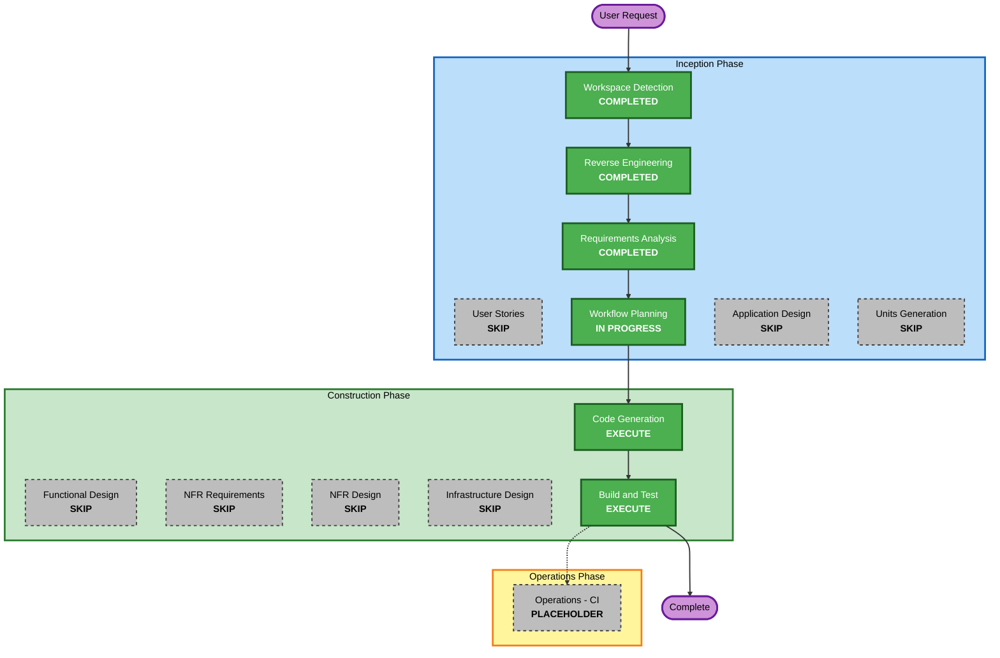

# Execution Plan — リソース詳細画面の情報拡充

## Detailed Analysis Summary

### Transformation Scope（Brownfield）

- **Transformation Type**: Single component change（`resources` ドメイン内での既存コンポーネントの拡張。アーキテクチャ変更・デプロイモデル変更なし）
- **Primary Changes**: `resources` テーブルへの2カラム追加（`equipment` / `notes`）と、それに伴うバックエンド4層・フロントエンド・関連 spec 4点の同期
- **Related Components**: `Resource`（domain）/ `ResourceRepository`（domain）/ `ResourceService`（application）/ `ResourceController`・DTO群（presentation）/ `V002` マイグレーション（infrastructure 相当）/ リソース詳細画面・管理画面フォーム・Zod スキーマ（frontend）

### Change Impact Assessment

| 観点 | 影響 | 説明 |
|---|---|---|
| User-facing changes | Yes | リソース詳細画面に設備一覧・利用上の注意を表示。管理画面に入力欄を追加 |
| Structural changes | No | 新規コンポーネント・新規サービス層は不要。既存の4層アーキテクチャの境界内で完結 |
| Data model changes | Yes | `resources` テーブルに `equipment TEXT NULL` / `notes TEXT NULL` を追加（Flyway `V002`） |
| API changes | Yes | 既存エンドポイント（`GET/POST/PUT /api/resources{,/{id}}`）のリクエスト・レスポンスに任意フィールドを追加。新規エンドポイントはなし |
| NFR impact | No | Requirements Analysis で Security/Resiliency/PBT 拡張はいずれも不採用と確定済み。性能・セキュリティ・スケーラビリティへの新規要求なし |

### Component Relationships

- **Primary Component**: `resources` ドメイン（backend 4層 + frontend 詳細/管理画面）
- **Infrastructure Components**: なし（CDK/Terraform 等の IaC はこのリポジトリに存在しない）
- **Shared Components**: `frontend/src/lib/types/api.ts`（`ResourceResponseSchema`、バックエンド DTO と手動同期）
- **Dependent Components**: `ReservationController` 等は `resources` テーブルを参照するが、今回追加する2カラムは予約ドメインのロジックに影響しない
- **Supporting Components**: `docs-next/docs/spec/{requirements.md, er-diagram.md, api-spec.md, screen-spec.md}`（Spec-first のため実装前に更新）

### Risk Assessment

- **Risk Level**: Low（既存カラムへの影響がない追加のみ・新規エンドポイントなし・単一ドメイン内で完結）
- **Rollback Complexity**: Easy（`ALTER TABLE ... DROP COLUMN` で Flyway 追加分を取り消し可能。既存データへの影響なし）
- **Testing Complexity**: Simple（既存テストの回帰確認 + 新フィールドを含む数件のテスト追加）

## Workflow Visualization

## Phases to Execute

### 🔵 INCEPTION PHASE

- [x] Workspace Detection（COMPLETED）
- [x] Reverse Engineering（COMPLETED）
- [x] Requirements Analysis（COMPLETED）
- [ ] User Stories — **SKIP**
  - **Rationale**: 新規ユーザー体験・新規ペルソナの追加ではなく、既存の閲覧・編集フローに2フィールドを足すだけの拡張。受入条件はビジネス要求シートに既に明記されており、ストーリー分解による追加情報はない。
- [x] Execution Plan（IN PROGRESS — 本ドキュメント）
- [ ] Application Design — **SKIP**
  - **Rationale**: 新規コンポーネント・新規サービスは不要。既存の `ResourceService` / `ResourceController` の責務範囲内で完結する変更のため。
- [ ] Units Generation — **SKIP**
  - **Rationale**: 縦切りの単一ユニット（`resource-detail-info`）で完結する変更であり、複数ユニットへの分解・依存関係整理は不要。

### 🟢 CONSTRUCTION PHASE（ユニット: `resource-detail-info`）

- [ ] Functional Design — **SKIP**
  - **Rationale**: 新規データモデルは単純な nullable TEXT 列2つのみで、複雑なビジネスルールを伴わない。フィールド定義・表示方式・入力方式は Requirements Analysis の `requirements.md`（データモデル変更／API変更／UI変更の各節）で確定済みであり、追加の詳細設計は不要。
- [ ] NFR Requirements — **SKIP**
  - **Rationale**: Requirements Analysis で Security/Resiliency/Property-Based Testing の3拡張はいずれも不採用と確定済み。新たな性能・セキュリティ・スケーラビリティ要求もない。
- [ ] NFR Design — **SKIP**
  - **Rationale**: NFR Requirements を実行しないため連動して SKIP。
- [ ] Infrastructure Design — **SKIP**
  - **Rationale**: CDK/Terraform 等の IaC はこのリポジトリに存在せず、デプロイモデル・ネットワーク構成への変更もない。
- [x] Code Generation — **EXECUTE（ALWAYS）**
  - **Rationale**: Part 1（実装計画）→ Part 2（実装）で以下を縦切りで実装する。
    1. Spec-first: `docs-next/docs/spec/{requirements.md, er-diagram.md（Markdown表 + .drawio + SVG再エクスポート）, api-spec.md, screen-spec.md}` を `/update-spec` スキルで更新
    2. バックエンド: `V002__add_resource_equipment_and_notes.sql` → `Resource` エンティティ → `ResourceResponse`/`CreateResourceRequest`/`UpdateResourceRequest` → 既存テストの回帰確認 + 新規テスト追加
    3. フロントエンド: `ResourceResponseSchema` / `CreateResourceSchema` / `UpdateResourceSchema` → リソース詳細画面の表示追加 → 管理画面 `ResourceForm` の入力欄追加 → 既存テストの回帰確認
- [x] Build and Test — **EXECUTE（ALWAYS）**
  - **Rationale**: バックエンド・フロントエンドの lint・テスト・ビルドを実行し、回帰がないことを確認する。

### 🟡 OPERATIONS PHASE

- [ ] Operations（CI） — **PLACEHOLDER**
  - **Rationale**: BookFlow では CI Frontend / CI Backend のワークフローゲートが Operations 相当。PR 作成後に GitHub Actions 上で実行される。

## Module Update Sequence

単一リポジトリ内の縦切り変更のため「パッケージ」単位の調整は不要だが、レイヤー間の依存関係から以下の順序で実装する。

1. **Spec 更新**（Spec-first）— 後続の実装がこの内容に従う
2. **バックエンド**（マイグレーション → エンティティ → DTO → Controller/Service の既存メソッド更新）— フロントエンドが参照する API 契約を先に確定させる
3. **フロントエンド**（型・Zod スキーマ → 詳細画面表示 → 管理画面フォーム）
4. **テスト・ビルド確認**（Build and Test フェーズ）

## Estimated Timeline

- **Total Phases**: 2（Code Generation, Build and Test）+ Spec 更新
- **Estimated Duration**: 3〜4時間（ビジネス要求シート記載の見積りを踏襲。対象レイヤー: 両方）

## Success Criteria

- **Primary Goal**: リソース詳細画面・管理画面で設備一覧（`equipment`）・利用上の注意（`notes`）を登録・表示できるようにする
- **Key Deliverables**:
  - `docs-next/docs/spec/` 4ファイルの更新（Spec-first）
  - `V002` マイグレーション・`Resource` エンティティ・関連 DTO の更新
  - リソース詳細画面・管理画面フォームの更新
  - 新フィールドを含む API テストの追加
- **Quality Gates**（`CLAUDE.md` 記載のコマンドで検証）:
  - `cd backend && ./gradlew test`（既存テスト回帰 + 新規テスト）
  - `cd backend && ./gradlew spotlessApply && ./gradlew checkstyleMain`
  - `cd frontend && pnpm test`（既存テスト回帰）
  - `cd frontend && pnpm lint`
  - `cd docs-next && npm run build`（spec 更新後、リンク・アンカー破損がないことを確認）
  - ビジネス要求シートの受入条件（6項目）を全て満たす
