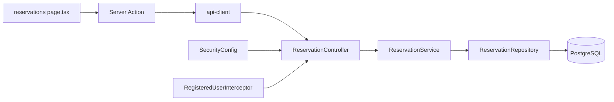
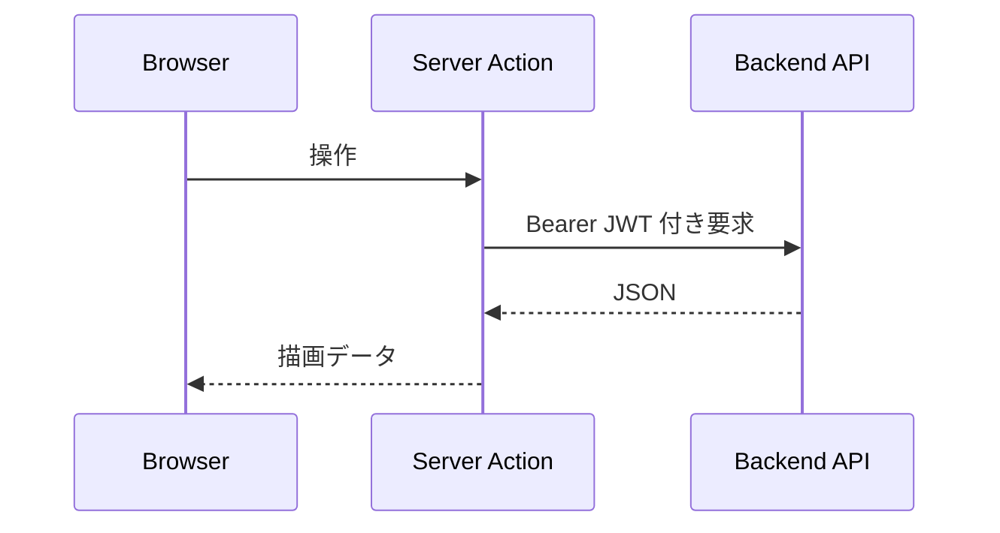

# System Architecture

## System Overview
フロントエンド（Next.js 15 App Router、Server Actions が BFF）とバックエンド（Spring Boot 4.0、4 レイヤー）のモノレポ。DB は PostgreSQL（Flyway で管理、テストは H2）。認証は Cognito の JWT を Spring Security の OAuth2 Resource Server で検証する。

## Architecture Diagram

## Component Descriptions
### SecurityConfig (infrastructure/security)
- **Purpose**: ステートレス JWT 認証。URL 単位のロール制限は持たず、`anyRequest().authenticated()` のみ。ロール制限は各 Controller メソッドの `@PreAuthorize("hasRole('ADMIN')")` で行う（`@EnableMethodSecurity`）。
- **Type**: Application
### RegisteredUserInterceptor / CurrentUserArgumentResolver
- **Purpose**: `/api/**` で JWT の `sub` が `users` に無ければ 401。`@CurrentUser User` で登録ユーザーを注入。
- **Type**: Application
### ReservationController / ReservationService (presentation / application)
- **Purpose**: 予約 CRUD。一覧は ADMIN が全件、それ以外は本人分。`status` の複数指定に対応。行レベルの所有権は Service が判定し、`@PreAuthorize` は使わない。
- **Type**: Application
### ReservationRepository (domain)
- **Purpose**: `JOIN FETCH` で resource と requester を取得するページング付き `@Query`。期間（from、to）で絞る問い合わせは存在しない。
- **Type**: Application
### GlobalExceptionHandler (presentation/exception)
- **Purpose**: 例外を `{ code, message }` に統一変換（400 / 401 / 403 / 404 / 409 / 422 / 500）。
- **Type**: Application
### フロントエンド BFF
- **Purpose**: JWT はサーバー側（Better Auth のセッション、開発時は `dev-id-token` cookie）にあり、Server Action が `getAccessToken` で付与してバックエンドを呼ぶ。`/api/backend/*` のリライトは Authorization ヘッダを付けないため、ブラウザから直接バックエンドの保護 API は呼べない。`src/app/api/` には Better Auth 用の Route Handler のみ存在する。
- **Type**: Application

## Data Flow

## Integration Points
- **External APIs**: なし（Cognito は JWT 検証用の JWKS 取得のみ）
- **Databases**: PostgreSQL（Flyway、V001 のみ）
- **Third-party Services**: なし

## Infrastructure Components
- **Deployment Model**: `.devcontainer/docker-compose.yml` によるローカル構成。CI は `CI Frontend` / `CI Backend`。
