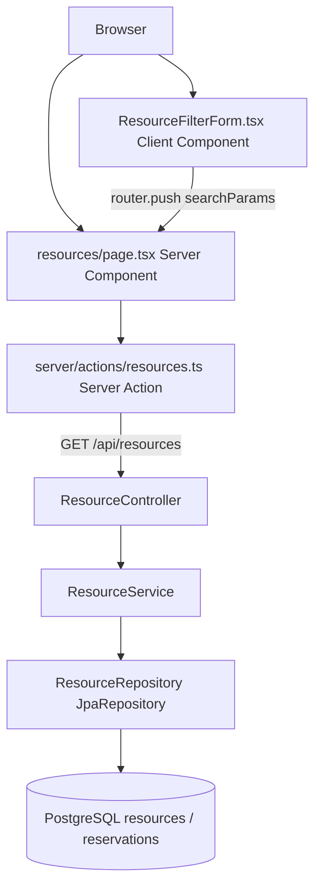
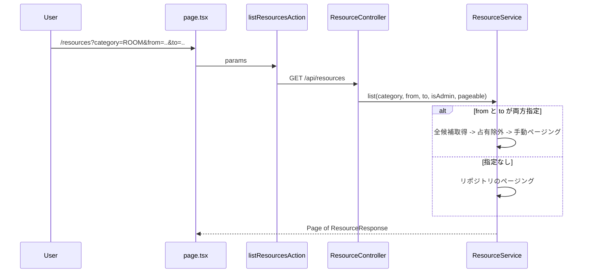

# System Architecture

## System Overview

Next.js 15（App Router）が BFF として Server Actions 経由で Spring Boot 4 の REST API（`/api`）を呼ぶ 2 層構成。認証は Cognito 発行 JWT（Better Auth）。バックエンドは domain / application / presentation / infrastructure の 4 層。DB は PostgreSQL（Flyway 管理、テストは H2）。

## Architecture Diagram

## Component Descriptions

### ResourceController（presentation）
- **Purpose**: `GET /api/resources` 等の受付。`from`/`to` の同時指定検証、ADMIN 判定
- **Dependencies**: ResourceService
- **Type**: Application

### ResourceService（application）
- **Purpose**: ロール別一覧、空きフィルタ、CRUD
- **Dependencies**: ResourceRepository, ReservationRepository

### ResourceRepository（domain インターフェース）
- **Purpose**: 永続化。ページあり/なし × カテゴリ有/無 × active のみ/全件 の一覧取得 8 通り（派生クエリ 6 本 + `JpaRepository` 継承の `findAll` 2 本）

## Data Flow（一覧取得）

## Integration Points
- **External APIs**: Cognito（JWT 発行・検証）
- **Databases**: PostgreSQL（本番・ローカル）/ H2（テスト）
- **Third-party Services**: なし

## Infrastructure Components
- **Deployment Model**: ローカルは DevContainer + Docker Compose。本課題のスコープ外
