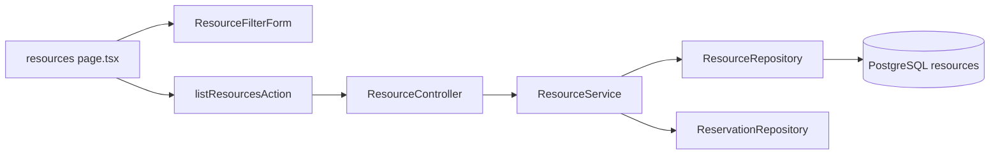

# System Architecture（リソース一覧に関係する範囲）

## System Overview
Next.js（App Router）が BFF と UI を兼ね、Server Action 経由で Spring Boot の REST API を呼ぶ。バックエンドは domain / application / presentation / infrastructure の 4 層。DB は PostgreSQL（Flyway で管理）、テストは H2。

## Architecture Diagram

## Data Flow
1. 利用者がフォームを送信すると `router.push("/resources?...")` で URL パラメータが更新される。
2. サーバーコンポーネント `page.tsx` が searchParams を読み、`listResourcesAction` を呼ぶ。
3. Action が `/resources` に `category/from/to/page/size` を渡す。
4. `ResourceController.list` が `from`/`to` の同時指定を検証し、`ResourceService.list` を呼ぶ。
5. `from`/`to` なしは Repository のページネーションクエリ、ありは全候補を取得して Java で重複除外し手動ページネーションする。

## Integration Points
- **External APIs**: なし（本課題の範囲）
- **Databases**: PostgreSQL の `resources` テーブル（`name` VARCHAR(100)、`description` TEXT）
