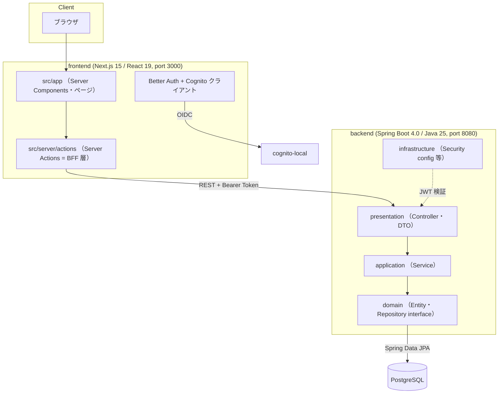
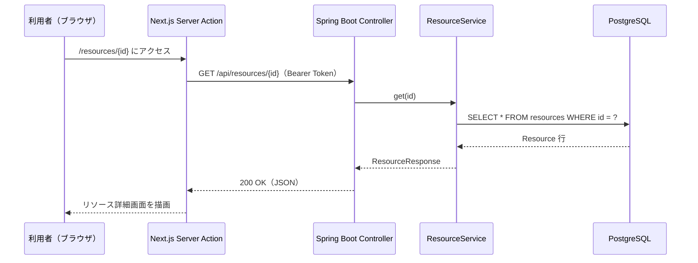

# System Architecture

## System Overview

BookFlow は「Next.js フロントエンド（BFF 兼務）+ Spring Boot バックエンド + PostgreSQL」の2層モノリス構成。マイクロサービス・Lambda・CDK は存在しない（本番想定アーキテクチャは AWS ECS Fargate 2本 + RDS + Cognito だが、本リポジトリはローカル DevContainer 上で完結する学習用モノレポである）。

## Architecture Diagram

## Component Descriptions

### frontend
- **Purpose**: 画面描画と BFF（バックエンド API 呼び出しの集約・認証トークン管理）
- **Responsibilities**: Server Components によるページ描画、Server Actions（`src/server/actions/`）からのバックエンド呼び出し、Zod（`src/lib/schemas/`）によるフォーム検証
- **Dependencies**: backend（REST API）、Cognito/cognito-local（認証）
- **Type**: Application

### backend
- **Purpose**: 業務ロジックの実装と永続化
- **Responsibilities**: 4層アーキテクチャ（domain / application / presentation / infrastructure）の実装、OAuth2 Resource Server によるアクセストークン検証、Flyway によるスキーマ管理
- **Dependencies**: PostgreSQL
- **Type**: Application

### docs-next
- **Purpose**: 仕様書・開発ガイドの公開（Docusaurus）
- **Responsibilities**: `docs/spec/` を真実の源として維持
- **Dependencies**: なし（frontend/backend とは独立）
- **Type**: Application（ドキュメントサイト、業務ロジックなし）

## Data Flow

## Integration Points

- **External APIs**: なし（外部 SaaS 連携なし）
- **Databases**: PostgreSQL 1台（`departments` / `users` / `resources` / `reservations` / `approval_steps` の5テーブル、Flyway `V001__create_initial_schema.sql` で定義）
- **Third-party Services**: Amazon Cognito（本番）／ cognito-local（ローカル開発、`docker-compose.yml` の `cognito-local` サービス）

## Infrastructure Components

- **CDK Stacks**: 該当なし（本リポジトリに IaC コードは含まれない。本番アーキテクチャは `docs-next/docs/reference/architecture.md` に文書化されているのみ）
- **Deployment Model**: ローカルは DevContainer + Docker Compose（`frontend` / `postgres` / `localstack` / `cognito-local` / `docs` の5サービス）。本番想定は GitHub Actions → ECR → ECS ローリングデプロイ（ドキュメント上のみ、本リポジトリでは未実装）
- **Networking**: 該当なし（ローカル Docker ネットワークのみ、VPC 等の設計はスコープ外）
