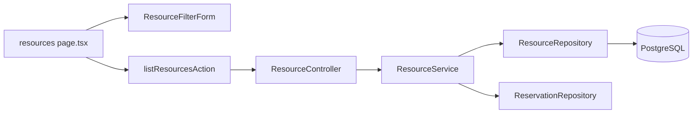
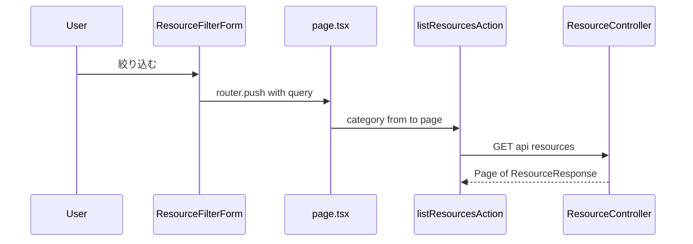

# System Architecture

## System Overview
フロントエンド（Next.js App Router、Server Actions が BFF）とバックエンド（Spring Boot、4 レイヤー）のモノレポ。DB は PostgreSQL（Flyway で管理）。

## Architecture Diagram

## Component Descriptions
### ResourceController (presentation)
- **Purpose**: GET /api/resources 等の受付。from と to の同時指定を検証。
- **Dependencies**: ResourceService
- **Type**: Application
### ResourceService (application)
- **Purpose**: 一覧（ロール別 active 制御、空き判定は Java 側で実施後に手動ページング）。
- **Dependencies**: ResourceRepository, ReservationRepository
- **Type**: Application
### ResourceRepository (domain)
- **Purpose**: 派生クエリ（findByCategory 系、IsActiveTrue 系）を、ページング有りと無しの両形式で提供。
- **Type**: Application

## Data Flow

## Integration Points
- **External APIs**: なし
- **Databases**: PostgreSQL（テストは H2）
- **Third-party Services**: Cognito（認証）

## Infrastructure Components
- **Deployment Model**: ローカルは DevContainer と Docker Compose。CI は GitHub Actions。
