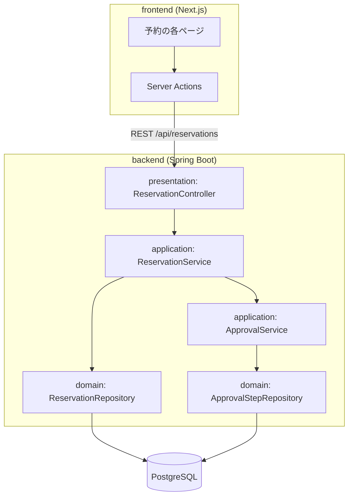
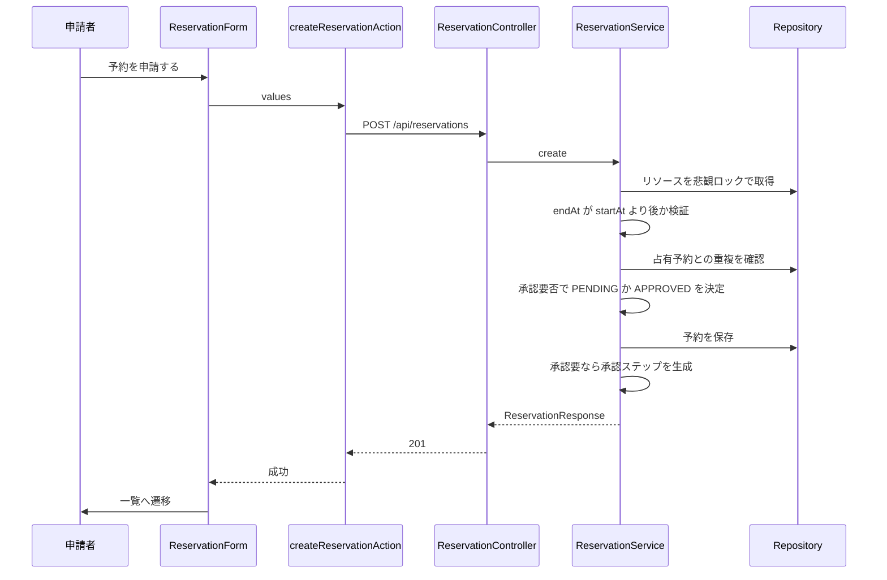

# System Architecture

**スコープ注記**: 予約の申請・参照・更新・取消・承認の流れに絞る。略記: `BE/` = `backend/src/main/java/com/example/bookflow/`、`FE/` = `frontend/src/`。

## System Overview

Next.js 15 の App Router（BFF + UI）が Server Actions 経由で Spring Boot の REST API を呼ぶ 2 層構成。バックエンドは domain / application / presentation / infrastructure の 4 層。永続化は Spring Data JPA（PostgreSQL、スキーマは Flyway）。

## Architecture Diagram

## Component Descriptions

### ReservationService（BE/application/ReservationService.java）
- **Purpose**: 予約のユースケース（一覧・取得・作成・更新・取消）。
- **Responsibilities**: リソースの悲観ロック、`endAt > startAt` の検証、重複判定、状態決定、承認ステップ生成の委譲、権限チェック（手書きで `AccessDeniedException`）。
- **Dependencies**: ReservationRepository、ApprovalService、ResourceRepository、UserRepository。
- **Type**: Application

### ApprovalService（BE/application/ApprovalService.java）
- **Purpose**: 承認ステップの生成と、承認・却下。
- **Dependencies**: ApprovalStepRepository、ReservationRepository。
- **Type**: Application

### 予約の画面群（FE/app/(authenticated)/reservations/ 配下）と承認一覧（FE/app/(authenticated)/approvals/）
- **Purpose**: 一覧・申請フォーム・詳細・編集・承認一覧の UI。
- **Type**: Application（UI + BFF）

## Data Flow

現行の予約申請（`POST /api/reservations`）の流れ。

## Integration Points

- **External APIs**: なし（通知・メール・監査などの外部連携や副作用は、`backend/src` の grep で見つからなかった）。
- **Databases**: PostgreSQL。本番は Flyway（`V001__create_initial_schema.sql` のみ）、テストは H2（PostgreSQL モード）で Hibernate が `create-drop`（CHECK 制約は効かない）。
- **Third-party Services**: 認証は Cognito + Better Auth（FE）、Spring Security + OAuth2 Resource Server（BE）。

## Infrastructure Components

- **CDK Stacks**: なし。
- **Deployment Model**: ローカルは DevContainer + Docker Compose。
- **Networking**: 本スコープでは対象外。
