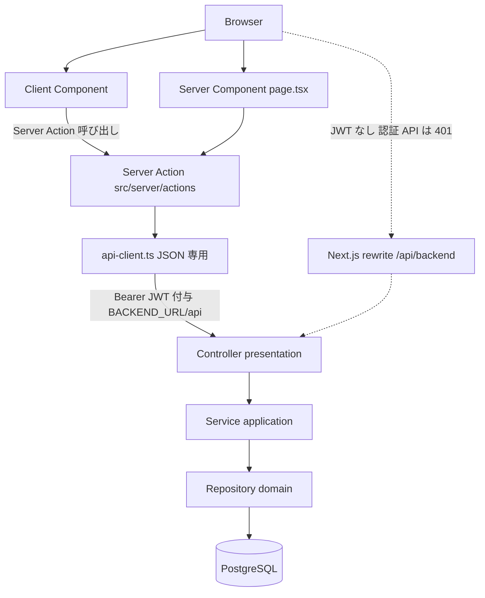
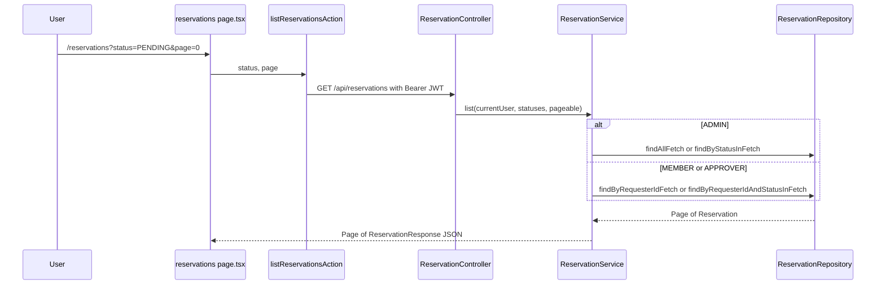

# System Architecture

## System Overview

Next.js 15（App Router）が BFF として Server Actions 経由で Spring Boot 4 の REST API（`/api`）を呼ぶ 2 層構成。認証は Cognito 発行 JWT（Better Auth、ローカルは開発専用ロール別ログインの cookie）。JWT はサーバー側（`src/lib/session.ts` の `getAccessToken`）でのみ取得・付与し、ブラウザは JWT を保持しない。バックエンドは domain / application / presentation / infrastructure の 4 層。DB は PostgreSQL（Flyway 管理、テストは H2）。

## Architecture Diagram

## Component Descriptions

### ReservationController（presentation）
- **Purpose**: `/api/reservations` の一覧・申請・詳細・更新・キャンセル
- **Responsibilities**: リクエスト受付のみ。`@PreAuthorize` は使わず、行レベル所有権チェックは Service が担う
- **Dependencies**: ReservationService
- **Type**: Application

### ReservationService（application）
- **Purpose**: 予約の業務ルール（重複判定、承認要否分岐、所有権、ステータスガード）
- **Responsibilities**: `list()` で `Role.ADMIN` なら全件、それ以外は本人分を返す
- **Dependencies**: ReservationRepository, ResourceRepository, ApprovalService

### ReservationRepository（domain インターフェース）
- **Purpose**: 予約の永続化。一覧用に JOIN FETCH 付き `@Query` 4 本（本人／全件 × ステータス有無、いずれも Pageable）
- **Type**: Application

### SecurityConfig ほか（infrastructure/security）
- **Purpose**: OAuth2 Resource Server（JWT 検証）、`@EnableMethodSecurity`、`custom:role` を `ROLE_*` に変換、401/403 の統一レスポンス
- **Responsibilities**: パス単位のロール制御はなく `anyRequest().authenticated()` のみ。ロール制御は各 Controller の `@PreAuthorize`

### AdminLayout（frontend `/admin/layout.tsx`）
- **Purpose**: `/admin/*` の ADMIN ガード。ADMIN 以外には 403 画面を表示

## Data Flow（予約一覧取得）

## Integration Points
- **External APIs**: Cognito（JWT 発行・JWK による検証）
- **Databases**: PostgreSQL（本番・ローカル）/ H2（テスト、ADR-018）
- **Third-party Services**: なし

## Infrastructure Components
- **Deployment Model**: ローカルは DevContainer + Docker Compose（frontend / postgres / localstack / cognito-local / docs）。本課題のスコープ外
- **Networking**: ブラウザからのバックエンド到達経路は Next.js rewrite（`/api/backend/:path*`）のみ。ただし JWT を付与できないため、認証必須 API には使えない

## Issue #29 に関係するアーキテクチャ上の所見

- `api-client.ts` の全メソッドはレスポンスを `res.json()` して Zod で検証し、リクエストに常に `Content-Type: application/json` を付ける。CSV（テキスト・バイナリ）を受け取る経路はない
- ブラウザが `<a href>` で直接ダウンロードする方式は、JWT がブラウザにないため成立しない。サーバー側で JWT を付けて中継する経路（Route Handler または Server Action）が必要になる。既存の Route Handler は `src/app/api/auth/[...all]/route.ts`（Better Auth）のみ
