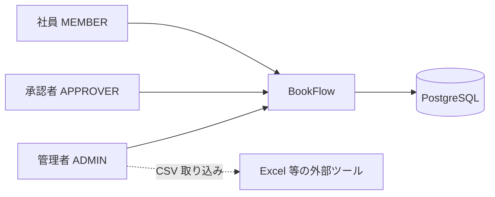

# Business Overview

対象課題: CSV 帳票出力（`docs-next/docs/spec/enhancements/intermediate/csv-export.md`、Issue #29）。再実行日 2026-10-29。

## Business Context Diagram

## Business Description
- **Business Description**: 施設・備品（会議室、機器、車両）を予約する社内システム。予約申請、承認フロー、リソース管理、ユーザー一覧を提供する。
- **Business Transactions**: 認証、リソース一覧と空き照会、予約申請、予約の更新とキャンセル、承認と却下、リソース管理（ADMIN）、ユーザー一覧（ADMIN）。CSV 出力は未実装。
- **Business Dictionary**: 予約ステータスは `DRAFT` / `PENDING` / `APPROVED` / `REJECTED` / `CANCELLED`。承認ステップ（`approval_steps`）は別テーブルで、`PENDING` / `APPROVED` / `REJECTED` を持つ。

## Component Level Business Descriptions
### 予約（reservations）
- **Purpose**: リソースの時間帯利用を表す中核データ。
- **Responsibilities**: 重複チェック、`requires_approval` による即時確定または承認待ちの分岐、本人または ADMIN による操作制御。
### 管理者機能（/admin/*）
- **Purpose**: ADMIN 専用画面（リソース管理、ユーザー管理）。`/admin/layout.tsx` が非 ADMIN に 403 画面を出す。
### CSV 出力（今回の対象）
- **Purpose**: 管理者が予約データを外部ツールへ転記できるようにする。現状は該当機能なし。
