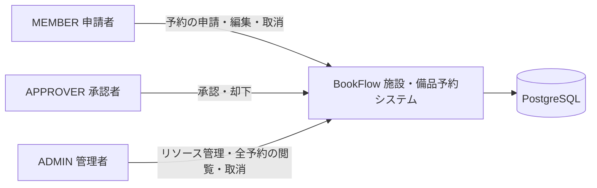

# Business Overview

**スコープ注記**: リポジトリ全体ではなく、対象エンハンス課題「予約の下書き保存」（`docs-next/docs/spec/enhancements/intermediate/reservation-draft.md`）に関連する予約ドメインに絞る。全体像は `docs-next/docs/reference/architecture.md` を参照。

## Business Context Diagram

## Business Description

- **Business Description**: 社内の施設（会議室）・備品・社用車を予約するシステム。申請者が時間帯を指定して予約し、承認が必要なリソースは承認者の承認を経て確定する。
- **Business Transactions（予約ドメイン）**:
  - 予約申請: リソース・開始終了日時・目的・参加人数を入力して申請する。承認不要のリソースは即時に確定（APPROVED）、承認必要なリソースは承認待ち（PENDING）になり承認ステップが作られる。
  - 予約の一覧・詳細参照: MEMBER は本人分のみ、APPROVER・ADMIN は全件を参照できる（現行実装）。
  - 予約の更新: 本人のみ、PENDING のときだけ可能（ADMIN も不可）。
  - 予約の取消: 本人または ADMIN。PENDING / APPROVED のときだけ可能。
  - 承認・却下: 承認者が承認ステップに対して行い、予約を APPROVED / REJECTED にする。
  - 重複予約チェック: 同一リソースで PENDING / APPROVED の予約と時間帯が重なる申請を 409 で拒否する。
- **Business Dictionary**:

| 用語 | 意味 |
|---|---|
| DRAFT | 下書き。DB の CHECK 制約と列挙型には定義済みだが、現行実装では未使用（今回の課題で実装する） |
| PENDING | 承認待ち |
| APPROVED | 承認済み（承認不要リソースの申請も即この状態） |
| REJECTED / CANCELLED | 却下 / 取消 |
| 占有（OCCUPIED_STATUSES） | 時間帯を押さえているとみなす状態の集合。PENDING と APPROVED。DRAFT は含まれない |
| approval_steps | 承認待ち予約ごとに 1 件作られる承認ステップ |

## Component Level Business Descriptions

### 予約（Reservation）
- **Purpose**: 利用者の予約の申請から確定・取消までの状態を管理する。
- **Responsibilities**: 申請の受付、重複判定、承認要否に応じた状態決定、参照権限の制御、更新・取消のガード。

### 承認（Approval）
- **Purpose**: 承認が必要なリソースの予約を、承認者が確定または却下する。
- **Responsibilities**: 承認ステップの生成、承認待ち一覧、承認・却下の実行と二重決済の防止。

### リソース（Resource）
- **Purpose**: 予約対象（会議室・備品・社用車）と、その空き状況の提供。
- **Responsibilities**: 一覧・詳細、時間帯指定の空き確認（占有予約の除外）。
