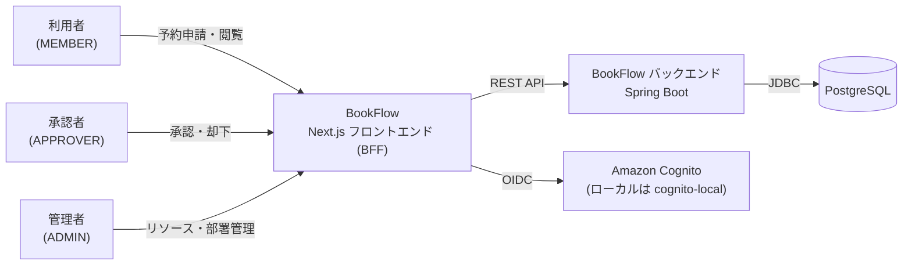

# Business Overview

## Business Context Diagram

## Business Description

- **Business Description**: BookFlow は社内の会議室・備品・車両などの「リソース」を予約するための施設・備品予約システムである。利用者はリソースの空き状況を確認して予約を申請し、リソースによっては承認者の承認を経て予約が確定する。
- **Business Transactions**:
  - リソース一覧・空き確認（カテゴリ・時間帯でリソースを絞り込み、空きを確認する）
  - リソース登録・編集・有効化/無効化（管理者のみ）
  - 予約申請・キャンセル（利用者）
  - 予約承認・却下（承認者、`requires_approval = true` のリソースのみ）
  - ユーザー・部署管理（管理者）
- **Business Dictionary**:
  - **リソース（Resource）**：予約対象となる会議室・備品・車両。カテゴリは `ROOM` / `EQUIPMENT` / `VEHICLE`。
  - **予約（Reservation）**：リソースと時間帯を紐づけた申請。状態は `DRAFT` → `PENDING` → `APPROVED`/`REJECTED`、または `CANCELLED`。
  - **承認ステップ（ApprovalStep）**：`requires_approval = true` のリソースに対する予約が経由する承認レコード。
  - **部署（Department）**：ユーザーが所属する組織単位。親子関係を持てる。
  - **ロール（Role）**：`MEMBER` / `APPROVER` / `ADMIN` の3種類。

## Component Level Business Descriptions

### frontend（Next.js App Router）
- **Purpose**: 利用者・承認者・管理者向けの画面提供と、Spring Boot バックエンドへの API 呼び出しを仲介する BFF。
- **Responsibilities**: 画面描画（Server Components）、Server Actions によるバックエンド呼び出し、Better Auth + Cognito によるセッション管理、フォームバリデーション（Zod）。

### backend（Spring Boot）
- **Purpose**: リソース・予約・承認・ユーザー・部署に関する業務ロジックと永続化を担う REST API サーバー。
- **Responsibilities**: 4層アーキテクチャ（domain / application / presentation / infrastructure）に基づく業務ルールの実装、OAuth2 Resource Server によるトークン検証、PostgreSQL への永続化（Flyway 管理）。

### docs-next（Docusaurus）
- **Purpose**: 学習者・運営者向けの仕様書・開発ガイド・ADR を公開するドキュメントサイト。本エンハンス課題の対象ではないが、`docs-next/docs/spec/` が仕様の真実の源であるため参照する。
