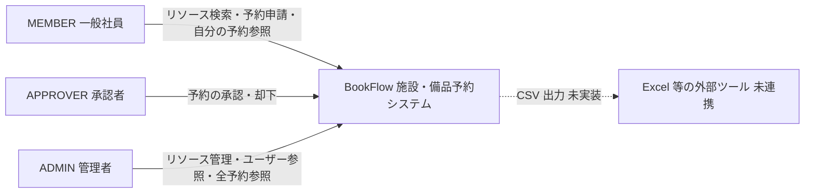

# Business Overview

## Business Context Diagram

## Business Description

- **Business Description**: 社内の施設（会議室等）・備品・社用車を予約するシステム。承認が必要なリソースは承認フローを経て確定する。予約データは画面で閲覧できるが、外部ツールへ持ち出す手段（CSV 等）はない。
- **Business Transactions**:
  - リソース一覧・空き確認（カテゴリ・キーワード・期間で絞り込み。PR #146 で keyword 追加済み）
  - リソース登録・更新・有効無効切替（ADMIN）
  - 予約申請・内容更新・キャンセル
  - 予約一覧参照（MEMBER / APPROVER は本人分、ADMIN は全件。ステータスで絞り込み可。Issue #29 の CSV 化の元データ）
  - 承認・却下（APPROVER / ADMIN）
  - ユーザー一覧参照（ADMIN）、部署参照、プロフィール参照
- **Business Dictionary**:
  - リソース：予約対象（ROOM 会議室 / EQUIPMENT 備品 / VEHICLE 社用車）
  - 予約ステータス：DRAFT ドラフト / PENDING 承認待ち / APPROVED 承認済み / REJECTED 却下 / CANCELLED キャンセル済み（表示名は `frontend/src/lib/labels.ts`）
  - 占有：PENDING または APPROVED の予約が時間帯を塞いでいる状態
  - 申請者：予約を申請したユーザー（`reservations.requester_id`）

## Component Level Business Descriptions

### backend（Spring Boot）
- **Purpose**: 業務ルールと永続化、認可の最終防衛線
- **Responsibilities**: REST API 提供、ロール別の一覧制御（予約は ADMIN のみ全件、リソースは ADMIN のみ inactive 可視）、予約重複判定、承認フロー

### frontend（Next.js BFF + UI）
- **Purpose**: 画面表示と Server Actions による API 中継（JWT はサーバー側で付与）
- **Responsibilities**: ロール別ナビゲーション、`/admin/*` の ADMIN ガード、一覧画面のフィルタ状態を URL searchParams で保持

## Issue #29 に関係する業務上の所見

- ビジネス要求シートは「UC-07（CSV・帳票出力）の実装」と記載するが、`docs-next/docs/spec/requirements.md` の UC-07 は「社員が自分の予約一覧を確認・編集・キャンセルする」である。CSV / PDF 帳票出力は同ファイルの機能一覧（L57）にのみ記載がある
- 管理者専用の予約一覧画面は存在しない。ADMIN が全予約を閲覧できるのは `/reservations`（ADMIN のときだけ見出しが「全予約一覧」になり申請者列が出る）
