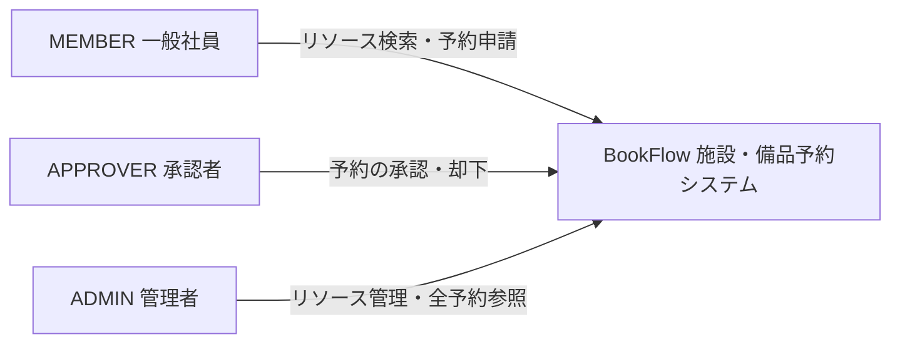

# Business Overview

## Business Context Diagram

## Business Description

- **Business Description**: 社内の施設（会議室等）・備品・車両を予約するシステム。承認が必要なリソースは承認フローを経て確定する。
- **Business Transactions**: リソース一覧・空き確認（UC-02、本課題の拡張対象）/ リソース登録・更新・有効無効切替（ADMIN）/ 予約申請・更新・キャンセル / 承認・却下 / ユーザー・部署参照
- **Business Dictionary**:
  - リソース: 予約対象（ROOM / EQUIPMENT / VEHICLE の 3 カテゴリ）
  - 占有: ステータスが PENDING または APPROVED の予約が時間帯を塞いでいる状態

## Component Level Business Descriptions

### backend（Spring Boot）
- **Purpose**: 業務ルールと永続化、認可の最終防衛線
- **Responsibilities**: REST API 提供、ロール別の一覧制御（ADMIN のみ inactive 可視）、予約重複判定

### frontend（Next.js BFF + UI）
- **Purpose**: 画面表示と Server Actions による API 中継
- **Responsibilities**: `/resources` の一覧・フィルタ UI、URL searchParams による状態保持
