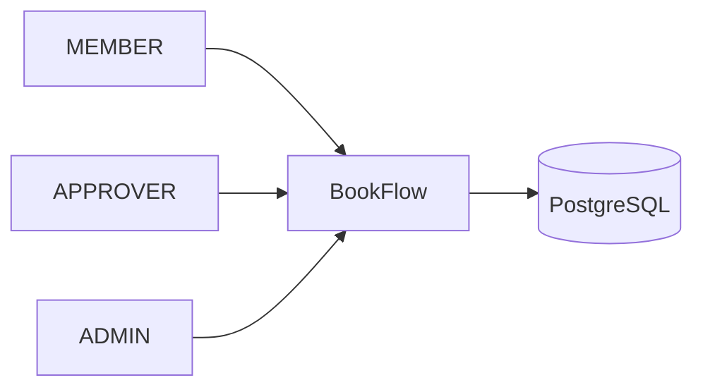

# Business Overview

## Business Context Diagram

## Business Description
- **Business Description**: 施設・備品（会議室 / 備品 / 車両）の予約と承認を扱う社内システム BookFlow。
- **Business Transactions**: リソース一覧・空き確認（UC-02）、予約作成・変更・取消、承認、リソース管理（ADMIN）。
- **Business Dictionary**: 用語は `docs-next/docs/spec/overview.md` を参照。

## Component Level Business Descriptions
### backend
- **Purpose**: REST API。リソース・予約・承認のユースケースを提供する。
- **Responsibilities**: 認可、業務ルール（重複予約判定）、永続化。
### frontend
- **Purpose**: Next.js の BFF と UI。Server Actions 経由で backend を呼ぶ。
- **Responsibilities**: 画面表示、フォーム入力、URL パラメータによる絞り込み状態の保持。
