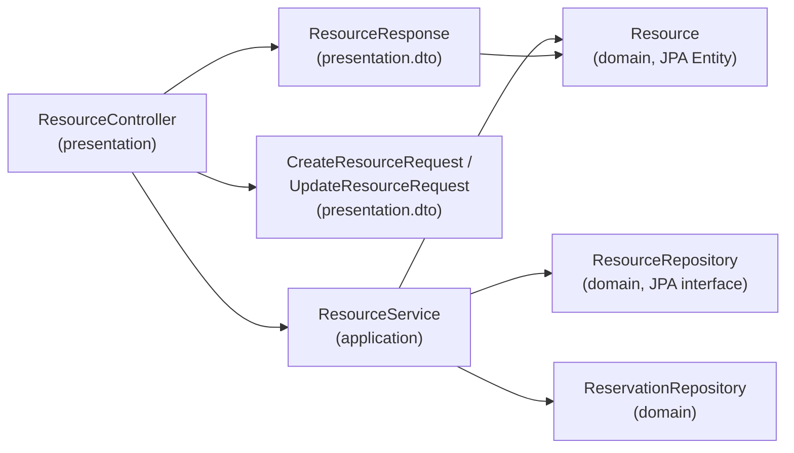

# Code Structure

## Build System

- **Type**: Gradle（Kotlin DSL、backend） / pnpm + Next.js（frontend） / npm + Docusaurus（docs-next）
- **Configuration**: `backend/build.gradle.kts`（Spring Boot 4.0.6、Java 25 toolchain、Spotless + Checkstyle）、`frontend/package.json`（pnpm、Next.js 15.3、oxlint + oxfmt）

## Key Classes/Modules

バックエンドは4層アーキテクチャ（`domain` / `application` / `presentation` / `infrastructure`）を全ドメイン（resources・reservations・approvals・users・departments・auth）で共通して踏襲している。`resources` ドメインはこの中で最も新しく、Service 層（`ResourceService`）を初めて導入したドメインである。

### Existing Files Inventory

**resources ドメイン（本エンハンス課題の直接の変更対象）**

- `backend/src/main/resources/db/migration/V001__create_initial_schema.sql` - 初期スキーマ。`resources` テーブルは `id, name, category, capacity, location, requires_approval, is_active, description, created_at` の9カラム（新規マイグレーションはこのファイルの直後の連番 `V002` になる）
- `backend/src/main/java/com/example/bookflow/domain/Resource.java` - JPA エンティティ。`create` / `update` ファクトリ・更新メソッドと getter のみを持つ（`ddl-auto: validate` のためカラムと厳密に一致させる必要あり）
- `backend/src/main/java/com/example/bookflow/domain/ResourceCategory.java` - `ROOM` / `EQUIPMENT` / `VEHICLE` の enum
- `backend/src/main/java/com/example/bookflow/domain/ResourceRepository.java` - Spring Data JPA リポジトリ（カテゴリ・有効フラグでの検索メソッドを含む）
- `backend/src/main/java/com/example/bookflow/application/ResourceService.java` - 一覧（ロール別フィルタ・空き確認フィルタ）・詳細取得・登録・更新・ステータス切替・空き照会のユースケース
- `backend/src/main/java/com/example/bookflow/application/exception/ResourceNotFoundException.java` - 404 用例外
- `backend/src/main/java/com/example/bookflow/presentation/ResourceController.java` - `GET/POST /api/resources`、`GET/PUT /api/resources/{id}`、`PATCH /api/resources/{id}/status`、`GET /api/resources/{id}/availability` の6エンドポイント
- `backend/src/main/java/com/example/bookflow/presentation/dto/ResourceResponse.java` - レスポンス DTO（9フィールド、`from(Resource)` ファクトリ）
- `backend/src/main/java/com/example/bookflow/presentation/dto/CreateResourceRequest.java` / `UpdateResourceRequest.java` - リクエスト DTO（同一フィールド構成、Bean Validation 付き）
- `backend/src/main/java/com/example/bookflow/presentation/dto/OccupiedSlot.java` / `StatusUpdateRequest.java` - 補助 DTO
- `backend/src/test/java/com/example/bookflow/application/ResourceServiceTest.java` / `.../presentation/ResourceControllerTest.java` - 既存テスト
- `frontend/src/app/(authenticated)/resources/page.tsx` - リソース一覧画面
- `frontend/src/app/(authenticated)/resources/ResourceFilterForm.tsx` - 一覧の絞り込みフォーム
- `frontend/src/app/(authenticated)/resources/[id]/page.tsx` - **リソース詳細画面（本課題 RES-04 の変更対象）**。名前・カテゴリ・場所・定員・承認要否・説明・空き状況を表示
- `frontend/src/app/(authenticated)/admin/resources/page.tsx` - 管理者向けリソース管理ページ（Server Component、一覧取得のみ）
- `frontend/src/app/(authenticated)/admin/resources/ResourceManagementClient.tsx` - **登録・編集フォーム（本課題 RES-03 の変更対象）**。`ResourceForm` 内部コンポーネントで新規登録・編集ダイアログを共用
- `frontend/src/server/actions/resources.ts` - Server Actions（`getResourceAction` / `createResourceAction` / `updateResourceAction` 等、**本課題 RES-02 の変更対象**）
- `frontend/src/lib/schemas/resource.ts` - Zod スキーマ（`CreateResourceSchema` / `UpdateResourceSchema`、フォームバリデーション用）
- `frontend/src/lib/types/api.ts` - `ResourceResponseSchema`（バックエンド DTO と対になる Zod スキーマ、記述箇所は同ファイル内、本課題での変更対象）
- `frontend/tests/unit/server/actions/resources.test.ts` - Server Actions の既存テスト

**他ドメイン（軽い一覧のみ。本課題では変更対象外）**

- `backend/.../domain/{User,Department,Reservation,ApprovalStep,Role,ReservationStatus,ApprovalStatus}.java` - 各ドメインのエンティティ・enum
- `backend/.../application/*Service.java`（Resource 以外は現時点で Service 層は `ResourceService` のみ確認、他ドメインは Controller が直接 Repository を扱っている可能性がある。詳細は今回のスコープ外のため未調査）
- `backend/.../presentation/{User,Reservation,Approval,Department,Auth}Controller.java` - 各ドメインの REST エンドポイント
- `frontend/src/app/(authenticated)/{reservations,admin,approvals}/` 配下 - 各画面

## Design Patterns

### ファクトリメソッド + カプセル化されたセッター
- **Location**: `Resource.create()` / `Resource.update()`（`domain.Resource`）
- **Purpose**: JPA エンティティの不変条件（ID・登録日時のアプリ側採番）を保証する
- **Implementation**: コンストラクタを `protected` にし、`static create()` と業務メソッド（`update` / `changeActive`）経由でのみ状態変更を許可

### DTO ファクトリメソッド
- **Location**: `ResourceResponse.from(Resource)`
- **Purpose**: エンティティ→DTO変換をレスポンス DTO 自身に持たせ、Controller/Service を薄く保つ
- **Implementation**: `record` の static factory method

### Server Actions を BFF 層とする分離
- **Location**: `frontend/src/server/actions/resources.ts`
- **Purpose**: フロントエンドの Server Components/Client Components からバックエンド API 呼び出しを一箇所に集約し、トークン管理をサーバーサイドに閉じる
- **Implementation**: `"use server"` ディレクティブ + `createApiClient(getAccessToken)`

## Critical Dependencies

### Spring Boot 4.0 / spring-boot-flyway
- **Version**: 4.0.6（Spring Boot）、Flyway は Spring Boot 4.0 で自動構成が別モジュール化されたため `spring-boot-flyway` を明示追加
- **Usage**: `backend/src/main/resources/db/migration/` 配下の SQL をアプリ起動時に自動適用
- **Purpose**: スキーマバージョン管理

### Zod + React Hook Form
- **Version**: zod ^3.25、react-hook-form ^7.76
- **Usage**: `frontend/src/lib/schemas/resource.ts` の `CreateResourceSchema` を `zodResolver` 経由でフォームに接続
- **Purpose**: クライアント側フォームバリデーション
