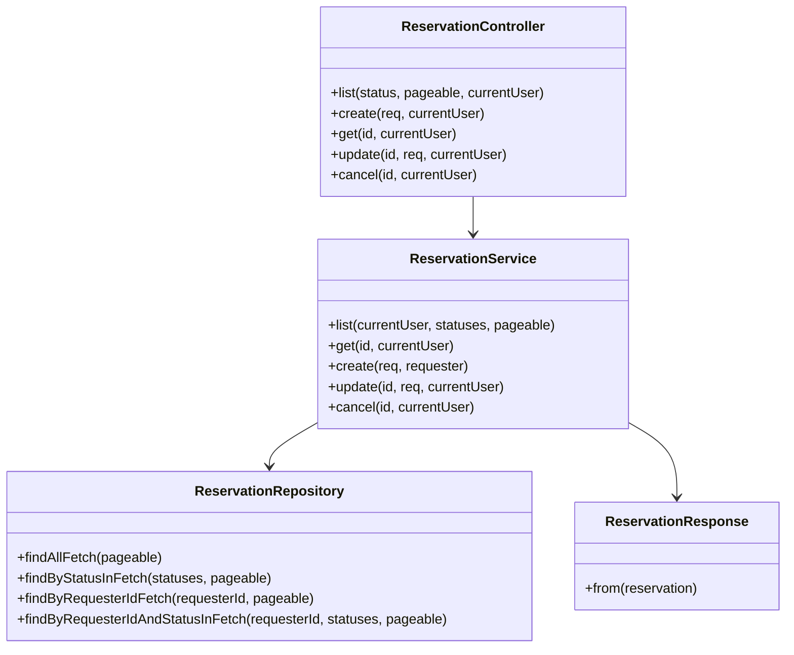

# Code Structure

## Build System
- **Type**: Gradle Kotlin DSL（backend）/ pnpm（frontend）
- **Configuration**: `backend/build.gradle.kts`（Spotless・Checkstyle・springdoc。CSV ライブラリは未導入）、`frontend/package.json`、`frontend/next.config.ts`（`/api/backend/:path*` を `BACKEND_URL` へ rewrite）

## Key Classes/Modules

### Existing Files Inventory（Issue #29 で参照・変更候補）

Backend（`backend/src/main/java/com/example/bookflow/` 配下）
- `presentation/ReservationController.java` - 予約 API。`status` は `List<ReservationStatus>`（複数指定可）
- `presentation/dto/ReservationResponse.java` - 12 フィールドの record。RPT-02 の出力項目（ID・リソース名・申請者名・開始・終了・目的・状態）をすべて含む
- `application/ReservationService.java` - `list()` 内で ADMIN 判定。`@Transactional(readOnly = true)`
- `domain/Reservation.java` - `resource` / `requester` は LAZY。`startAt` / `endAt` は `LocalDateTime`（タイムゾーンなし）
- `domain/ReservationStatus.java` - DRAFT / PENDING / APPROVED / REJECTED / CANCELLED
- `domain/ReservationRepository.java` - 一覧用 `@Query` 4 本（すべて Pageable）。期間条件のメソッドなし。`JpaSpecificationExecutor` 未継承
- `domain/ResourceSpecifications.java` / `domain/ResourceRepository.java` - PR #146 で導入した Specification による条件の AND 結合の実装例
- `application/ResourceService.java` - `public static overlaps(...)`（時間帯重複判定。再利用可能）
- `presentation/UserController.java` - `@PreAuthorize("hasRole('ADMIN')")` の実装例
- `presentation/ResourceController.java` - POST / PUT / PATCH に `@PreAuthorize("hasRole('ADMIN')")`
- `infrastructure/security/SecurityConfig.java` / `RoleJwtAuthenticationConverter.java` / `RestAccessDeniedHandler.java` - 認証・認可・403 応答
- `presentation/exception/GlobalExceptionHandler.java` - `AccessDeniedException` を 403 `{code, message}` に変換
- `infrastructure/config/WebMvcConfig.java` + `infrastructure/security/RegisteredUserInterceptor.java` - `/api/**` で JWT の sub を users と照合（未登録は 401）

Frontend（`frontend/src/` 配下）
- `app/(authenticated)/reservations/page.tsx` - 予約一覧。`getProfileAction()` で ADMIN 判定し表示を切替。ステータスフィルタは URL searchParams
- `app/(authenticated)/admin/layout.tsx` - `/admin/*` の ADMIN ガード
- `app/(authenticated)/admin/resources/page.tsx` / `admin/users/page.tsx` - 既存の管理画面
- `components/layout/nav-items.ts` - ロール別サイドナビ（`ADMIN_ITEMS`）
- `server/actions/reservations.ts` - `listReservationsAction`（`status` / `page` / `size`）
- `lib/api-client.ts` - BFF 共通クライアント（JSON 専用）
- `lib/session.ts` - `getAccessToken`（JWT 取得。サーバー側専用）
- `lib/labels.ts` - `RESERVATION_STATUS_LABELS` ほか日本語表示名
- `lib/types/api.ts` - `ReservationResponseSchema`（Zod）

Tests
- `backend/src/test/java/com/example/bookflow/support/` - `BaseControllerTest`、`@WithMockAdmin` / `@WithMockApprover` / `@WithMockMember`
- `backend/src/test/.../presentation/UserControllerTest.java` - ADMIN 専用 API のロール別テスト（200 / 403 / 403 / 401）
- `backend/src/test/.../presentation/ReservationControllerTest.java` / `application/ReservationServiceTest.java`
- `frontend/tests/unit/server/actions/reservations.test.ts` - Vitest + MSW
- `frontend/tests/unit/msw/handlers.ts` - MSW デフォルトハンドラ

Spec
- `docs-next/docs/spec/api-spec.md`（§予約 L482〜、エンドポイント一覧 L147〜。帳票セクションなし）
- `docs-next/docs/spec/screen-spec.md`（§予約 `/reservations` L205〜、§リソース `/admin/resources` L144〜）
- `docs-next/docs/spec/requirements.md`（機能一覧 L57、UC-07 L236）

## Design Patterns

### Layered Architecture
- **Location**: backend 全体
- **Purpose**: 責務分離（Controller は薄く、業務ルールは Service）
- **Implementation**: domain にエンティティと Repository インターフェース、application に Service、presentation に Controller と DTO

### ロール制御の二系統
- **Location**: Controller の `@PreAuthorize`（エンドポイント単位）と Service 内の `Role.ADMIN` 判定（行レベル）
- **Purpose**: 「誰が呼べるか」と「どの行が見えるか」を分ける

### Server Component + URL 状態
- **Location**: `reservations/page.tsx`、`resources/page.tsx`
- **Purpose**: フィルタ状態を URL に保持し、Server Component で再取得（Zustand は不使用）

### Specification による動的条件
- **Location**: `ResourceSpecifications` + `ResourceRepository extends JpaSpecificationExecutor`
- **Purpose**: 任意条件の組み合わせで派生クエリが増えるのを避ける

## Critical Dependencies
- Spring Boot 4.0 / Java 25 / Spring Data JPA / Spring Security - 永続化と認可
- Next.js 15 / React 19 / Zod - UI と型検証
