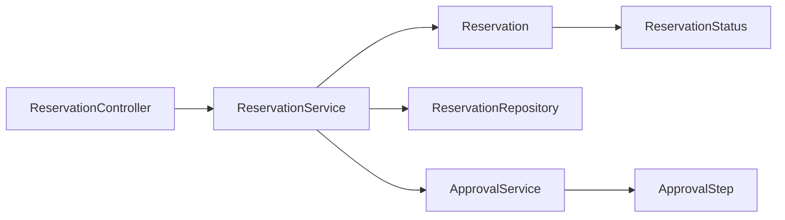

# Code Structure

**略記**: `BE/` = `backend/src/main/java/com/example/bookflow/`、`FE/` = `frontend/src/`。

## Build System

- **Type**: pnpm（frontend）/ Gradle Kotlin DSL（backend）
- **Configuration**: backend は `ddl-auto: validate` + Flyway（`backend/src/main/resources/application.yml`）。テストは `application-test.yml` で H2 + `create-drop`。

## Key Classes/Modules

### Existing Files Inventory（変更候補）

バックエンド:
- `BE/domain/Reservation.java` - エンティティ。`purpose`・`startAt`・`endAt` が `nullable=false`。状態遷移は `cancel()` / `markApproved()` / `markRejected()` のみで、DRAFT から PENDING への遷移メソッドはない。
- `BE/domain/ReservationStatus.java` - DRAFT を含む 5 値の列挙（定義済み）。
- `BE/domain/ReservationRepository.java` - status 条件のあるクエリと、無いクエリ（`findAllFetch`、`findByRequesterIdFetch`）が混在。
- `BE/application/ReservationService.java` - `create`（承認要否だけで状態決定、承認ステップ生成はここだけ）、`update`（PENDING 以外を拒否）、`cancel`（PENDING / APPROVED のみ）、`checkReadAccess`（MEMBER 以外は全件可）。
- `BE/application/ApprovalService.java` - `createInitialStep`、`guardReservationPending`（PENDING 以外を拒否）。
- `BE/presentation/ReservationController.java` - GET / POST / GET {id} / PUT {id} / POST {id}/cancel。DELETE は無い。
- `BE/presentation/dto/CreateReservationRequest.java` - `draft` フィールドなし。`@NotNull` / `@NotBlank` が常に有効。
- `BE/presentation/dto/UpdateReservationRequest.java` - status や提出を表すフラグなし。
- `BE/presentation/dto/ReservationResponse.java` - `status` は文字列。
- `backend/src/main/resources/db/migration/V001__create_initial_schema.sql` - `reservations` の NOT NULL・CHECK 制約。

フロントエンド:
- `FE/app/(authenticated)/reservations/page.tsx` - 一覧。`ALL_STATUSES` に DRAFT なし（下書きタブなし）。「すべて」は status 未指定で DRAFT も返る。バッジ色の定義をローカルに持つ。
- `FE/app/(authenticated)/reservations/new/ReservationForm.tsx` - 申請フォーム。ボタンは「予約を申請する」と「キャンセル」のみ。
- `FE/app/(authenticated)/reservations/[id]/page.tsx` - 詳細。`canEdit` は PENDING かつ本人のみ。DRAFT の操作ボタンなし。バッジ色が一覧と重複定義。
- `FE/app/(authenticated)/reservations/[id]/edit/page.tsx` - PENDING 以外は `notFound()`（DRAFT は編集画面に入れない）。
- `FE/app/(authenticated)/reservations/[id]/edit/ReservationEditForm.tsx` - 更新フォーム。
- `FE/server/actions/reservations.ts` - Server Actions。`createReservationAction` は `draft` を送らない。
- `FE/lib/schemas/reservation.ts` - `CreateReservationSchema` / `UpdateReservationSchema`。必須項目は DRAFT でも必須のまま。
- `FE/lib/types/enums.ts`, `FE/lib/types/api.ts`, `FE/lib/labels.ts` - DRAFT は定義済み（表示名「ドラフト」）。

## Design Patterns

### 4 層アーキテクチャ
- **Location**: `BE/` 配下の domain / application / presentation / infrastructure
- **Purpose**: 責務の分離。遷移の事前検証は Service 側の責務（`Reservation` の Javadoc に明記）。

### 手書きの権限チェック
- **Location**: `ReservationService`（`AccessDeniedException` を投げる）
- **Purpose**: 予約系 Controller では `@PreAuthorize` を使わない方針（`ReservationController` の Javadoc に明記）。`@PreAuthorize` は `ResourceController` と `ApprovalController` で使用。

### 占有状態のホワイトリスト
- **Location**: `ReservationService` / `ApprovalService` / `ResourceService` のそれぞれが `OCCUPIED_STATUSES = [PENDING, APPROVED]` を個別に定義
- **Purpose**: 重複判定と空き確認の対象。DRAFT は自動的に対象外になる。

### 悲観ロック
- **Location**: `ReservationService.create` / `update`（`findByIdForUpdate`）
- **Purpose**: 同一リソースへの同時予約の競合防止。

## Critical Dependencies

### Spring Data JPA / Flyway
- **Usage**: 永続化とスキーマ管理。`ddl-auto: validate` のため、NOT NULL を緩める場合は Flyway SQL とエンティティの `nullable` の両方を揃える。

### React Hook Form + Zod
- **Usage**: フォームと入力検証（`FE/lib/schemas/reservation.ts`）。
