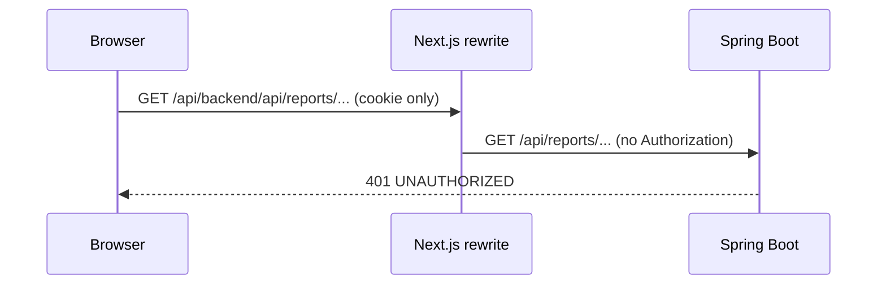

# Reverse Engineering 補足：csv-export

**作成日時**: 2026-10-26T01:25:59+00:00
**対象タスク**: csv-export（`docs-next/docs/spec/enhancements/intermediate/csv-export.md`、Issue #29）
**位置づけ**: 同じディレクトリの既存 8 ファイル（2026-10-26T00:22:33+00:00、リソース一覧機能に限定した分析）を補う。既存ファイルは書き換えていない。システム全体の構成（4 レイヤー、BFF、認証方式）は既存の `architecture.md` と `technology-stack.md` を前提とし、ここでは CSV 出力に関わる範囲だけを記す。

---

## 1. 予約ドメインの現状（backend）

### 1.1 データモデル

`reservations` テーブル（`V001__create_initial_schema.sql`）と `Reservation` エンティティ。

| 列 | 型 | CSV 要件（RPT-02）との対応 |
|---|---|---|
| `id` | UUID | 予約 ID |
| `resource_id` → `resources.name` | UUID（FK）→ VARCHAR(100) | リソース名（JOIN が必要） |
| `requester_id` → `users.name` | UUID（FK）→ VARCHAR(100) | 申請者名（JOIN が必要） |
| `start_at` | TIMESTAMP | 開始日時 |
| `end_at` | TIMESTAMP | 終了日時 |
| `purpose` | VARCHAR(255) NOT NULL | 目的（自由入力。カンマ、改行、ダブルクォート、先頭の `=` などを含みうる） |
| `attendees_count` | INTEGER NULL | RPT-02 には含まれない |
| `status` | VARCHAR(20) | 承認状態。CHECK 制約は `DRAFT / PENDING / APPROVED / REJECTED / CANCELLED`。ベース実装は `DRAFT` を使っていない |
| `created_at` / `updated_at` | TIMESTAMP | RPT-02 には含まれない |

- `Reservation.resource` と `Reservation.requester` は `FetchType.LAZY`。一覧系クエリは N+1 を避けるため `JOIN FETCH r.resource JOIN FETCH r.requester` を使う慣例がある。
- インデックスは `resource_id`、`requester_id`、`status` のみ。`start_at` / `end_at` にはない。
- 日時はすべて `LocalDateTime`（タイムゾーンなし）。api-spec の日時フォーマット規約により、サーバー、DB、クライアント間でタイムゾーン変換を行わない。

### 1.2 Repository

`ReservationRepository` の一覧系メソッドは、すべて `Page<Reservation>` を返す `@Query`（JPQL、JOIN FETCH、countQuery 付き）である。

| メソッド | 条件 |
|---|---|
| `findAllFetch(Pageable)` | 全件（ADMIN） |
| `findByStatusInFetch(statuses, Pageable)` | `status IN :statuses`（ADMIN） |
| `findByRequesterIdFetch` / `findByRequesterIdAndStatusInFetch` | 本人分（ADMIN 以外） |
| `findByResource_IdAndStatusIn` / `findByResource_IdInAndStatusIn` | 空き照会用（List 返却、期間条件は Java 側） |

**期間（日時範囲）で絞り込むクエリは存在しない。** 空き照会の重複判定も、期間条件を DB に渡さず `ResourceService.overlaps`（`public static`）で Java 側で行っている。CSV の `from` / `to` 絞り込み（RPT-03）には新しいクエリが必要になる。ページングしない全件取得のメソッドもない。

### 1.3 Service / Controller / DTO

- `ReservationService.list(currentUser, statuses, pageable)`：ADMIN なら全件、それ以外は本人分。`statuses` が空なら全ステータス。`@Transactional(readOnly = true)`。
- `ReservationController`（`/api/reservations`）：`status` を `List<ReservationStatus>` で受け、複数指定（`?status=PENDING&status=APPROVED`）できる。行レベルの所有権チェックは Service が担い、`@PreAuthorize` は使っていない。
- `ReservationResponse.from(Reservation)`：12 フィールド。`resourceName` と `requesterName` を持つため、RPT-02 の 7 項目はこの DTO から取り出せる。ただし LAZY 関連を読むのでトランザクション内で呼ぶ必要がある。
- `reports` という名前のパッケージ、Controller、Service はまだない。CSV を生成するコードも、CSV ライブラリ（opencsv 等）の依存もない（`build.gradle.kts` 確認済み）。

### 1.4 認可とエラー処理

- `SecurityConfig` は `anyRequest().authenticated()` までで、URL パターン単位のロール制御はしていない。ロール制御は `@EnableMethodSecurity` と各 Controller の `@PreAuthorize` で行う。
- ADMIN 限定の前例：`UserController`（`@PreAuthorize("hasRole('ADMIN')")`）、`ResourceController` の POST / PUT / PATCH。
- `@PreAuthorize` 違反は `GlobalExceptionHandler.handleAccessDenied` が `403 { code: FORBIDDEN }` を返す（JSON）。CSV エンドポイントで 403 になった場合も、本文は CSV ではなく JSON のエラーになる。
- クエリパラメータの型変換失敗（`LocalDateTime` に変換できない値、未知の enum 値）は `MethodArgumentTypeMismatchException` として `400 VALIDATION_ERROR` になる。複合条件の検証（例：`from` / `to` の同時指定）は `ValidationException` を投げて 400 にする前例が `ResourceController.list` にある。
- `from > to` のような前後関係の検証の前例は、予約申請の「終了日時は開始日時より後」（`BusinessException`、422）である。クエリパラメータの範囲指定に対する前後関係の検証の前例はない。

## 2. BFF とダウンロード経路の現状（frontend）

### 2.1 トークンの所在

- JWT はブラウザの JavaScript から読めない。開発環境では `dev-auth.ts` が `dev-id-token` cookie に IdToken を保存する（`httpOnly: true`、`sameSite: "lax"`、`maxAge: 3600`）。本番相当では Better Auth のセッションから取り出す。
- サーバー側（Server Component、Server Action）で `getAccessToken()`（`src/lib/session.ts`）を呼び、`createApiClient(getAccessToken)` が `Authorization: Bearer` を付ける。

### 2.2 rewrite 経由の直リンクでは認証が通らない見込み

`next.config.ts` は `/api/backend/:path*` を `BACKEND_URL/:path*` に rewrite するだけで、Authorization ヘッダを付け足さない。backend は Bearer トークンだけを見る（cookie は見ない）。

このため、ブラウザから `<a href="/api/backend/...">` で直接ダウンロードさせる方式は 401 になる見込みである（コードの読解による判断で、実行しての確認はしていない）。サーバー側でトークンを付けて backend を呼ぶ経路（Route Handler、Server Action のいずれか）が必要になる。

- 既存の Route Handler は `src/app/api/auth/[...all]/route.ts`（Better Auth）だけで、backend へ中継する Route Handler の前例はない。
- `middleware.ts` はない。

### 2.3 API クライアント（`src/lib/api-client.ts`）の制約

- `buildHeaders` は `Content-Type: application/json` を固定で付ける。
- 公開メソッド（`get` / `getPaginated` / `getArray` / `post` / `put` / `patch` / `postEmpty`）は、`postEmpty` 以外すべて `res.json()` で JSON を読んで Zod で検証する。**テキストやバイト列（CSV 本文）をそのまま受け取るメソッドはない。**
- エラー時は `assertOk` が `{ code, message }` を読んで `ApiClientError(code, message, status)` を投げる。403 なら `code: "FORBIDDEN"`, `status: 403`。
- 配列パラメータは繰り返しキー（`status=A&status=B`）で送れる。

### 2.4 管理者画面

| 画面 | 構成 |
|---|---|
| `src/app/(authenticated)/admin/layout.tsx` | `getProfileAction()` でロールを取得し、ADMIN 以外には 403 画面を描画する（`/admin/*` 共通ガード） |
| `/admin/resources` | Server Component の page が `listResourcesAction({ size: 100 })` を呼び、`ResourceManagementClient`（Client Component）に一覧と操作を渡す。予約データは扱っていない |
| `/admin/users` | Server Component。`listUsersAction` と `PaginationNav` |

- サイドナビ（`src/components/layout/nav-items.ts`）の ADMIN 専用項目は「リソース管理」「ユーザー管理」の 2 つ。純関数 `navItemsForRole` に単体テスト（`tests/unit/layout/nav-items.test.ts`）がある。新しい管理者ページを作る場合は、ここと screen-spec の画面一覧、サイドナビ表の更新が伴う。
- 予約ステータスの日本語ラベルは `src/lib/labels.ts` の `RESERVATION_STATUS_LABELS`（承認待ち / 承認済み / 却下 / キャンセル済み / ドラフト）にある。backend 側に日本語ラベルの定義はない。
- 絞り込みフォームの前例は、前回課題の `src/app/(authenticated)/resources/ResourceFilterForm.tsx`（Client Component、URL の searchParams に反映）。

## 3. テスト基盤

| 層 | 基盤 | CSV 機能での使いどころ |
|---|---|---|
| BE ユニット | JUnit 5 + Mockito（`ReservationServiceTest`、`ResourceServiceTest` が前例） | 受入条件「CSV 生成ロジックのユニットテスト」の置き場所 |
| BE 結合 | `BaseControllerTest`（`@SpringBootTest` + H2 + MockMvc）、`@WithMockMember` / `@WithMockApprover` / `@WithMockAdmin` | 403（MEMBER / APPROVER）、Content-Type、BOM、絞り込みの確認 |
| FE ユニット | Vitest（jsdom）+ Testing Library + MSW（`tests/unit/msw/handlers.ts`）、Server Action は `vi.mock` で検証する前例 | ボタン、ダウンロード経路のテスト |
| E2E | Playwright（`tests/e2e/`） | 受入条件には含まれない |

前回課題（PR #157）では、FE の送信処理と page の受け渡しにテストがないことがレビューで NG になった。

## 4. 関連仕様の状態と、シートとの食い違い

- `docs-next/docs/spec/api-spec.md` に §帳票出力 はない。エンドポイント一覧表にも `/api/reports` 系はない。レスポンス形式の方針は「JSON（`Content-Type: application/json`）」と書かれており、CSV を返すエンドポイントは方針の例外になる。
- `docs-next/docs/spec/screen-spec.md` の `/admin/resources` に CSV 関連の UI 要素はない。
- `docs-next/docs/spec/requirements.md` では「CSV / PDF 帳票出力」は対象外（学習者拡張課題）に挙がっている。
- **シートの記述と既存仕様が食い違う点**：
  - シートは本課題を「ユースケース UC-07（CSV・帳票出力）の実装」としているが、requirements.md の UC-07 は「社員が自分の予約一覧を確認・編集・キャンセルする」である。
  - シートの背景は「予約一覧・利用実績を CSV で」と書くが、要件 RPT-01〜05 は予約一覧の CSV だけを定めている。利用実績の集計は別課題（`intermediate/usage-statistics.md`）がある。
- シード（`scripts/seed.sql`）の予約は 2 件（APPROVED 1 件、PENDING 1 件、いずれも申請者は田中花子）。PostgreSQL での動作確認では、絞り込みの差が出るよう予約を追加する必要がある。

## 5. 今回の課題で判断が必要になる点（Requirements Analysis への引き継ぎ）

コードからは決まらず、Requirements Analysis または設計ステージで決める必要がある点を列挙する。ここでは決めない。

1. 期間（`from` / `to`）の意味（期間と重なる予約か、開始日時が期間内の予約か）、境界、日付か日時か、必須か、前後関係が逆のときの扱い
2. `status` を単一にするか複数にするか（既存の `GET /api/reservations` は複数指定可）
3. CSV の列順、ステータスの表記（enum 値か日本語ラベルか）、日時の書式、行の並び順、ファイル名
4. CSV のエスケープ（RFC 4180）と、表計算ソフトでの数式実行（先頭が `=` `+` `-` `@` のセル）への対策
5. シートの「AI 活用ポイント」が比較を求める 3 点：`StreamingResponseBody` か `ResponseEntity<byte[]>` か、opencsv か手書きか、`<a href>` か Fetch + Blob か（2.2 の認証経路の制約と合わせて判断する）
6. ボタンの置き場所（`/admin/resources` か、新しい管理者ページか）
7. テストの範囲（BE ユニットは受入条件で必須。FE のテストを含めるか）
8. 上記 4 で挙げた食い違い（UC 番号、利用実績）の扱い
