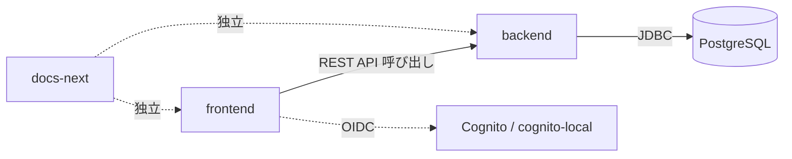

# Dependencies

## Internal Dependencies

### frontend depends on backend
- **Type**: Runtime（HTTP REST 呼び出し、`frontend/src/server/actions/*.ts` から）
- **Reason**: フロントエンドは Server Actions を通じて全てのデータ取得・更新をバックエンド API 経由で行う（DB への直接アクセスはしない）

### backend depends on PostgreSQL
- **Type**: Runtime
- **Reason**: Spring Data JPA によるエンティティ永続化

### docs-next は frontend/backend から独立
- **Type**: なし
- **Reason**: ドキュメントサイトはビルド・デプロイともにアプリケーションコードと分離されている

## External Dependencies

### spring-boot-starter-data-jpa / spring-boot-flyway / flyway-core / flyway-database-postgresql
- **Version**: Spring Boot BOM 4.0.6 系
- **Purpose**: エンティティ永続化・スキーマバージョン管理
- **License**: Apache-2.0（Spring）/ MIT（Flyway Community）

### spring-boot-starter-oauth2-resource-server
- **Version**: Spring Boot BOM 4.0.6 系
- **Purpose**: アクセストークン（JWT）検証によるリソースサーバー認可
- **License**: Apache-2.0

### springdoc-openapi-starter-webmvc-ui
- **Version**: 3.0.1
- **Purpose**: OpenAPI ドキュメント自動生成（ADR-015）
- **License**: Apache-2.0

### next / react / react-dom
- **Version**: next ^15.3.2、react/react-dom ^19.1.0
- **Purpose**: フロントエンドのレンダリング基盤（App Router、Server Components）
- **License**: MIT

### better-auth
- **Version**: ^1.2.7
- **Purpose**: 認証クライアント（Cognito 連携）
- **License**: MIT

### zod / react-hook-form / @hookform/resolvers
- **Version**: zod ^3.25.76、react-hook-form ^7.76.1、@hookform/resolvers ^5.4.0
- **Purpose**: フォームスキーマ定義・バリデーション連携
- **License**: MIT

### zustand
- **Version**: ^5.0.3
- **Purpose**: クライアント最小限の状態管理
- **License**: MIT
