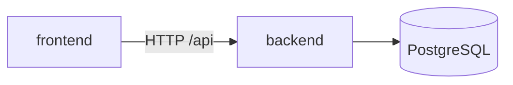

# Dependencies

## Internal Dependencies

### frontend depends on backend
- **Type**: Runtime
- **Reason**: Server Actions が REST API を呼ぶ。

## External Dependencies
バージョンは `backend/build.gradle.kts` と `frontend/package.json` を参照。本課題で新規依存は不要の見込み。
