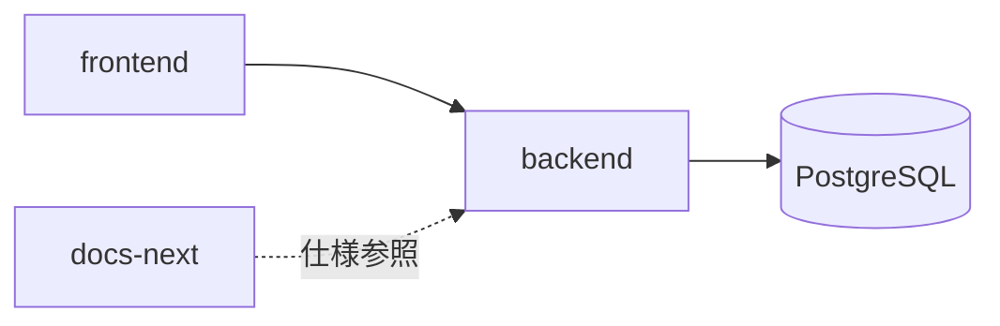

# Dependencies

## Internal Dependencies

### frontend depends on backend
- **Type**: Runtime
- **Reason**: Server Action が `BACKEND_URL` の REST API を呼ぶ

## External Dependencies
- CSV 生成ライブラリは未導入（`opencsv` を足す場合は `build.gradle.kts` への追加が要る）
- Spring Boot BOM、springdoc-openapi 3.0.1、logstash-logback-encoder 8.0、Lombok 1.18.38
- FE: better-auth、react-hook-form、zod、zustand、sonner ほか（`package.json`）
