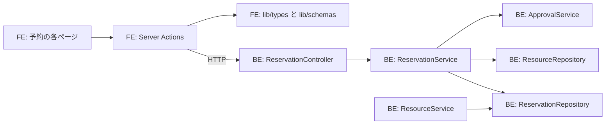

# Dependencies

## Internal Dependencies

### ReservationService depends on ApprovalService
- **Type**: Compile / Runtime
- **Reason**: 承認要のリソースの予約作成時に `createInitialStep` を呼ぶ。承認ステップ生成の唯一の呼び出し元。

### ResourceService depends on ReservationRepository
- **Type**: Compile / Runtime
- **Reason**: 空き確認で占有予約（PENDING / APPROVED）を取得する。

### 占有状態集合の重複定義
- `ReservationService`・`ApprovalService`・`ResourceService` が、同じ `[PENDING, APPROVED]` を個別に持つ（共有定数はない）。

## External Dependencies

### 主要ライブラリ
- **Version**: `frontend/package.json` / `backend/build.gradle.kts` を参照（今回のスコープでは追加・変更しない）
- **Purpose**: React Hook Form + Zod（フォーム検証）、shadcn/ui（UI）、Spring Data JPA（永続化）、Flyway（マイグレーション）
- **License**: 未調査（今回の課題では新規依存を追加しない前提）
