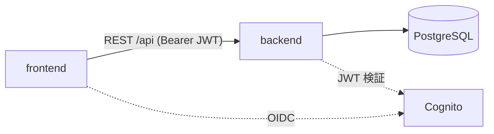

# Dependencies

## Internal Dependencies

### frontend depends on backend
- **Type**: Runtime
- **Reason**: Server Actions が `/api` を呼ぶ

## External Dependencies
- Spring Boot 4.0 / springdoc-openapi 3.0.1 / Flyway / H2（テスト）/ Next.js ^15.3.2 / React ^19.1.0 / Zod ^3.25.76 / MSW ^2.7.5 / Vitest ^3.2.6
- ライセンス詳細は本課題のスコープ外（新規依存追加なし想定）
